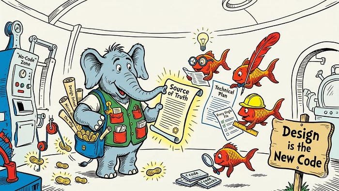

> 原文：[Elephants, Goldfish and the New Golden Age of Software Engineering](https://drensin.medium.com/elephants-goldfish-and-the-new-golden-age-of-software-engineering-c33641a48874)
> 作者：[Dave Rensin](https://drensin.medium.com/) · 发布时间：2026 年 4 月 27 日 · 阅读时长：27 分钟 · 更新：2026 年 10 月 21 日

# 大象、金鱼与软件工程的黄金新时代



> **更新（2026-10-21）——Google 已允许我和团队把内部用于实践这套方法论的 AI 编码助手插件开源。详情见 [https://egm.dev](https://egm.dev/)。**

## 引言

我写这篇文章时是 2026 年 4 月，生成式 AI 工具、尤其是大语言模型（LLM）正在彻底重塑我们思考和执行工作的方式，这一点已经很清楚了。这不只是软件工程的一次转变，它触及每一种职业。这篇文章是我对过去一年的记录——我和我的团队走过的路、吃过的苦头，以及我个人对接下来的判断。

无论你已经在用 AI 编码工具，还是刚刚开始拿 AI 聊天机器人试手，我都希望你能从这篇文章里带走一点东西，帮你重新思考 AI 在你工作中的角色，以及怎么用它让自己更高产、更有价值。

不管你从哪里起步，有两点我要大声说清楚：

1. 这些观察只是我个人的视角。用好这些工具的成功路径有很多条，你应该广泛尝试，找到最适合自己的那一条。别人的效果未必适用于你（Your mileage may vary）。
2. 变化快得让人喘不过气，再过一年这些话可能就过时了。请带着健康的怀疑来读。

## 本文结构

这篇文章分三个主要部分。

第 1 部分里我提出一个论断：我们大多数人，连基础聊天机器人算在内，用 AI 工具的方式都不对。我会给出另一种用法，希望对无论从事什么职业的人都有价值。这一节面向所有人，也为后面铺垫。

第 2 部分我会更深入地讲：怎么把第 1 部分的基本原则真正用在写软件上。特别是介绍一种我们称为**大象-金鱼模型（Elephant-Goldfish Model）**的工作方式。如果你已经在用 AI 编码工具，这一节里很多东西你会觉得眼熟，不过我想还是会有几处对你来说是新的。读第 2 部分不要求你是软件工程师，但那里描述的工作方式，直接来自我写软件的经验。

最后在第 3 部分，我会（考虑到变化这么快，也许有点不明智地）闯进预测这个领域。行业演进的速度快得惊人，但我认为已经有一些正在浮现的模式，可以用来为我们最终无论身处哪一种具体未来做准备。

## 第 1 部分：它是工具，不是玩具

10 倍的生产力提升不只是给用 AI 模型的工程师准备的，也给你准备。现在稍稍改一下你用工具的方式，就能让你今天更快、明天**快得多**，并且提升产出的质量。这不是标题党，就是一句大实话。

## 我们来买辆车吧！

假设你想买辆新车，你会怎么处理这件事？

我们大多数人（不久前的我也一样）会认真想一遍自己觉得这辆车重要的地方，打开最顺手的 LLM 工具、切到研究模式，然后告诉它：

> "我想买辆新车。下面是我能想到的关于想买什么车的一切。<把你想到的一切插在这里> 去把互联网翻个底朝天，给我产出一份关于我该考虑哪些车、最后该买哪辆的、全世界最全面最漂亮的报告。花多久都行。"

二十分钟后，我们会拿到一份看起来非常唬人的报告，给出一个听起来挺合理的推荐。我们会满意地冲自己点点头，觉得自己真聪明，然后开始上网给这个"AI 认证"的车型找最划算的报价。

而且，我们做错了。

我们把一个极其强大的工具当玩具用，于是拿到了一个玩具结果。那么……买车到底该怎么用 AI？

## 第 1 步：胜利偏爱有准备的人

我们这场假想的"买对车"之旅注定失败，因为我们没有让机器做好替我们成功的准备。**我们让它当研究员，而不是当审问者。**

下面才是我们本该给那个被折腾的 AI 助手的 Prompt：

> "我想买辆新车。因为要花一大笔钱，做出信息充分、论证扎实的决定对我很重要。我已经想过自己对这辆车的需求，但我肯定漏掉了关键方面。我会告诉你目前想到的东西，你的任务是不断问我澄清性问题，直到我叫停。我们俩共同的任务，是把这个决定的所有重要边界都探索一遍。请持续质疑我的假设、逼我把关键点说清楚，直到我告诉你我们做完了为止。下面是我目前想到的：<把前面那段插在这里>"

接下来 15–20 分钟，用来回答 AI 的这些问题和诘难。偶尔问一句"你怎么看？"。不同意的时候就跟它争。只是要记住：**争是为了学到东西，不是为了赢。**

> **注意**：如果模型开始说"这个点提得好！你太天才了！"这类没用的话，说明它掉进了谄媚的螺旋（这是所有模型都被要求"友好且乐于助人"的必然副作用）。通常你可以用下面这句把它拉出循环，提醒它什么叫**真正**有帮助：
>
> "你同意我的时候并不算有帮助。你最有帮助的时刻，是挑战我的思路、逼我去想问题边界的时候。"

这是我在模型开始变得过于顺从时的固定应对句。

15–20 分钟后，你手上会有一份对理想车型完整得多的描述，最初那一段会扩展成 2–3 页。哪怕你到此为止、把这份新描述交给 AI，结果也已经会好很多。但我们还能做得更好。

现在可以进第 2 步了。

## 第 2 步：信任，但要验证

把问题描述透，只是拿到好答案的配方里的一半。下一步是确保模型告诉你的东西既有用、又**可验证地为真**。

接着当前这个会话，给它这段 Prompt：

> "谢谢你的提问，但我认为我们的描述已经完整了。我会把这份描述交给一位从没合作过的研究员。我需要确信，等他交出报告之后，我能信得过那份报告的质量。现在请你扮演一位持怀疑态度的专家级事实核查者。我想和你聊一聊：在他的报告里我应该看到哪些东西，才能让我相信他的工作是扎实且正确的。什么样的链接？引文？等等。我只有一次让他做这项研究的机会，也没有追问的余地，所以我必须把我会怎么评估他的工作讲得极其清楚。我们现在就把这件事讨论清楚，等我告诉你可以了，验收标准就算定稿。"

现在重复上一步那套访谈流程，只不过这一次的焦点完全放在"我将来怎么给最终产出的质量打分"上。和之前一样，这一步预计也要花 15–20 分钟。

做完后你会再得到 2–3 页文字，也就是这份报告的评分量规（grading rubric）。现在，对"问题"和"评估标准"你都有了更完整的描述，可以进最后一步了。

## 第 3 步：收成

用你的 LLM 开一个**全新**会话，切到某种深度研究模式，然后告诉它：

```text
我有一个需要你深入思考的课题。请用你手上的一切工具把这个问题回答透。我会同时给你研究主题，以及我用来评估最终报告质量的具体标准。你的目标是产出一份既把问题回答透、又能轻松通过全部评估标准的最终成果。

下面是我要你研究的主题描述：

— — — — — — -

<把第 1 步的文本插在这里>

— — — — — — -

下面是我评估你产出质量所依据的标准：

— — — — — — —

<把第 2 步的文本插在这里>

— — — — — — -
```

接下来就让它把深度研究跑多久都行，而你可以有底气地相信：拿到的产出质量会远好于用一句一次性 Prompt 硬来。

## 关于判断力

我们日常的工作大概都不是买车（如果这**就是**你的本职，那你的工作可太酷了！）。但不管岗位叫什么（销售、市场、财务等等），我们被雇来做的其实是同一件事：**运用出色的判断力，为企业创造更多价值。**

> *公司是通过我们持续展现的判断力的质量与影响力，来决定我们的价值的。*

如果我们职业早期，雇主是在赌我们有能力快速习得所在领域的良好判断力；如果已经到了职业后期，公司雇我们，是让我们把已经积累的判断力拿出来为它所用，并帮别人也长出自己的判断力。

这些模型（至少在写作本文时）还做不到这种判断——尽管它们**极擅长**生成一串表面上很像判断力的词。别犯把判断力外包给机器的错。

## 加速"未来的你"

这一节的几个步骤，能很短时间内把你的判断力杠杆成高得多的生产力。但……真正的价值其实会随时间复利。

**把**你在这些步骤里生成的完整描述、验收标准和最终产出**存起来**，放在一个你很容易再找到的地方（共享盘、NotebookLM 之类）。时间一长，你会攒下数量惊人的推理过程和历史，将来和模型讨论别的问题时可以拿来用。

**注意**：没必要把完整对话都存下来；这三份产物就够了，其余部分到头来基本都是 Token 噪声。

为什么要这么做？因为这样你就能和自己过去的判断、或者团队的集体智慧对话了！

> "我们当初为什么这么决定？关于 X 我们当时是怎么想的？"等等。

有了它，带新员工上手会容易多少？拿未来的产出去对照过去的推理会容易多少？重建一个项目、一个团队、一个长期项目的轨迹又会容易多少？

如果你从今天开始这么做，提速和质量会迅速向未来复利。**未来的你**会比**现在的你**高产到认不出来。

## 第 2 部分：大象与金鱼

2025 年夏天，我在工作上碰到一个业务问题，于是（在 AI 的大量帮助下）写了个小工具来解决它。那个小工具后来对我的同事有用，而且——连我都没想到——对很多别的人也有用。其他工程师开始找上门，想给这个工具贡献新功能（我感激地照单全收），几个月内就有超过 100,000 名 Googler 经常用它来处理自己形状类似的问题。

我觉得，如果不用 AI 编码助手，不可能做到这么快、还能安全地接收几十个人的贡献、同时又守住我们的安全、隐私与信任标准。（我自己用的是 Google Antigravity 和 Gemini。）

这样工作很爽，但用不了多久你就会意识到一件让人后背发凉的事：

> *一不小心，我们不只是把代码写得更快了，我们是在* **批量生产自己的错误。**

如果你用 AI 追求速度，却没有维持高信噪比，那你的生产力其实是在倒退。如果坏代码的生成速率高于有效代码的生成速率，项目最终会被自身那堆读不懂、维护不了的 slop 压垮。

接下来的几周几个月里，我们找到了更好的办法；但前提是先得接受一件事：纯人工"码农"的时代正在迅速走向终点。

## 三个"啊哈"时刻

问题的规模是在一个格外让人抓狂的下午真正砸到我身上的。我当时正用 AI 实现一个新功能，会话进行了一小时，已经钻进细节深处，结果模型直接崩了。

我开了个新会话，一片空白。它对前一小时的工作毫无记忆。为了把我们那个高度复杂的任务重新引导回正轨，得喂进去几百行代码，既枯燥、又吃 Token、还极其让人恼火。

那就是**啊哈时刻 #1**：如果我当时只是**维护一份写清楚的文档，说明我的意图和当前进展**，重新引导就只是 30 秒的事（"读这份文档，读它引用的代码，告诉我我们到哪了，然后继续"）。

于是我试了。上下文回来了。然后我让 AI 把实现做完。

问题解决了！才怪……它立刻跑偏，朝着我从没要求过的方向一路狂奔，幻觉出不存在的 API，做出对我们系统毫无意义的架构选择。

那就是**啊哈时刻 #2**：AI 模型急于取悦人，这意味着如果你不**筑起非常严格的护栏**，它们会兴高采烈地冲下悬崖。

但真正的顿悟是几周后，我启动一个全新功能的时候。我意识到，要让 AI 理解这个系统，根本不需要把源代码喂给它，只要把设计文档喂给它就够了。

这就引出了**啊哈时刻 #3**，简单到只有一行：

`sizeof(docs) << sizeof(code)`

用平实的英文设计文档给 AI 提供上下文，比逼它去读、去解释几万（乃至几十万）行裸代码，要便宜得多、快得多、也可靠得多。

## 正在消失的代码

要理解这件事为什么重要，得回头看看我们今天是怎么造软件的。

历史上，设计判断——一个系统的"为什么"和"怎么做"——待在两个地方：设计文档里，以及代码本身里。人写代码的时候，会在逻辑里留下一串微观决策的痕迹。

但如果代码由 AI 来写，人就不再做那些微观决策了。如果我们不逼着所有这些设计判断在写代码**之前**"左移（shift left）"进设计文档，最终成型的系统，对那个最终要为它负责的人来说，将完全无法理解。

我们正处在一个阈限状态（liminal state）。我们仍然需要代码，因为仍然需要严谨性；但"100% 由人评审的代码"正在成为一个消失中的中间步骤。

在我看来，我们最终会落到两种情形之一：(1) 模型产出的代码多到人类根本不可能全部审完；或者 (2) 模型干脆直接产出二进制，把代码这一层整个跳过去。不过哪种成真并不重要。无论是淹没在暴雪里还是面对二进制，代码都会变得对我们不透明；而一旦代码不透明，唯一还重要的产物就是设计。

*设计就是新的代码。*

## 大象-金鱼模型（EGM）介绍

随着时间推移，团队打磨出一套简单却极其有效的工作框架，我把它叫作**大象-金鱼模型（Elephant-Goldfish Model，EGM）**。

它建立在一个非常直白的比喻上，讲的是我们怎么构建上下文、又怎么检验它：

- **大象**："大象永不遗忘。"指的是那个被大量 Prompt 喂养、上下文极其丰富的 AI 会话，以及它帮你写出来的那份设计文档。大象装着全部组织记忆（institutional knowledge）、全部微观决策、你和模型吵过的架，以及这个功能的完整历史。
- **金鱼**：一个全新的、记忆为零的 AI 会话。它只知道被直接摆到眼前的东西。

我们每个新功能的流程就一句话：**喂饱大象；拿金鱼来验。**

## 阶段 1：养大大象（还不写代码）

这一阶段的目标，是在**写下第一行代码之前**，把功能和评估标准共同设计出来。

### 第 1 步：装载上下文

用你的 AI 工具开一个全新会话，把它指向相关的设计文档或源码树，让它给你一份它学到了什么的高层描述。

*为什么？* 因为如果它在第一分钟就误解了你的系统，第十分钟它就会写出很烂的代码。立刻纠正它的理解。

如果你是从零开始一个全新项目，这一步可以跳过，因为没有可供引导 AI 的历史和上下文。

### 第 2 步："不准写代码"规则

工程师爱写代码，AI 也爱写代码。你得主动跟这股冲动对抗。给 AI 这段 Prompt：

> "我不许你创建代码。我们不打算创建代码。忍住你写代码的冲动。相反，我们要做一场设计讨论。我马上会描述一个功能，我要你问我澄清性问题、挑战我的假设。别我说什么你就接受什么。"

给 AI 讲清楚你想达成什么，然后像跟人聊天一样跟它来回聊 20–30 分钟。如果 AI 出现幻觉，就把它指到能纠正它的那个文件上。真的要跟 AI 争。这些模型是极出色的审问者，所以要让它狠狠推着你去想清楚你要解决的问题的描述和边界。

这一步在功能上，跟前面买那辆假想车时的来回访谈是一样的。目的就是产出一份对所解问题的透彻描述。

你能把"想达成什么"说得越干净利落，最终产出就越好。

### 第 3 步：谄媚挑战

AI 模型被训练成乐于助人，这常常让它们变成让人受不了的马屁精。如果 AI 不再问尖锐问题、只说"好主意，Dave！"，你就得把它强行拽回批评者模式。告诉它：*"你这样并不算有帮助。你最高、最好的用处是挑战我的思路。"*

> **进阶技巧**：只问 AI 一句*"你为什么这么想？"*，就是你最好的朋友。它常常能一下把模型从幻觉循环里拽出来。

### 第 4 步：技术方案初稿

等你对"问题描述已经完整"满意了，就该开始辩论各种可能的方案了。

让 AI 用散文和框图提出实现方案。短的伪代码块可以，但要坚持要成段的文字。跟 AI 争，直到敲定一个扎实的方案。

**非常**重要的一点是：要让 AI **先**提设计。这会告诉你它是不是真把你的问题理解到位了。

反过来，如果你先提一个初始设计、再让 AI 来评价，你几乎一定会漏掉某些盲点。让模型做这件事的方式有很多，我最常用的是这段 Prompt：

> "基于你对代码库的理解和我们刚才的讨论，我想请你给我一份技术实现的初稿提案，用来真正把这个功能做出来。我要的不是代码。我要的是能体现你理解我系统的散文。如果你觉得有帮助，短的伪代码块可以，但我强烈希望是写清楚的正文和框图。"

初稿一定会（至少有一点）错。追问澄清性问题（比如"你为什么选那个模式？我以为系统是像 X 那样工作的……"）。跟 AI 争，直到敲定一个扎实的技术方案。

当模型对你系统的某处产生幻觉时，把它指到能纠正它理解的文件上："不对，我不觉得是那样工作的。请读一下 `auth.py`（或者 `AUTH.md` 之类）。"

来回打磨这份技术提案可能要花上几个小时。我和 Gemini 的一些会话为了辩论重要决策，持续过 2–3 天。

**别急着赶这段来回，赶了你会后悔的。**

## 阶段 2：教大象

现在我们来创建那份 markdown 文档，它将成为绝对的事实来源，也是代码的护栏。不要让 AI 一口气写完整个文档，因为当前模型对单次输出的 Token 有上限。要在同一个会话里迭代着把它搭出来。

下面是我们发现最有用的章节结构和顺序。**不要**试图一次性把这份文档写完，每一节分开写。

1. **问题**：让 AI 用平实英文写一段业务问题的描述。3–5 句大概就够了，只要让随手翻到的读者能看懂你想达成什么。
2. **技术计划**：让它用少用行话的语言描述大的组成部分，以及它们如何配合。合适的话附一张主要组件的框图。这一节的目标是解释性散文。
3. **备选方案**：把第 1 阶段里考虑过但否决掉的想法记录下来。确保所有被考虑过又被否掉的重要决定，在这一节里都得到一定交代。它们会成为日后抵御幻觉和争论的重要护栏。
4. **详细实现**：这会是文档里最长的一节，应该包含一份极其详细的、一步一步的实现计划。要求 AI **逐一列举**每一个将被创建或修改的文件，以及为什么这么做的理由。这一点**至关重要**，它能帮 AI 在实现阶段不脱轨。

把这个文件存进你的源码树。这是你这个新功能的第一份产物，而且现在它就是你的新源代码。

## 阶段 3：金鱼协议

你怎么知道自己的设计文档是真得好，还是只不过在吃"大象"会话里攒下的上下文老本？

拿金鱼来验。

### 第 5 步：理解测试

开一个全新的空 AI 会话（金鱼），把那份 markdown 文档给它，说：

> "读这份文档以及它引用的文件。告诉我它想达成什么，以及我的系统目前在与这个功能相关的部分是怎么工作的。"

如果金鱼**仅凭**这份文档和它引用的文件讲不清你的系统，说明文档缺上下文。补上细节，重复这个测试，直到通过。别跳过这个循环。能通过金鱼测试的文档，是对抗 slop 的重要防护。

### 第 6 步：批评者评审

再开一个金鱼会话：

> "请扮演一位专家级技术评审。读这份设计文档和它引用的所有文件。把我漏掉的所有东西、所有错误假设、所有我没覆盖到的边界情况，以及我本该考虑却没考虑的事情，全告诉我。你找出的每一个错误和每一处含糊，都让你更有帮助、更有用。"

按我的经验，它大约 30% 的建议是极有价值的——这已经足够让这件事划算了。照着更新文件。

反复循环，直到建议和问题稳定地落进"吹毛求疵"那一类为止。

### 第 7 步：实现就绪度

再开一条新金鱼，问它：

> "你是一位熟悉我们代码库的资深软件工程师。读这份文档和它引用的文件，然后告诉我：它是否绝对具备了你第一遍就能成功实现这个功能所需要的全部信息？"

如果它提问，就把答案写进文档。反复循环，直到你确信没有重要的遗漏项或未解决的含糊之处。

最后，拿给一个真人评审并批准（如果你是单干，这一步可能做不到，自行判断即可）。

## 阶段 4：实现

### 第 8 步：带护栏地写代码

现在，而且只有到这时，才写代码。把定稿的设计文档交给 AI，说：

> "读这份设计文档和它引用的文件。按文档描述实现这个功能，严格照计划执行。"

因为文档明确列出了每一个文件和每一处改动，AI 产出的代码质量会高得多。如果实现会话期间 AI 转飞了或者崩了，你只要开个新会话、把设计文档递过去、让它读文档和所有被引用的文件，立刻就能回到正轨。

### 第 9 步："刻薄"的代码评审

代码写完后，把它回喂给 AI，让它找出这代码每一处糟糕的地方。我原话是这么说的：

> "我有种强烈的直觉，觉得这段代码质量很差。请把它撕成碎片，告诉我它烂在哪儿。"（对，这就是我实际用的 Prompt。）

让它标出任何连续 10 行都没有注释的地方。**坚持要求严格的可读性。**

反复循环，直到批评变得无关紧要（或者干脆消失）。

## 引导你的现实（或者说，"拿花生和干草喂大象"）

我给别人讲这套方法时，他们第一句话往往是："Dave，新项目这么干挺好，可我的代码库有几百万行，我没时间给它全写设计文档。我没法为一头单体巨兽养出大象来。"

其实可以，而且差不多一周就够，代码库多大（几乎）都无所谓。

诀窍在于懂得怎么喂大象。把这个比喻再拧一下：如果你试图把整片源代码的丛林一次塞给 AI，它会噎住——丢上下文、犯迷糊、开始幻觉。你得喂它花生和干草：小块、高营养、压缩过的上下文。（没错，还是工程师，烂双关照样来……不过至少你能凭这个确认这是人写的。）

那些"花生和干草"就是 `README.md` 文件。你只要让 AI 通过一套递归摘要流程去把它们"收割"出来，重活让它干：

1. **从源码树的叶子开始**。给每位开发者分配一组目录。
2. **产出花生**：让他们把 AI 指向该目录，说：*"读这个目录里的文件，生成一个名为 `README.md` 的新文件。这个文件要 (a) 说明该目录及其中文件的用途，(b) 逐一列出目录里的每个文件并简述其功能。"*
3. **人工校验**：在叶子目录上 AI 大约会有 50% 是错的，因为它只能依赖代码本身。负责该目录的工程师花 5–10 分钟把文件内容修对。
4. **把干草卷上来**：叶子做完后，往上一层：*"请读我下面所有子目录里的全部 `README.md`，然后只读本目录里的代码，并在这里创建一个名为 `README.md` 的文件。基于这些信息，该文件要 (a) 说明该目录及其中文件的用途，(b) 逐一列出目录里的每个文件并简述其功能。"*
5. **继续往上**——一层一层——直到抵达项目根目录。

做完后，你会得到一套极好的上下文层级结构，也就是那堆"花生和干草"。你可以在项目根目录开一个全新会话，只把树里的 README 喂给大象，它（几乎）立刻就能理解你的代码库，而且比让它逐个读源文件省下多得多的 Context Window。

它不会完美，但会好得让你意外：能可靠地挑出主要子系统和设计模式——等你真要去改动时，这会是巨大的助力。

> **README 要留多久？**：README 只需要存在到你攒够了设计文档、使得**所有**代码文件都至少在一份文档里被引用（并略作解释）为止。一旦文件覆盖率达到 100%，你就可以把 README 删掉（或者不删，随你）。如果你在一个新应用上从一开始就严格按大象-金鱼流程写设计文档，那压根就用不上这些 README。

从那里开始，你就照上面这套大象-金鱼流程，为新功能写设计文档即可。

## 附加收益：即时上手

让整棵源码树都有一套 `README.md` 层级文档、以及/或者扎实的设计文档，还有一个极好的附带好处：新员工上手变得摩擦极低。

如果有新工程师加入团队，这就是你的新上手流程：

1. 新建一个 NotebookLM 笔记本（或你选的类似工具）。
2. 把整套 `README.md` 层级和已有的设计文档一股脑倒进去。
3. 在系统指令里，告诉笔记本这位新成员将要专注系统的哪个具体部分。
4. 把笔记本交给他。

告诉他们第一项任务，是用这个笔记本把系统学到足以按上面的流程为自己第一个功能写出一份优秀设计文档。

等他能写出一份通过金鱼测试的好文档，你就可以放心地认为他已经懂得足够多，能对这个代码库做出有效贡献——至少不会在代码评审里浪费你的时间。不用再花几周贴身跟着别人学，也不用再逆推那些不透明的遗留代码。

经常有人跑到我收件箱里给我们的工具提新功能。2025 年以前，我们只会把它丢进 backlog，等哪天有空再说。但有了这套办法，我现在只问一句：*"你有没有写过代码的背景？"*

很多产品经理、项目经理和其他岗位的人，多少都有一点编码经验。对这类人，我们就准备一个新笔记本，请他们用它为自己想要的功能写设计文档。

（通常）几天后，一份新的设计文档就出现在我的评审队列里。多数时候它已经对了大约 70%–80%，我评审一遍、给点改进建议。再过一两轮，就能达到我们的质量门槛。

一旦过了那条线，我就能放心：他们用 AI 产出的代码最终会进我们的源码树。当然，一切还是会照常评审，但那不会是 slop——也就是说，不会浪费时间。

## 为速度而来，为理解而留

我们正在走进这样一个世界：在 IDE 里敲语法，不再是软件工程师的主要工作。工作是意图，是架构，是设计判断。

如果我们全盘依赖 AI 写代码，却不把这些设计判断逼进人类可读、经过严格检验的文档，我们就会失去理直气壮地在自己本该背书的成果上署名的能力。说到底，智能体采取的任何行动，最终都要由人来负责；而如果我们并不真正理解智能体在我们指挥下造出来的系统，就没法被合理地要求承担这份风险。

但如果我们把"设计当作新的代码"，就把人类对理解的需求，和 AI 对速度的容量对齐了。这是终极的去风险练习。

## 第 3 部分：一些大概是错的预测

> "预测是件难事，尤其是关于未来的预测。"
>
> —— Yogi Berra

这个领域变化太快，做预测大概本身就是个错误，但我还是要这么做。我认为已经有一些持久模式的轮廓，可以拿来导航无论最终到来的是什么；不过我也可能是错的，所以请带着非常健康的怀疑来读。

## 我们现在都是管理者了

在现行秩序里，管人的叫"人员管理者（people manager）"，不管人的叫"个人贡献者（individual contributor，IC）"。在我看来，**今年**这条界线就会变得极其模糊。

随着工具和模型越来越能干，我们所有人都会开始管理若干替我们干活的智能体。如果你本来就是经验丰富的人员管理者，适应起来应该相当轻松；但如果你从没管过别人，这就需要你学一些新的（而且非常有用的）技能。

表面上看，管人和管 AI 智能体似乎该是天差地别的两件事。但我想说，它们的重合度比你以为的高得多。

## AI 智能体不是人——但有时候押韵

管理的目的，是让你的判断力和专长产生远超你个人力所能及的杠杆。

糟糕的管理者，会把每件小事该走的每一步都精确告诉员工。我们管这叫微观管理（micro-managing），凡是领教过的人都知道，它既不可扩展，也很少带来你想要的结果。

而好的管理者，告诉员工自己要的是什么**结果**，并给人护栏和准则。他们会讲清楚员工可以运作的职权范围与自由度，以及在什么条件下应该停下来寻求指导。

当你能成功地把视线从员工身上移开一阵子、回头看一切仍井井有条时，你就算管理得不错。你能移开视线越久，就越说明你在把员工培养起来。随着这个时长变长，你可以带更多的人，因为摊到每个人头上的管理开销在下降。

我觉得你不用太费劲眯眼，就能看出这套东西怎么平移到管理 AI 智能体上。当然，你不用给人做职业规划，但我想说，相同之处比不同之处多得多。

## 一些实用建议

如果你觉得这个前提不算完全疯，而且你现在是个 IC，那你该做什么？

**立刻去上一门基础的人员管理课。真的，现在就去。**

这建议听起来可能有点怪，但听我说完……

管理的目的，是把你判断力的影响力放大到你一天亲自能完成的量之外。当你能成功地把视线从员工身上移开一段时间、并且有信心回头看时一切井然有序，你就是个好管理者。

你给员工铺路铺得好的证据，是"能成功移开视线的时长"随时间变长。这时候摊到每位员工身上的个人开销就缩小了，意味着你能成功带上更多人，而不被各种打断吞掉、不至于燃尽。

学会把自己的判断力成功扩展到一批替你行事的独立实体上，是一项需要训练和练习的技能。AI 智能体管理的时代已经到了，你得从现在开始练这个能力。

很多公司内部都有面向新任管理者的培训，专门讲授权、协调和编排。去报一个。如果现在的雇主不开这类课，那就买本书、看点 YouTube 视频、上一门[在线课程](https://www.coursera.org/specializations/google-people-management-essentials)——总之**做点什么**。

我给的另一个建议是：**慢慢加**你同时要管的智能体数量。

我们刚当人员管理者时，通常先带一个 3–5 人的小团队，原因是管人意味着要学会设定目标、激励和规则，才不会被各种打断淹没。

在你学习如何顺畅地通过智能体放大判断力时，这条经验法则似乎是个不错的首要目标。有点像一项新运动：慢慢起步，把正确姿势固定下来，再从那里加量。

## 持续专注是一块需要练出来的肌肉

AI 正在一点点吸走我们工作里的苦活，比如状态报告和进度同步会。这确实是好消息，但它引出一个问题：省下来的时间拿来干什么？

答案是那些我们一直没空做的事：硬思考，真正的设计，那种没法委托给同事、也没法委托给模型的判断。

麻烦在于，持续专注是一项我们大多数人根本没机会练出来的技能。不是因为没这个能力，而是因为现代社会喜欢用各种争抢注意力的东西来打断我们。

练专注跟练任何其他耐力一样。如果你不习惯长时间集中思考，一上来就两小时，相当于第一天就跑 10 公里。更好的起点是每个工作日 30 到 45 分钟，狠狠地专注在一个问题上；每周开头再加 5 到 10 分钟。几个月后，你就能把脑力耐力练到一次专注 2 小时（甚至更久）。

这是人人都需要练的一块肌肉。你不必修道院式地静坐，完全可以拿这段时间去和你的 AI 工具辩论某个正在做的问题。要点是想/辩到某种程度的脑力疲惫。疲惫的大脑和疲惫的肱二头肌一样，是生长的信号。

如果 AI 拿走了我们大量的苦活，那是不是意味着大家都能少干点活了？并不会。

你也许盼着 AI 把工作变得高效到一天只干几小时就行。然而历史表明，当工具让工作变容易，我们未必就干得更少——我们最终只是做得更多，因为这份努力的成本下降了。这是一个被长期观察到的现象，叫[杰文斯悖论（Jevons' Paradox）](https://en.wikipedia.org/wiki/Jevons_paradox)。

## 最后一点想法

说到 William Jevons 和他那个著名的悖论，我有时会听到学生和年轻同事担心：AI 会不会意味着他们没法拥有漫长而有成果的职业生涯。我们日常任务确实可能会有些变化，但这不代表我们会失去目标或价值。自我进入职场以来，这类变化一直都在发生。

你的价值在于你习得并成功应用的判断力。你在自己特定领域里养出的品味越好、越懂得怎么把它放大，你就越抢手。这一直成立，我猜它会一直成立下去。

这些 AI 已经是非常强大的工具了。学着像匠人那样用它们，你会发现对你的技能求贤若渴。会难吗？当然，但那是像爬一座小丘那样难，不是像爬一座大山那样难；所以，迈开腿就是了。

*感谢以下同事为这篇文章问世提供的宝贵帮助——Elise Ewing 是最初逼我把这些写下来的人，Amber Huffman 和 Partha Ranganathan 耐心通读了早期草稿并给出周到的编辑建议。*

---

## 原文信息

- 原文标题：*Elephants, Goldfish and the New Golden Age of Software Engineering*
- 作者：Dave Rensin · 发布：2026-04-27 · 更新：2026-10-21（开源 [egm.dev](https://egm.dev/) 的公告）
- 原文篇幅：Medium 标注 27 min read；全文含 3 个部分、9 个步骤（Step 1–9）、4 个阶段、10 余段完整 Prompt
- 原文配图：正文仅 1 张封面插画（另有作者头像，属页面装饰，未本地化）

## 版权与许可

- **原文**：Dave Rensin，《Elephants, Goldfish and the New Golden Age of Software Engineering》，2026-04-27 — [原文链接](https://drensin.medium.com/elephants-goldfish-and-the-new-golden-age-of-software-engineering-c33641a48874)
- **原文许可**：Medium 页面未声明任何开放许可（无 CC 标注），默认视为作者保留所有权利；本站按译文站惯例收录全文翻译，署名原作者并链接原文
- **本译文**：非官方中文翻译，仅作学习与交流用途；如权利人提出异议将即时下架
- **配图**：封面插画版权归原作者所有，此处为配合译文说明而本地化引用

## 译者注

1. **抓取方式**：原站 `drensin.medium.com` 直连返回 Cloudflare 403（"Just a moment…"），正文经阅读器代理取得；代理输出中夹有 Medium 订阅组件文字（"Get Dave Rensin's stories in your inbox""Join Medium for free to get updates from this writer""Remember me for faster sign in"），已剔除，但紧随其后的正文段落"Ask the AI to propose an implementation in prose and block diagrams…"按原文完整保留。
2. **Prompt 处理**：全文 10 余段示例 Prompt 均译为可直接使用的中文，`<INSERT …>` 占位符、`— — — — — —` 分隔符、`README.md`、`auth.py`、`AUTH.md`、`NotebookLM`、`sizeof(docs) << sizeof(code)` 等标识符与命令原样保留；需要精确英文原句时请对照原文链接。按项目惯例，未插入 `?sk=` 一类不稳定的付费绕行参数，链接一律用规范 URL。
3. **原文笔误与排版**：`Google has allowed my team and I to open source`（按语法应为 `me`）、`on.The point is`（缺空格）、`It is a simple truth`（缺句号）、`It's **very**important`（缺空格）、`It is much much cheaper`、`whatever specific future` 等，均按语义顺畅译出，未改动原文措辞；`the duration of how long you can successfully look away increases` 一句按语义简译。
4. **术语**：大象-金鱼模型（Elephant-Goldfish Model，EGM）、设计就是新的代码（Design is the new code）、左移（shift left）、阈限状态（liminal state）、slop（读不懂、维护不了的劣质产出，按项目惯例保留英文）、信噪比（signal-to-noise ratio）、评分量规（grading rubric）、上下文窗口（Context Window）、人员管理者 / 个人贡献者（people manager / IC）、微观管理（micro-managing）、杰文斯悖论（Jevons' Paradox）、Yogi Berra、Google Antigravity、Gemini、NotebookLM、egm.dev。
5. **数据保留**：10x、15–20 分钟 ×2、2–3 页 ×2、20–30 分钟、2–3 天、100,000 名 Googler、30 秒、30% 建议有价值、约 70%–80% 正确、50% 错误率、5–10 分钟、约一周、3–5 人、30–45 分钟、5–10 分钟、2 小时、10K、3–5 句、`sizeof(docs) << sizeof(code)`、连续 10 行无注释、100% 文件覆盖率等，全部按原文保留。
6. **链接**：[egm.dev](https://egm.dev/)（2026-10-21 开源公告）、[Coursera 人员管理课程](https://www.coursera.org/specializations/google-people-management-essentials)、[杰文斯悖论（维基百科）](https://en.wikipedia.org/wiki/Jevons_paradox) 均按原文保留。
