> 原文：[The Harness Playbook](https://stencil.so/blog/harness-playbook)
> 作者：[Can Bölük](https://stencil.so/about) · 发布时间：2026 年 9 月 2 日

# Harness 工程手册（The Harness Playbook）

[译者注] omp 是作者维护的编码智能体 harness 项目（从 Pi fork 而来），omp²（“omp squared”）是其正在进行的完整重构；文中提到的 OpenCode、OpenClaw、Pi 与 omp 同属“智能体 harness”一类软件。本文既是对 omp 的复盘，也是 omp² 的设计手册。

首先，道一声谢。数十万读者用过 omp、报告过哪里坏了、提过缺什么，是你们把它塑造成了今天的样子。这篇文章与 omp² 本身，都因你们而生。

听到 omp² 的消息后，很多人的第一反应是问：“为什么？”

一个 while 循环包着一个 fetch，听起来很简单。但 OpenCode、Pi、OpenClaw 与 omp 之所以全都在同时做一次彻底重构，是有原因的：这类软件以前并不存在，只有先把简单版本做出来，我们才能看清裂缝在哪里，进而朝更好的版本努力。

无法回避的复杂性需要有人认领。眼下，[复杂性守恒定律](https://en.wikipedia.org/wiki/Law_of_conservation_of_complexity)的天平倒向了扩展作者与用户，让任何人都没法在 omp 或 Pi 之上写出可靠的软件。我已经能听到那句*“什么嘛，扩展起来明明又简单又舒服。”*——给我几章篇幅，让我改变你的想法。

Dijkstra 写过[“简单是可靠的前提条件”](https://www.cs.virginia.edu/~evans/cs655/readings/ewd498.html)，而他名垂青史靠的是用算法解决寻路问题。为什么不直接暴力搜索？他压根不是在主张我们如今复读成**简单就好、复杂就糟**的那句话。那条建议是为了帮助实现者推理；我们却厚着脸皮拿它当实现者免于推理的借口。

Ousterhout 在他斯坦福课程的讲义里补上了缺失的另一半。他告诉模块作者要[“拥抱苦难”](https://web.stanford.edu/~ouster/cgi-bin/cs190-spring16/lecture.php?topic=modularDesign)：把难题接过来，彻底解决掉，让成果对其余所有人都好用；把复杂性压进模块内部，让少数实现者扛着它，而不是让每个调用方各自扛一份略有小改的拷贝。

---

相信很多读者还记得那条“把 Claude Code 比作游戏引擎”的推文引发的 meme 潮。这个对比听着离谱，但把 harness 的职责列出来——先不谈渲染——确实对得上号：

它维护一个权威世界，记录变更日志，运行不可信的动作，把状态复制给多个视图，调度各类 actor，解释命令，适配互不兼容的协议，渲染实时界面。

耳熟吗？游戏引擎似乎已经在同一类复杂性上当了几十年的家。

接下来这篇既是复盘，也是手册：

- **omp 教给我们的**，点名我们在一个真有人用的系统里实际遇到的失败。
- **omp² 的改变**，描述替代架构——一部分已经建成，一部分还在推敲。

**目录**（9 章 · 2 附录）

1. [设计包络](#设计包络)
2. [状态](#状态)
3. [运行时](#运行时)
4. [控制面](#控制面)
5. [推理](#推理)
6. [工具面](#工具面)
7. [界面](#界面)
8. [技术栈](#技术栈)
9. [结语](#结语)
10. [附录 A：官方示例中的状态失效](#附录-a官方示例中的状态失效)
11. [附录 B：弹性投机槽位（Elastic Speculative Slots）](#附录-b弹性投机槽位elastic-speculative-slots)

## 设计包络

*先选定运行模式；每个子系统都必须在全部模式下活下来。*

在讨论智能体 harness 的任何子系统之前，先想象有四个截然不同的产品要依赖它：

- **多路复用工作区（Multiplexed workspace）** *同一文件夹下有多个智能体与子智能体的本地环境。*
- **远程驾驶端（Remote driver）** *用手机上的远程客户端驱动云端智能体——或者桌下那台机器。*
- **旁观者（Spectator）** *在网页端围观 Claude 干活的客户端。*
- **异星工厂（Factorio）** *用 SDK 面对不可信输入、全自动运转的软件工厂。*

[译者注] Factorio（异星工厂）是一款自动化工厂建造游戏，此处指无人值守、全自动运行的软件工厂形态。

每一个都从不同维度挤压 harness，逼它不再只是一个聊天循环：

| 考察点 | 本地或远程 | 交互或自主 | 信任边界 | 并发 |
| --- | --- | --- | --- | --- |
| 多路复用工作区 | 本地 | 交互式 | 基本可信 | 多智能体，一个工作区 |
| 远程驾驶端 | 远程 | 交互式 | 宿主/客户端分离 | 一个或多个智能体 |
| 旁观者 | 远程查看 | 观察式 | 不可信的展示输入 | 多个观看者 |
| 异星工厂 | 远程或集群 | 自主 | 恶意的仓库与工具输入 | 多个作业 |

只满足第一种情形的设计，往往会把控制器偷渡进 TUI、把状态塞进闭包、让扩展在引擎进程里执行，并假设人能从一次无界调用里恢复过来。四种情形全都扛得住的设计，则会被迫画出更好的边界。

全书余下部分遵循五条推论：

1. **唯一的权威会话。** 回退、分叉、恢复、复制与检查，必须全部派生自同一份 journal 化状态。
2. **可信的控制面。** 策略与会话所有权留在宿主；沙箱只接收有界的执行请求。
3. **有界的工作。** 工具调用、子智能体与后台作业，都是带中心限额与可观测性的可取消流。
4. **显式的兼容性。** 模型与提供商的怪癖是结构化知识，不是散落在各调用点的分支。
5. **视图是投影。** TUI、网页客户端、远程客户端与子智能体检查器渲染同一份状态，而不是各自变成新的权威。

本文后面的所有东西（DOM、convar、Director、VM 桩、组件渲染器）都是为了满足这五条之一而存在。

## 状态

*如果权威状态无法从 journal 派生，回退、分叉与恢复就都是谎言。*

### 什么必须活下来

想让一样东西持久、可回退、抗崩溃、可分叉，只有三种选择：

1. 保存产生它的历史。
2. 保存你关心的属性变化。
3. 保存机器本身。

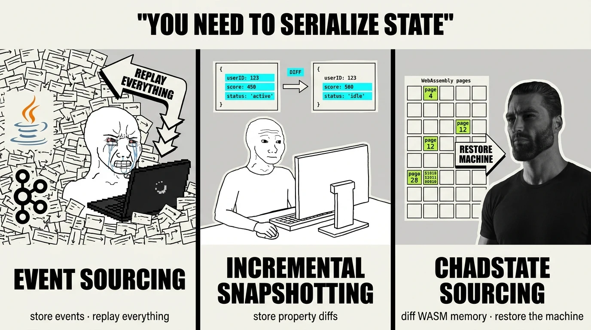

起源引擎在网络层用的是第二种的变体。而 omp 和 Pi 目前用的……哪种都不算一致。事件是有的，但状态并不是真正从那些事件溯源而来——这违背了事件溯源的第一原则：**状态必须仅凭事件即可派生。**

[译者注] 起源引擎（Source Engine）是 Valve 的游戏引擎；`.dem` 是其比赛录像格式，回放可精确到某一 tick。

### omp 教给我们的：两个权威

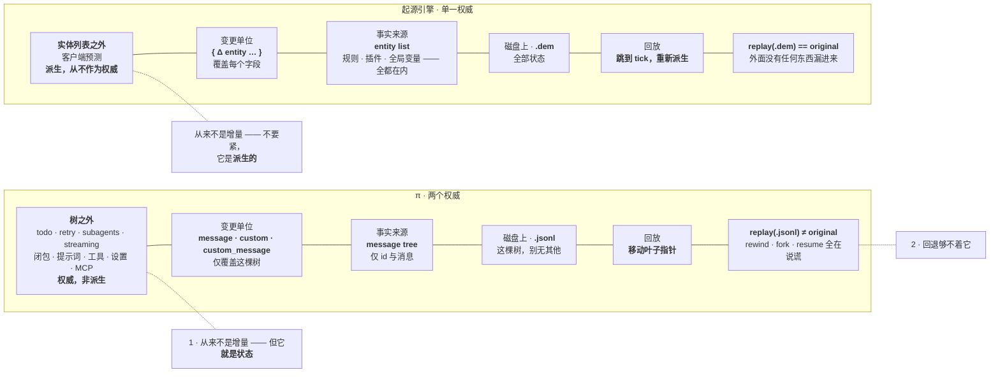

一个权威对两个权威：Source 中一切都是实体增量，所以 `replay(.dem) == original`；Pi 的 journal 只覆盖消息树，权威状态却活在树外——回退、分叉、恢复全都在说谎。

走到这一步有可理解的原因。把系统提示词和 `AGENTS.md` 重复进每份日志确实浪费——这可以通过对模板做哈希、只存变量解决；这种风格的状态建模在 TypeScript 里也不常见，毕竟 TS 并没有真正的运行时类型。

但结果依然是两份事实来源：

| | Source Engine | Pi 风格的 harness |
| --- | --- | --- |
| **事实来源** | `entity list`，仅此而已。服务器模拟，客户端预测。 | 消息树，**加上** todo 状态、重试计数、子智能体注册表、流式标志，以及其他持久化看不见的状态 |
| **Δ 的单位** | `{ Δ entity ... }`，覆盖每个字段，因为每条增量都是实体增量 | `message` / `custom` / `custom_message`，引擎不做折叠；每个扩展手搓派生 |
| **全局变量** | `CCSGameRules` 是单例**实体**。没有特例。 | 三层，其中一层能用 |
| **插件状态** | 插件写实体字段，状态默认就联网、可回放 | 模块级闭包：`let turnCount = 0`、`new Map()`、`new Set()` |
| **回放** | 加载 `.dem`、跳到某个 tick、重新派生 | 加载 `.jsonl`；叶子指针动了，其他权威要么重置、要么幸存，全凭运气 |

全局变量那一行最有意思。Source 没有会话全局变量这种东西——它们只是某个实体的属性。我们的却自成一整套层级：

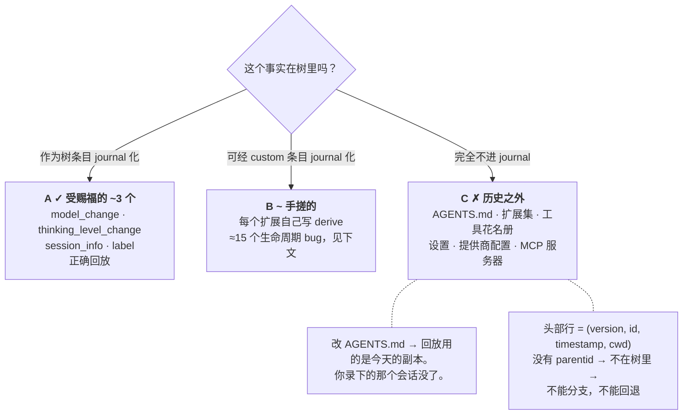

会话全局变量的三层，其中一层能用。

Source 不是靠一个精心编写的 reconciler 或优秀的文档走到这一步的。它让不可回放的状态**无法被表达**，于是没有哪个扩展作者需要记得注册两个钩子、再定义一套更新形状。

### 证据：正确性在 API 里是可选项

我们看了 78 个 Pi 官方扩展示例。六十个无状态；十七个有状态的里面，只有两个是对的。

| 示例 | 逃出权威的状态 | 用户可见的失败 |
| --- | --- | --- |
| `git-checkpoint.ts` | 检查点 ref 存在临时的 `Map` 里 | `agent_settled` 已经清掉检查点之后，`/fork` 才运行 |
| `plan-mode/index.ts` | 从整个文件恢复计划模式，而不是所选分支 | 回退后限制仍然激活；恢复能复活死分支 |
| `status-line.ts` | 轮数计在闭包里 | 从第 3 轮回退到第 1 轮，下一轮显示 4；恢复从零开始 |
| `dynamic-tools.ts` | 实时扩展注册表 | 一个工具熬过回退，又在恢复后消失 |
| `snake.ts` | 恢复时扫描废弃分支 | 死分支上的存档回来了 |
| `bookmark.ts` | “最后一条”指文件顺序里的最后一条 | 废弃分支上一条看不见的 assistant 消息被打了书签 |
| `kimi-deferred-tools.ts` | 活动工具花名册不重新派生 | `Calculator` 在其发现点之前仍然激活 |
| `auto-commit-on-exit.ts` | 关闭把进程退出与会话切换混为一谈 | `/new`、`/resume` 或 `/fork` 都会提交工作树 |
| `tic-tac-toe.ts` | 实时写入与恢复读取用不同的条目类型 | 一次崩溃能让用户的落子消失 |

细节在[附录 A](#附录-a官方示例中的状态失效)。光靠更好的文档修不好散布成这样的 bug；引擎需要一个状态能安身的地方。

> `tic-tac-toe.ts`：下 X，趁 O 还没回话时崩溃，恢复后 X 没了。实时写入与恢复读取用了不同的条目类型。

### omp² 的改变：一个物化的会话

如果整个会话物化成一棵 DOM 呢？当然你也可以用带序列化的 ECS 系统，或任何你想要的表示格式；我主要选 XML，是因为它让状态非常容易组合、检查和调试。

```
<meta>
   <todo>…</todo>          <!-- persistent components, journal-derived -->
   <jobs>…</jobs>
</meta>
<body>                     <!-- the live chain, entries as elements -->
   <user id="e12">…</user>
   <ai id="e13">…</ai>
   <Read id="e14" status="ok">
      <input path="src/main.rs:1-80"/>
      <result lines="80">…</result>
   </Read>
</body>
<queues>
   <steering>...</steering>
   <prompts>...</prompts>
</queues>
```

它的事件是属性变更流：

```
: todo.done
event: patch@1
by: e41
data: {"ops":[["set",412,"status","completed"],["set",415,"status","in_progress"]]}
```

树就是权威；journal 存它的增量变化。运行时对象可以缓存或索引它，但不会成为第二个真相存放地。在 journal 的任意一点，harness 都能物化——也就是快照——整个会话。

### 一个权威能买到什么

状态与会话记录进同一棵树后，好几个难题坍缩为同一个操作。

**回退是一次 DOM diff。** 把当前物化结果与目标状态做 diff。一个 `<subagent>` 元素消失了？销毁元素即终止。多出来一个？创建元素即恢复或派生。delta 本身就是完整的生命周期工作清单。

**给一个有状态的功能加东西，永远不会给回退、分叉、恢复或复制增加新的调用点。**

**Prompt 变成投影。** 不再有一个 100 行的状态对象传进每个模板。系统提示词与其他一切读同一棵树：

```
- {{ count(select("todo item[status!=completed]")) }} open items
```

**复制变成订阅。** 应用与派生已经就位。远程客户端消费 patch 流，而不是 tail 一个文件。远程驾驶端与旁观者两种情形，从此不需要单独的状态管道。

**渲染变成投影。** 组件注册表可以从同一个元素状态渲染 Read、Bash、一条消息或一个子智能体。流式参数改变 `<input>`，流式输出改变 `<result>`。详见[界面](#界面)一章。

### 控制器与 actor

这层分离也让子智能体变得可检查。Pi 的视图直接读实时会话状态——页脚调用 `sessionManager.getEntries()`——所以“检查子智能体”意味着把控制器状态穿过 UI 内部一路接管。

把控制器与 actor 彻底分开：控制器持有会话状态；actor 只渲染它的快照与 patch 流。TUI、远程客户端与子智能体检查器从此平起平坐。检查一个子智能体，就是把同一个 actor 指向那个孩子的状态。

## 运行时

*把策略留在可信的宿主；沙箱里只放一个带宽受限的执行桩。*

### 沙箱应当执行，而不是决策

从设计包络的“异星工厂”情形说起。假设我们克隆了 roboomp，让 gpt spark 把每一处提到它名字的地方换成 CodeWhatever，然后开始靠这套“魔法技术”每人收几千块。谁来运行工具？当然是 VM 呗。

是啊，对哦。

下面是当我们把执行器放进 VM 后会发生什么：

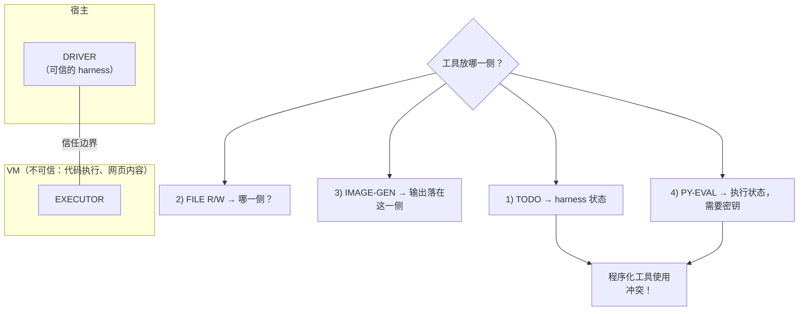

呃，这样行不通。因为：

- 程序化工具使用需要访问全部工具；所以我们没法把 harness 状态工具与环境状态工具随意拆开
- 我们得建一个双工网关，让 VM 调用宿主工具；而这会
- 毁掉初衷（要么你把 DoS 放进来，要么你得对你自己 VM 的某些操作做限流）
- 平白更复杂了，不了谢谢。

好，那把驱动应用放进 VM！

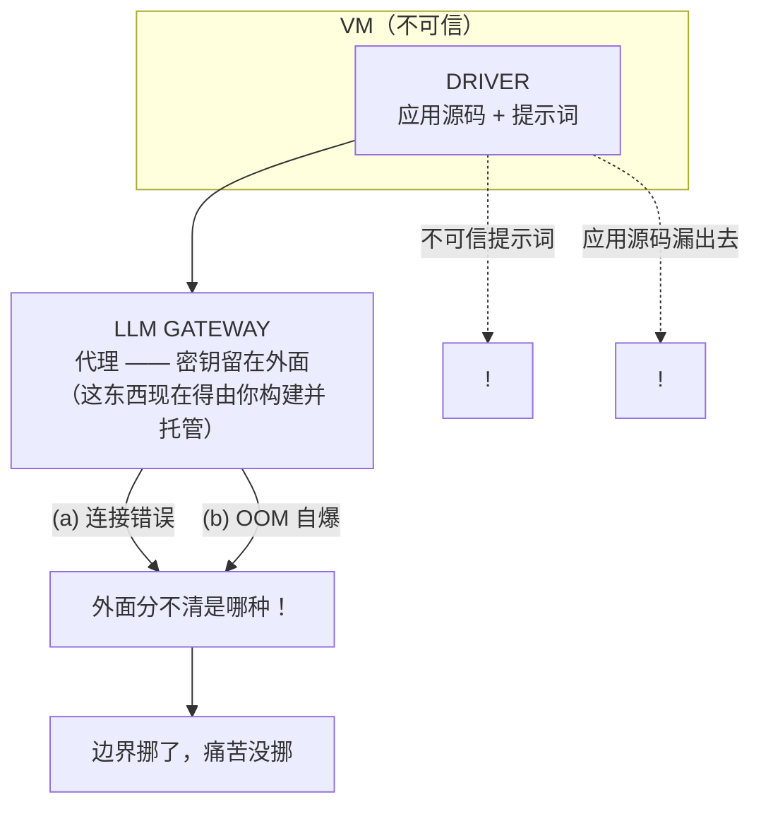

- 现在应用提示词连同内部源码一起泄漏，除非把应用挪出 VM、通过网络 RPC 连 harness，同时把会话存储也挪出去
- 而会话存储在外面，意味着得给 VM 写权限——又绕回问题一和二的合体。

解法是往 VM 里放一个单一的、唯命是从的桩，并且非常非常小心地限制回流数据的最大量（你不会想让一次误用的 Read 工具拿到 2GB 响应）：

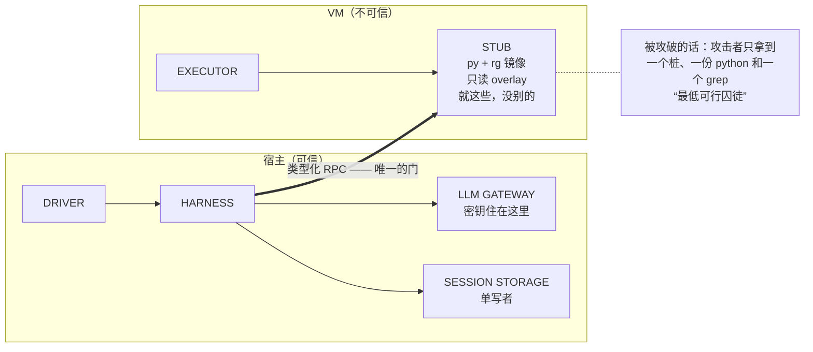

于是切分变成：

- **宿主**持有会话状态、推理、策略、工具路由、审批、限额与 journal。
- **沙箱**通过一个小巧恭顺的协议持有环境执行。
- 每一条回流的数据流，都在不可信一侧耗尽宿主内存或上下文之前先行设界。

本地使用也没有变差：同一个宿主可以把桩指向本地进程、容器、VM 或远程机器。

### 子智能体跨过同一条边界

放置问题不只是宿主对 VM。子智能体在文件系统层需要同样的边界：worktree 只隔离被跟踪的文件，而 pi-iso 用 APFS、btrfs、ZFS、overlayfs、ProjFS 或拷贝回退，给每个孩子一份整个工作区的写时复制视图。孩子分叉，父母收到 diff。

### omp 教给我们的：一次调用，三个互不相连的 API

好，那工具怎么定义？我们最初做的改动后面再讲，但核心契约大体保持不变：

```
export const myCustomTool: ToolDefinition = {
	name: "my_tool",
	parameters: mySchema,

	// 1. Called during argument streaming & before execute()
	renderCall(args, theme, context) {
		if (context.argsComplete) {
			// Trigger async preview computation
		}
		return new Text("Pre-execution preview UI...", 0, 0);
	},

	// 2. Main execution
	async execute(_id, params) {
		/* ... -> string */
	},

	// 3. Called after execute() settles
	renderResult(result, options, theme, context) {
		return new Text("Final execution result UI", 0, 0);
	},
};
```

小而讨喜，但它把一个操作劈成三个互不相关的回调，尽管预览、执行、模型结果、人类结果、诊断、流式更新、取消与 journal 记录描述的都是同一次调用。

### 回调切分造成重复劳动

首先，拆开渲染路径让响应性变成可选项。即使被渲染的工具没有“啪”地变成新形状，作者也不得不复制大段展示逻辑。

更大的问题在 execute 怎么工作。以 Edit 为例：

- renderCall 会打开文件，祈祷读过的部分在哪儿被缓存了（哪里？），套上编辑，渲染 diff
- execute 接着再次打开文件，全部应用，写入，返回模型友好格式的 diff
- renderResult 拿到这个 diff，却还得解析我们自己选定的格式！为什么？因为人类当然想看带颜色高亮的版本，行号说不定还要更漂亮。

这催生了一个下意识的实现，它：

- 浪费 I/O 时间：文件打开了两次
- 浪费 CPU 时间：应用不是算一次、不是两次，而是每改一个字符就全部重算（renderCall 不是协程！）
- 多余的序列化/反序列化：为了实现 renderResult，得解析模型输出（或者把数据塞进 details，把 journal 过的数据复制一遍）

要让它高效，你得实现一个在定义之外驱动的协程，找个地方存它的句柄，而且整套结果反序列化的活儿还是躲不掉。

在重复底下，契约里没有任何东西把这次调用从“参数流式”贯穿到“运行中”再到“已落定”，于是每个实现都自己发明侧信道。

### omp² 的改变：执行是状态流

工具执行是一条有界的、可取消的状态流。

也没有统一的办法附加结构化警告、诊断或截断提示。多数 Pi 工具实现最后都是这么干的：

```
text += `\n${theme.fg("warning", `[Truncated: ${truncation.outputLines} lines shown (${formatSize(truncation.maxBytes ?? DEFAULT_MAX_BYTES)} limit)]`)}`;
```

模型于是只能靠猜才知道工具数据在哪里结束、harness 的旁白从哪里开始。execute 又不是生成器，流式输出还得在更新通道上再叠一层协议。

DOM 模型把这两个特例都消掉了：

- 流式输出改变 `<result>` 主体；
- 加一条警告就是创建 `<diag severity="warn">`。

执行进行中，客户端收到这个状态的 patch；落定后，相对前一状态的最终 diff 进 journal。

统一会话模型里，一次调用是一个带结构化子节点的元素：

```
<Edit id="e41" status="running" version="3">
   <input i="Update the parser without changing the public API">…</input>
   <result>…streaming structured state…</result>
   <diag severity="warn">…</diag>
   <usage tokens="0" elapsed-ms="842"/>
</Edit>
```

执行器一边运行一边改变这个元素。模型、用户、journal、远程客户端与测试 harness 观察同一状态的不同投影。落定会冻结最终 diff；任何客户端都不必为了找回序列化之前那个更丰富的对象，去解析结果字符串。

### 限额是原语的一部分

Pi 的工具没有限额：返回 1MB 文本，就原样转发给模型。作为暴露出去的原语，这层级太低了。

#### 输出一次性设界

Pi 自己在 Bash 和 Read 上撞到过这个问题，答案是导出一个截断工具给各实现共享。omp 用一套 artifact 系统扩展了它，让模型能把保留下来的完整输出读回来，但责任还留在 Pi 放的地方：每个实现身上。

给模型发 1MB 也许是一种值得保留的能力，但它应当是退出项——一处中心实现，加一个显式的 notrunc 属性——而不是“好设计需要主动开启截断”。把这个助手做成可选项，会从两头失败：

多数工具需要某种截断，所以“选择加入的助手”保证了覆盖不均：

- 不知道有这个助手的作者自己造一个，每家的提示语还略有不同；
- 从没想过会有巨大结果的作者则什么都不做。

在工具实现内部截断，而不是在会话渲染层截断，还会搞坏 Code 模式：

- 智能体永远没法在 Eval 里依赖工具输出；每次都得先把 harness 旁白从数据里解析掉；
- Eval 的结果本身也可能被截断，于是每次调用都在同一份数据外面再叠 N+1 层独立截断。

#### 阻塞时间一次性设界

“任何东西都能转后台”，以及“一次调用最多能阻塞多久”，同样属于库层，而不是碰巧会跑久的每个工具。

第一个理由是缓存与体验。一次意外漫长的调用，会让智能体无从察觉、无从调整，用户回到一个卡死的会话，自主作业干等，提供商的 KV 缓存在调用返回前就过期了。

第二个理由，omp 也栽过：重复。每个工具都长出自己的后台化，每个工具也就长出自己的 spawn、poll、message、kill 与 list 助手。看 Claude 围着自己的 Task 与 Bash 工具画的这张图：

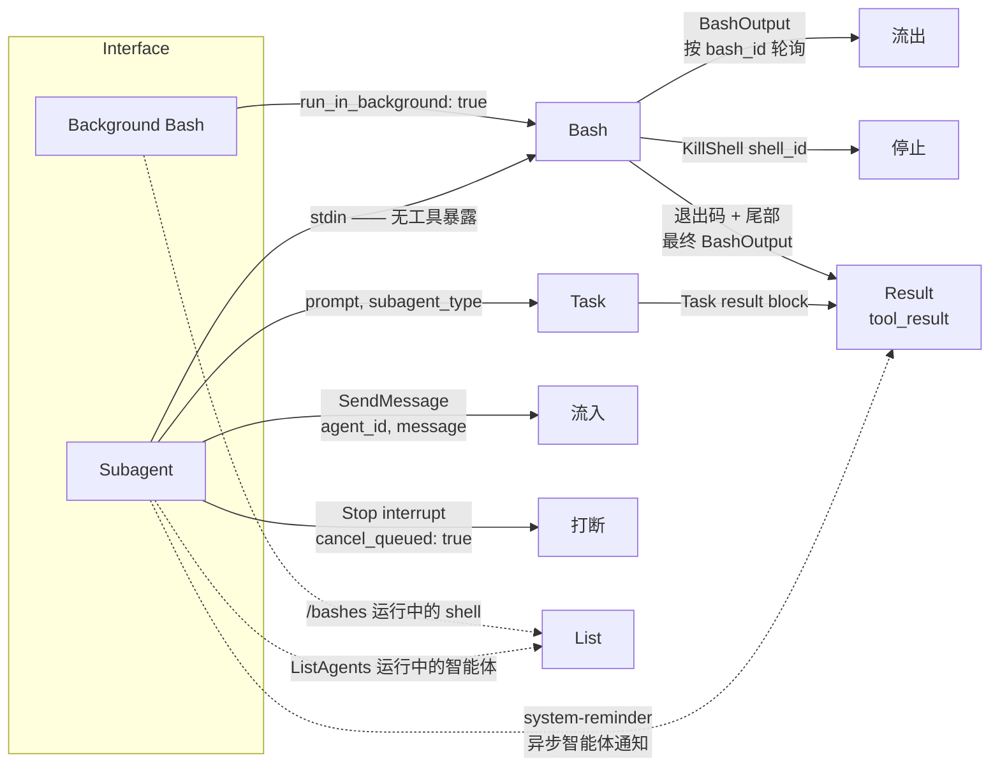

两者都收敛到进程的接口：信号 + 流入 + 流出。转后台的 shell、子智能体、dev-server 守护进程、远程函数、超了预算的普通调用，是同一个东西——一个有 stdin、stdout、退出状态与信号句柄的 job。一个 stdio 形状的 job 原语应当把它们全装下。这样，阻塞预算在一处强制，输出溢出到一个 artifact 路径，检查、发消息或杀掉任何一个都是同一张表面，而不是每个工具一份拷贝。

可观测性预期也以同样方式收敛。想看子智能体状态的用户，同样想看后台 shell。跨 harness 实例互发消息的智能体，也想看到对方跑的守护进程——于是一个目录里的 N 个智能体共享一个 HMR bun dev，而不是在 N 个端口上开 N 份。

### 取消需要一条杀掉边界

扩展——也就是自定义工具——共享引擎的 JavaScript isolate，通向灾难。像样的热重载几乎不可能，而工具调用一旦逃出协作式取消，就再也无法强行停止。

JavaScript 与 Go 通过 AbortSignal 和 context.Context 暴露取消：有用的协议，但不强制。忘了传信号、调用了不接受信号的依赖、跑了同步任务、陷入无限重试循环——超时只会告诉智能体继续；工作本身可能还在后台烧资源。

所以，一个安全的宿主需要一个真正能终止的执行单元——进程、worker、子解释器、VM 请求，或等价的、死了也不会把会话权威一起带走的边界。

### 让强制边界变得愉快

一个刻意装傻的沙箱桩会带来最后一个 SDK 问题：扩展作者现在看到两个文件系统。一个自定义 edit 函数搞不好得在一侧读文件、整个传过去、再在另一侧写回来。

这正是 omp² 给扩展选 Python 的原因。Python 可以用标准库检查自己的 AST、打包函数所需的源码、提交给另一个运行时；一个 @remote 属性能把看起来本地的函数变成 RPC。也是这同一种性质，让 Modal 的 Python SDK 里远程函数显得自然。

把 Python 运行时带进来，还让 Eval 从“碰运气装了哪个解释器”变成可靠。一石二鸟。

## 控制面

这里住着两种控制。**Values**：当前激活的是哪个模型、哪一档、哪个主题、哪条策略。**Behaviors**：智能体可不可以交出控制权、是否必须再跑一轮、临时需要什么能力。当每个调用方都自带 setter 或 flag 时，两者都会变成烂摊子。

### Values：在设置定义处声明策略

在设置定义的地方，声明它的作用域、持久化、继承与复制。

配置系统也变成了雷区，脏标记叠着好几层配置（全局、会话级、临时的……）。多数 get/set 都要穿过 AgentSession 类型，跟 Pi 一样，因为变更必须持久化进 JSONL。

你知道哪个配置系统多年前就把这些问题全解决了吗？没错，起源引擎！

尤其了不起的是，碰过 Valve 游戏的人，大多数都能脱口而出 sv_cheats 是干什么的。这么多年来大家折腾自己的配置，我想不起一个不开心的用户。你还能想起其他任何软件的配置吗？

[convar](https://developer.valvesoftware.com/wiki/ConVar) 是一个带类型的变量：有名字、默认值、帮助字符串和一串标志**位域**，在定义处一次性声明：

```
ConVar sv_gravity("sv_gravity", "800", FCVAR_REPLICATED | FCVAR_NOTIFY, "World gravity.");
```

持久化、所有权、作用域、复制、甚至回放诚实性：全是**变量的属性**，在它出生的地方写明。没人穿过神对象去 set，没人手搓脏标记。

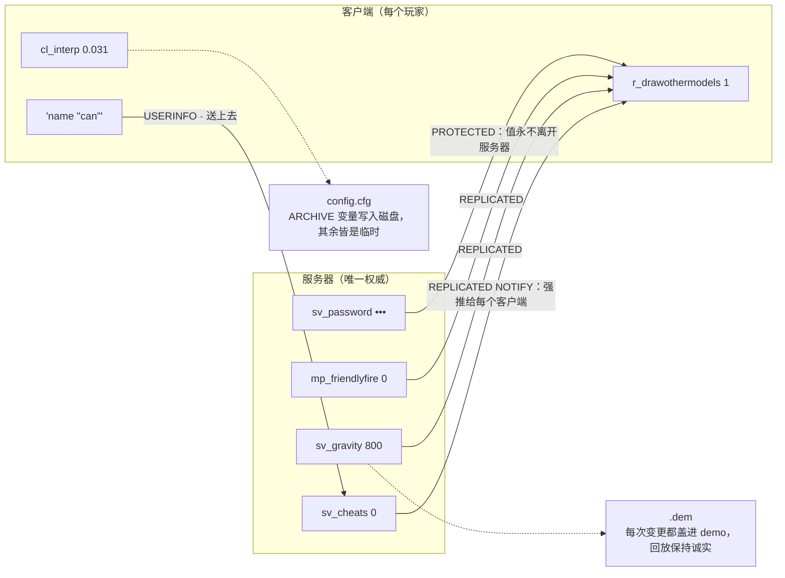

一个权威的服务器存储，镜像到每个客户端。REPLICATED 把值推下去，USERINFO 把客户端变量送上来，CHEAT 用 sv_cheats 锁住变量，ARCHIVE 决定什么能进 config.cfg——而每一次变更都盖进 .dem。不走“穿过神对象 set() + 脏标记”的路：标志长在变量出生的地方。一个存储，标志决定其余。

convar 不等于在会话 DOM 旁边再开一个设置数据库：会话作用域的 convar 只是树里又一个 journal 化节点，它的标志声明它在恢复、回退、派生、复制与归档时的行为。

### 继承不应该需要第二个设置

今天在 omp，服务档位（即 `/fast`）光给子智能体就有一个单独设置：

```
tier:
  openai: priority
  subagent: inherit   # separate setting
```

在 convar 的世界里，ai_fastmode 是同一个变量，标了 SESSION：随会话 journal，恢复即还原。继承根本不需要标志：派生出来的孩子，默认从父亲的实时值种下每一个变量。没有什么需要“开启”。

想让孩子钉死？一行搞定：

```
# subagent.cfg — auto-exec'd for every spawn
ai_fastmode 0

# sonic.cfg — auto-exec'd when a sonic spawns, class config
ai_model @smol
ai_thinking low
```

config.cfg 给主会话，任意数量的用户 cfg 做档案，subagent.cfg 每次派生自动执行，`<agent>.cfg` 叠加其上——顺手把“千属性神对象”也解决了。TF2 早知道路该怎么走！

### 档案与键位留在带内

cfg 有了之后，bind 让它更好——bind、toggle 和 alias 也是控制台命令，所以我们不断为其发明 schema 的每一种输入模式都留在带内。用户想要一个隐藏思考流的键位？

```
bind ctrl+t "cl_showthinking 0"        # careful — one-way; the second press still writes 0
bind ctrl+t "toggle cl_showthinking"   # there we go; toggle also cycles value lists

alias +thinkhud "cl_showthinking 1"         # fires on key-down...
alias -thinkhud "cl_showthinking 0"         # ...and on key-up
bind ctrl+h +thinkhud                       # hold to peek at the thinking stream
```

我们的键位层就该长这样：而不是一个自带默认值表的手工 schema！

cfg 文件、控制台输入、alias、bind、远程管理与 journal 回放，说的是同一套命令语言，作用在同一批变量上。

### Behaviors：循环形状的空洞

凡是能跨轮持有控制权的东西，都该住进一个可组合的、智能体持有的 Director 原语。

另一个值得关心的是可扩展性。我承认 Pi 的扩展层其实相当棒，但它确实有一个“循环”形状的空洞。

我装上了 Pi 里最流行的 Plan 与 Goal 实现。试着把两个都激活，你会看到：

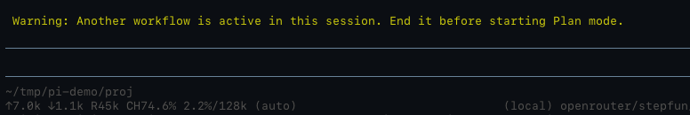

好吧！有意思，但根本没有“workflow”API。这要怎么工作？实现自己定义：

```
export const WORKFLOW_MUTEX_CHANNEL = "workflow:mutex:v1";
export const AGENT_WORKFLOW_GROUP = "agent-workflow";

export class WorkflowMutex {
  private session: object | undefined;
  private readonly heldGroups = new Map<string, WorkflowMutexOwner>();
  private generation = 0;
  private readonly pi: Pick<ExtensionAPI, "events">;

  constructor(pi: Pick<ExtensionAPI, "events">) {
    this.pi = pi;
    pi.events.on(WORKFLOW_MUTEX_CHANNEL, (payload) => {
      this.answer(payload);
    });
  }
```

啊哈！两个实现出自同一位作者——他撞到过这个问题，于是造了一个在自己插件套件里能用的方案。

引入一个封装此行为的系统，这份复杂性被转嫁给了插件作者，而他们只能造出在自家扩展之间可用的系统。

omp 有类似的问题：

```
// modes/interactive-mode.ts — the exclusivity "system", in its entirety
if (this.goalModeEnabled || this.goalModePaused) { this.showWarning("Exit goal mode first."); return; }
if (this.vibeModeEnabled)                        { this.showWarning("Exit vibe mode first."); return; }
// …restated by hand at six other entry points
```

一把私有互斥锁能挡住同一位作者的 Plan 和 Goal 插件互撞，但挡不住任意扩展相互组合；omp 手写的检查也一样挡不住。所以我们给“拥有循环的原语”起了名字，叫 **Director**，并把更多内建行为挪上公共扩展表面，让这个洞没法被无视。

### Directors 持有候选让渡

智能体有一个循环。越来越多的东西想指挥这个循环：plan 想在计划出现前再要一轮，goal 想在目标完成前再要一轮，`/force` 想改写下一次推理，todo 提醒器想在我们让渡前争取最后一次反对机会。

所以给**智能体层**一个持有该决定的对象：一个 Director 栈。

所谓“栈”，是会话 DOM 里一棵活的子树，不是一个我们发誓稍后会序列化的 Python 数组。DOM 是权威；运行时只是走它。

```
候选让渡沿此方向流动 ──────────────────────────────────────┐
                                                            ▼
Base  →  TodoReminder  →  Goal  →  Plan  →  ForceTool(write)
                                                父层      子层（栈顶）
```

循环保持无聊：

```
while True:
    request = directors.prepare_inference(base_request)  # outside → inside
    turn = await inference(request)
    await execute_tools(turn)

    if turn.has_tool_calls:
        continue

    decision = await directors.on_yield(turn)            # inside → outside
    match decision:
        case Continue(): continue
        case Yield():    return
```

prepare_inference 从外向里走栈，最内层的行为得以精炼父层正要发出的请求。on_yield 再从里向外走回去。每个 Director 可以：

- **Pass**——放行，让下一个 Director 检查这次候选让渡。
- **Continue**——吃掉让渡，再跑一轮。
- **Yield**——吃掉它，真正让渡给用户。
- **Push**——在自己头上压一个子 Director。
- **Done**——弹掉自己，把同一次候选让渡交还父层。
- **Fail**——带着错误弹出。

于是，回退移除 Directors，恢复还原它们，远程检查器能看到当前是哪个行为持有候选让渡。

### Plan 模式，完整体

假设 plan 模式激活，模型没写计划文件就想让渡。Plan 在任何外层行为之前看到那次候选让渡：

```
class Plan(Director):
    async def on_yield(self, agent, turn):
        if not turn.wrote(self.plan_file):
            return agent.force_tool(
                "write",
                until=lambda turn: turn.wrote(self.plan_file),
                reminder="Write the plan file before yielding.",
                retries=3,
            )

        if not turn.called("ask") and not turn.proposed_plan():
            return agent.force_tool(
                "required",
                until=lambda turn: turn.called("ask") or turn.proposed_plan(),
                reminder="Propose the plan, or ask the user what is missing.",
                retries=3,
            )

        return Yield()
```

而 `force_tool("write")` 的软模式会压入一个小型内建 Director，为下一次推理请求贡献能力：

```
class ForceTool(Director):
    def prepare_inference(self, request):
        return request.with_tool_choice(self.tool)

    async def on_yield(self, agent, turn):
        if self.until(turn):
            return Done()                    # pop; offer the yield back to Plan
        if self.retries_left:
            return Continue(self.reminder)
        return Fail("tool requirement exhausted")
```

Plan 栈下面已经有另一个 Director：

```
Base → TodoReminder → Plan
```

一次候选让渡先到达 Plan。Plan 激活期间，要么继续、要么压个孩子、要么直接让渡给用户。它不会 Pass，所以外层 TodoReminder 永远看不到那次让渡。

扩展用的是一模一样的接口：

```
await agent.direct(VerifyBeforeYield(...))
```

```
<directors>
  <todo-reminder id="d1">
    <plan id="d2" plan-file="local://auth-plan.md">
      <force-tool id="d3" tool="write" attempts="1" max-attempts="3"/>
    </plan>
  </todo-reminder>
</directors>
```

Plan 持有让渡、压住 ForceTool 一阵子、孩子做完后收回同一次候选让渡，然后要么继续，要么交还给用户。

### 钩子、Directors 与推理

- **钩子（hook）**观察或编辑一次推理或一轮。
- **Director** 能跨轮持有控制权，拦截让渡。
- Directors 有意义地堆叠、嵌套、完成并恢复父层。

这覆盖了 plan、goal、vibe、autoresearch、提醒器与外部验证，它们谁都不需要知道别人的 flag。

ForceTool 表达的是一个语义请求：“下一个成功的回合必须调用 `write`。”它不知道所选的提供商是否支持原生 tool_choice、强制会不会打爆缓存、本地模型需不需要一条额外提示。那层翻译属于推理层。

## 推理

*把模型怪癖放进一本带显式优先级的规则手册。*

### omp 教给我们的：怪癖变成架构

这条最好解释，因为 omp v1 上有一个现成的前后对比提交。dd57045396 之前，OpenAI 兼容住在一个 880 行的文件里，中心是一个巨型 builder。打开它，迎面就是：

```
const isCerebras = modelMatchesHost(hostModel, "cerebras");
const isZai = modelMatchesHost(hostModel, "zai");
const isKimiModel = isKimiModelId(spec.id);
const isMoonshotKimi = isKimiModel && isMoonshotNative;
const isAnthropicModel =
    modelMatchesHost(hostModel, "anthropic") ||
    isClaudeModelId(spec.id) ||
    isAnthropicNamespacedModelId(spec.id);
// …then DeepSeek, Qwen, MiMo, Grok, Mistral, OpenCode, local servers
```

然后那些布尔喂进更多布尔、几层嵌套三元，最后汇成一个巨型 compat 对象。Kimi 能不能边思考边强制工具调用？取决于哪个 Kimi、在哪个宿主上、走哪条 API。这个回环 URL 是 llama.cpp，还是 LiteLLM 代理的别的东西？再加一条特例吧。

每条分支单看都没错！每条都修过真实的提供商 bug。问题是同一份知识最后被编码进了好几个地方：

- compat/openai.ts：880 行
- model-thinking.ts：977 行
- variant-collapse.ts：1,776 行
- 另有 Bedrock、Anthropic、Devin 的兼容 builder
- discovery 与提供商序列化器里更多的名字探测

取而代之的是什么？

```
taxonomy/   "what model is this string?"
classes/    "what is true of this model lineage?"
providers/  "what does this host change?"
```

现在 Anthropic thinking 长这样：

```
class "anthropic" {
    on "anthropic" "amazon-bedrock" "google-vertex" {
        family "sonnet" {
            revision ">=3.7 <4.6" { thinking-mode "budget" }
        }
        revision ">=4.7" {
            thinking-mode "anthropic-adaptive"
        }
    }
}
```

这才是我们本来要表达的知识！4.6 之前的 Sonnet 用 budget thinking；Anthropic 4.7+ 用 adaptive thinking；只在我们验证过的宿主上声明。

KDL 本身不是魔法。救了我们的是编译器，它让我们不至于在更漂亮的格式里重搭一遍烂摊子：

- 未知的指令或值？报错。
- 两条同等具体的规则设置同一个东西？报错——文件顺序不许偷偷获胜。
- 没有匹配的规则？Unknown，而不是“false”。

这让提供商变正常了吗？当然没有。我们还是有叫 requires-mistral-tool-ids、qwen-preserve-thinking、strip-deepseek-special-tokens 的兼容轴，和十种拼写“关掉推理”的方式。看看这些名字，哭吧。

它救下的是：下一个怪癖不用再写成四个不同函数里的四条分支。现在它是一条规则，住在拥有该事实的地方，编译器会在优先级含糊时冲你吼——推理层也终于能回答：这个精确的模型、在这个精确的宿主上，到底支持什么？

### 提供商不止是流

这个坑注定会回来找我——我一实现我那个 Pi 网页搜索插件就中招了。其实，仓库极简主义的出身也承受着同样的压力，看 Pi 新的 [image models](https://github.com/earendil-works/pi/blob/main/packages/ai/src/image-models.ts) 实现就知道。

Pi 把模型提供商建模成 stream 与 streamSimple，差不多就完了！快速接一个提供商很爽，在上面越盖越多的东西就不爽了，因为：

- Anthropic 的 token 计数接口呢？
- Codex 的 WebRTC 语音端点与远程压缩呢？
- Anthropic/OpenAI 的网页搜索呢？
- embeddings 呢？
- 图像/视频生成呢？
- 分词呢？
- 用量查询呢？
- 模型发现呢？

你以为每个做了其中一项的扩展，还会各自把同步的 OAuth 刷新与重试做对吗？

再往外说，能摸到推理提供商支持的前沿控制项是重大优势，比如：

- 受约束采样
- OpenAI 的文本详略选项
- Google 的上下文过滤选项
- 强制工具调用
- Developer 角色
- 会话中途的系统提示词
- ……

### 能力策略：强制工具调用

强制工具调用说明了为什么“支持一个 flag”不够：

- **不支持的提供商上报错**：任何 harness 原生功能只要用它，就会把大半个模型阵容排除在外。
- **默默丢弃**：调用方收到一条意料之外的“尽力而为”路径，只好自己发明强制循环。
- **原样透传**：提供商的副作用变成产品 bug；比如 Anthropic 可能把一次强制调用变成整场对话的缓存失效。
- **干脆不暴露**：知情的调用方绕过库，亲手重现前三种失败。

理想的 harness 实现：

- 无条件注入一条软提示，告诉模型下一轮必须调用工具。无条件做是值得的：OpenAI 这类托管 API 会悄悄替你前置这个提醒，开源推理引擎不会——于是 vLLM 后面的模型得到一个从没人告诉过它的硬约束，一开推理就抓瞎。软提示把这块场地拉平。
- 只有免费时才设原生标志。提供商支持强制工具调用且无副作用，就透传；有代价，就跳过标志，只靠软提示。
- 不从命就升级。模型不调用，就有界重试；最后一招，哪怕有代价也把原生标志设上。说服失败之后，正确性赢过缓存。

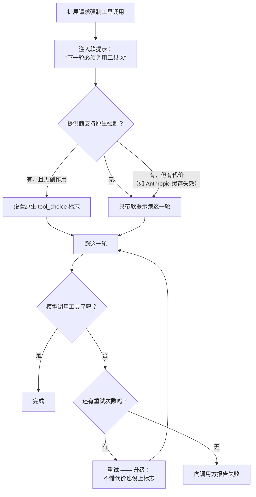

强制调用从软提示开始；原生标志只在提供商无副作用地支持时打开；模型仍不调用，就有界重试升级到不惜代价设标志，然后才向调用方报失败。

这是 ForceTool 的推理一半：Director 说必须发生什么，提供商层挑最便宜的到达路径，模型不从命就升级。

### 工具 schema 是面向模型的协议

工具的 parameters 字段严格定义参数形状。这对人类 API 是理想做法；模型不是通用 API 客户端。它们的错误往往特定于工具名，以及训练数据里出现过的那些 harness。

RL 拉满的智能体可能拿另一家 harness 的 schema 去调一个熟工具。Composer 模型有时会凭空吐出 Grep，还按它们期望的形状来，哪怕根本没有 Grep 这个工具。Codex 看到 paths: string[]，可能看心情发一个用 `;` 或 `,` 分隔的字符串。

所以库应当校验**并纠正**。对工具的语义契约严格，对模型的方言宽容：paths: "a,b" 在映射无歧义时修成列表；否则返回结构化、可重试的错误。裸的 JSON Schema 校验器独自担不起这一层。

### 严格采样需要预算与方言

受约束采样是我们最早加给 Pi 的功能之一：

```
+   strict?: boolean;
+   customFormat?: { syntax: "lark" | "regex"; definition: string };
+   customWireName?: string;
```

Pi 几个月后跟进了 LARK 与 strict 支持，但把它暴露成一个给提供商层透传的不透明结构。两条系统级约束让这不够用：

- **严格 schema 的容量是共享预算。**很多提供商限制严格 schema 的数量。足够多独立编写的扩展，就能让提供商拒绝所有请求。用户不该靠二分搜索加打补丁来救回 harness。
- **文法方言是提供商特定的。**把 LARK 文法发给每个提供商，这件事本身就可能非法。扩展没法维护这张兼容映射，因为用户可能把同一个模型走原生宿主、代理或自定义提供商路由。

这就是为什么看似“复杂”的实现属于推理层：

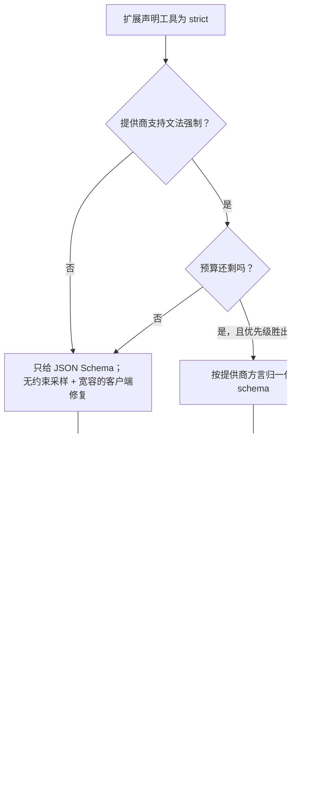

兑现 strict 实际需要什么：提供商能力、带优先级的严格 schema 预算、逐方言归一化、客户端修复路径——不透明的透传结构一样都给不了。

### 纠错推理

推理库还需要：

- 修复畸形 JSON；
- 检出 Gemini、DeepSeek 这类模型的复读循环；
- 解析每个模型的输出方言，在结构化输出漏进正文时，合成规范的 tool_call 与 think 块。


一次泄漏成散文的工具调用：方言没有被解析成 tool_call 块。

工具调用这一侧，我写过一篇[前文](https://blog.can.ac/2026/08/03/the-minutiae-of-tool-calling/)。支持一个提供商或模型，除了接好一个 URL，还要处理它的个别怪癖。

### 压缩是排程的，不是触发的

*在限额之前，从 journal 快照开始总结；到限额时，只有快照仍然描述当前分支才提交它。*

天真设计在这里给出的 UX 也最差：用户在投入感最强的时刻，等整场会话里最大的一次请求。

除了用 [Snapcompact](https://stencil.so/blog/snapcompact) 一类方法，这里还有很大改进空间。

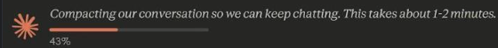

连前沿实验室发布的也是天真设计。

应该做的是：在到达限额前约 10% 就投机启动压缩。你等于让会话分形成两个并发版本——一个里用户和模型继续干活；另一个里模型在压缩对话。


看到投机压缩触发时显示的分层图标了吗？

收到响应后，你把它拼接进另一条分支，这也保住了工作的势头——模型不会因为历史里孤零零立着一条交接消息而迷惑，而是能看到它本来就该看到的全部进展。

除了提示词，其他值得考虑的方法包括：

- **远程压缩**：提供商在服务端做。OpenAI 的 API 返回一个不透明状态 blob，但它看得到解密后的思考，能显著改善上下文损失。
- **交接**：不求总结，试试让模型把工作“交接”出去。
- **抖落**：纯本地，直接把重的工具结果从历史里剪掉。

注意这也是你在 UI 渲染与请求渲染的抽象里要考虑的：用户回看历史时，期待所有消息原样都在；而对模型，那些消息一条都不存在。因此创建请求时，应把提示词历史里的每个条目建模为一个“折叠”，fn(this, req) -> req，在 `<Handoff>` 的实现里处理它。

### 用小模型干 harness 的活

微型本地模型超级有用！就算你真的只跟前沿模型打交道，我也建议你实现一个嵌入式小模型（尤其去看看 LiquidAI 的模型），分类任务能省下大量延迟与钱，起标题、翻译、判断用户对对话走向的满意程度这类小事也一样。当然还有 TTS/STT，本地已经能做到 SoTA。

## 工具面

*每个常驻工具都向每一轮收税；花名册要小，原语要深。*

### 每个 schema 都有税

把多数工具呈现给模型的最好方式，是**压根不放进常驻工具花名册**。

前阵子我收到一条抱怨，说 omp 在同一任务上比 codex 慢——不是 token 口径，是挂钟时间。我完全以为是个 nothing-burger，结果惊讶地发现是真的，还差了快两倍！

| 变体 | 定义 / 轮数 | 中位挂钟（秒） | 请求前缀（k Token） | 相对上一行 |
| --- | --- | --- | --- | --- |
| omp · 原版 | 23 个工具定义 · 12–16 轮 | 86.2 | 25.1 | — |
| omp · todo 批处理 | 23 定义，r9 · 6–8 轮 | 59.5 | — | ↓ −26.7s（todo 批处理修复） |
| omp · `/xdev` 默认 | 15 定义，r11 · 6–8 轮 | 45.4 | 20.6 | ↓ −14.1s（线上定义 23→15） |
| omp · 精简下限 | 5 工具，r11 · 4–6 轮 | 36.6 | 15.1 | ↓ −8.8s（仅保留必备 5 个） |
| codex-cli 0.144（参照） | 3 工具 · 4 轮 | 42.2 | 9.6–12.3 | — |
| pi（参照） | ~5 个小 schema 工具 · 6 轮 | 37.0 | 5.6 | — |

原文此处为条形图：每行粗条为中位挂钟（秒）、细条为请求前缀（k Token）；任务 sol，6 次运行取中位，每次全新会话；青色为 omp 变体，灰色为外部参照；标注为相对上一行的差值。

罪魁祸首是工具花名册。砍到五个必备工具，36.6 秒，反超 Codex 的 42.2 与 Pi 的 37.0。为什么？工具文法！哪怕它对模型只是一段文字描述，在大多数前沿提供商那里，它都会实际参与 token 生成——它影响生成过程，逼着模型永远给你合法 JSON（这还不算描述它本身花掉的 token）。

工具不是“以防模型需要”的免费保险——这是动态工具发现的想法。但动态方案一改花名册就缓存失效，所以我们不太喜欢它。

Pi 有一件事做对了，我们也一直同意：MCP 设计得一塌糊涂，不属于常驻工具层。那怎么既满足想要 Figma MCP 的用户，又满足推理约束？

### 把长尾放到稳定表面后面

来认识 dyn CLI！这当然不是真的 CLI，而是我们 Bash 实现暴露的一个内建命令，给模型一个稳定的发现协议，可以通过 Bash 用，也可以通过 Eval 当 Python 函数用。

```
dyn
dyn --q github
dyn github/list_prs --state open | jq '.[] | .title'
cat query.sql | dyn database/query - --params limit=5
dyn image_gen "blueprint of a frog" > result.json
```

一旦找到有趣的工具，跟工具搜索一样，可以用 `--help` 看细节：

```
$ dyn github/create_pr --help
dyn github/create_pr <title> [OPTIONS]

Arguments:
  <title>

Options:
  -d, --draft / --no-draft
  -r, --reviewers <TEXT>[,…]  (repeatable)
  -p, --pr-meta.priority <INTEGER>
  -m, --pr-meta.notify / --no-pr-meta.notify
  -j, --json <JSON>
  -h, --help
```

这当然是从 JSON schema 合成的——光 schema 就足够生成一个漂亮的 CLI 映射。

大输入是它格外香的地方：

```
dyn database/query "SELECT 1"       # literal
dyn database/query @query.sql       # file contents
cat query.sql | dyn database/query - # stdin
```

有一个边界情况要处理：返回图片的工具怎么办？嗯，omp 是怎么给你显示图片来着？Sixel 或 Kitty 协议，对吧？那为什么不在 Bash 工具里解析同样的输出，把图片附上！现在你还能通过 ssh 看远程图片，甜。

当所有操作都属于同一个 API 时，还有第二种选择：暴露一个代码表面。Browser 只留 open / run / close，在一个常驻标签页上跑代码；Computer 在一个常驻会话里暴露 desktop、wait 与 assert。一个稳定的 schema，操作在调用内组合。**有界操作集：schema。开放操作集：代码表面。**无论哪种，发现之后，常驻花名册再也不变。

### 契约卫生：意图与版本

契约有一个小改动值得单独一提：每个工具都获得一个 `i`（intent）参数。

它在参数流式时到达，于是 renderCall 能在调用完成前展示模型以为自己在干什么。journal 也得到一份可读的摘要，不用每个工具自己发明 reason / purpose。

人们应该给工具**标版本**。

这让 trace 好用得多：你可以解析一个频繁变更工具的 I/O，跨时间评估它的成功率，而不用猜每次调用出自哪一版契约。

### 深挖内建

花名册小，只有当每个工具覆盖大片地面才行，而且得是因为它是同一个操作，而不是一坨不相关功能凑成的 switch。omp 的内建是这么干的：

#### Read：物化一个资源

omp 里最无聊的工具，实际打包了别处 20 个工具的活：

- 能读目录，不用 Ls。
- 不用额外的 ReadNotebook 工具，读 .ipynb 文件默认就是漂亮输出。
- .pdf、.docx、.pptx、.xlsx、.epub？给你提取好的 markdown。
- .cpuprofile、.sample.txt？你猜对了！瓶颈摘要。
- .sqlite、.sqlite3、.db、.db3？列出表、检查 schema、看行，甚至直接查询。
- 图片返回图片或元数据（无视觉能力时）。预览 SVG 就加 :img。
- 归档不用解包就能寻址——不止 ZIP 和 TAR，还有 JAR、wheel 和 ASAR。
- 同样的投影适用于 http://... 的在线资源，按需范围读取；普通网页变 markdown，跟 web_fetch 一样。

这不是为了炫技的多态。从模型视角，这些全是同一个操作：

> 把这份资源物化成我能推理的最有用表示。

对代码，它还能返回结构摘要，把大段声明体替换为省略号。模型不必为了找 class X 把整个大文件拖进上下文。

:raw 在字节要紧时绕过投影。:conflicts 给每个未解决的合并冲突块一行，而不是让模型在整份文件里翻找。

范围可以开区间、按长度、不相交：

```
:50
:50-
:50-200
:50+150
:5-16,960-973
:raw:50-100
:50-100:raw
```

还有非 web 的 URL：

```
artifact://<id>
agent://<id>
history://<id>
issue://123
pr://123/diff/2
skill://react
rule://foo
memory://...
local://...
vault://...
security://...
omp://...
xd://browser
ssh://host/path
mcp://...
```

仓库信息、MCP 资源、子智能体会话记录、技能、记忆、本地草稿区、omp 文档，甚至 SSH 上的远程机器，全部塞进同一个内部 URL 子系统。我们推荐这个设计。

Read 还处理不显眼的恢复：从唯一的工作区后缀解析错误的绝对路径、在 Windows 上展开 ~、避开其他浪费轮次的路径错误。

这本来能不能就是：

```
return await Bun.file(path).text();
```

能。然后扩展作者会自造各自的 reader，或者模型去 shell 里找替代，而 harness 用 web_fetch 之类分开的名字暴露形状相似的功能。

复杂性不会消失；它只会散落到 shell 命令、提示词、扩展与失败的工具调用里——没人拥有它，人人都实现 30%，还各不相同。

Read 复杂，是为了让“读”不复杂。

#### Bash：一门感知策略的命令语言

Bash 工具不该只是起一个 Bash 进程来干活。这话听着像疯话。

omp 内置了完整的 bash 解析器、解释器，外加全套 coreutils，全部进程内；这个选择很对，理由很简单：

- 保住模型的肌肉记忆。它照旧伸手用 grep；因为 omp 是解释器，我们截获命令，把合适的参数路由进 ripgrep 引擎。没人浪费上下文在 AGENTS.md 里求模型用 rg。
- 平台中立几乎白送。不用 WSL 或 Git Bash：omp 在 Windows 上进程内就能跑多数 bash 调用。不用多解释。
- 控制台跨调用保持有状态：变量、退出码、$! 等等。

更有意思的优势出现在 Claude 递过来这种东西的时候：

```
INC="…/10.0.22621.0"; declare -A R
for d in um shared ucrt; do while IFS= read -r f; do b="${f##*/}"; R["${b,,}"]="$f"; done \
  < <(find "$INC/$d" -maxdepth 1 -type f -name "*.[hH]"); done
n=0
while IFS= read -r ref; do case "$ref" in */*) continue;; esac; r="${R[${ref,,}]:-}"; \
  [ -n "$r" ] || continue; rd="${r%/*}"; rn="${r##*/}"; \
  if [ "$ref" != "$rn" ] && [ ! -e "$rd/$ref" ]; then ln -s "$rn" "$rd/$ref"; n=$((n+1)); fi; \
done < <(grep -rhoiE "#[[:space:]]*include[[:space:]]*<[^>]+>" "$INC/um" "$INC/shared" "$INC/ucrt" \
  | sed -E "s/.*<([^>]+)>.*/\1/" | sort -u)
```

你能在 5 秒内说清它在干什么吗？（说能的都在撒谎）

无论你对工具审批持什么立场，这都糟透了：没人会读它。Anthropic 的近期研究也指向同处——auto mode（另一个 Claude 读命令）把人类甩开很远。

omp 自己解释命令时，可以在执行抵达 `ln` 的那一刻再询问；在那之前一切都是只读。用户已经允许写入该目录时，连提示都能跳过。

这让 harness 从“Bash”的 TSA 安检，变成一个能力审批人：“我可以用 Git 来 push 吗？”find、cat、ln 这类常见命令进程内运行、即时查询访问模型，并继承用户已有的读写策略。

[译者注] TSA 即美国运输安全管理局，以繁琐的机场安检流程著称，此处讽喻“一刀切的命令审批”。

#### AutoQA：给智能体一条 bug 报告路径

这个工具是我们 fork 一个月之后加的，比 Anthropic 给他们家加同类功能还早。

你通常会提供一个地方让用户报告产品问题，对吧？这是等价物，只不过面向智能体。它让你完全自主地收集：他们喜欢工具的什么、哪里犯迷糊、看到哪里出了错。

现在报告的质量嘛，不算多好——比如 Codex 就特爱抱怨文件被外部改动，怪 Read 或 LSP 工具没把名字改对（哥们，这真不怪我，去问 TypeScript 那帮人）——但它们非常容易过滤，一旦滤掉，哪个工具失败、该怎么改进，你获得的是巨量信号。

## 界面

| 数字 | 含义 |
| --- | --- |
| 267s → 90ms | 渲染时间，单个会话 |
| 13% | 单次 .includes 占 profiled CPU 的比例 |
| 98.7s | 花在 wrapAnsi 里重新折行 |
| 0 | 那个会话里的图片数 |

一串 ANSI 转义的字符串数组加 render()，构成不了一个合格的渲染原语。

### omp 教给我们的：字符串会复利

这其实是我给 [pi-mono](https://github.com/earendil-works/pi/pull/1084) 最早一批 PR 的话题。改动之前，你 profile 一个跑任务的 Pi，看 CPU 占用，榜单整页都是——你猜对了——渲染器！

> 原文此处为一张交互式 treemap 火焰图：一个 Pi 会话中自耗时（self time）的分布，字符串扫描（红色）一项就烧掉了会话的五分之一；悬停每个色块可见对应代码。见[原文](https://stencil.so/blog/harness-playbook#what-omp-taught-us-strings-compound)。

作为 TypeScript CLI，有些代价不可避免（光是字符串内部是 UTF-16 这一点，就意味着每帧都要走一遍相对昂贵的转码，除非你像疯子一样到处传 Uint8Array）。

但真正让这笔开销复利的，是契约本身。想嵌一个子组件？现在你得处理：

- 清洗字符串，丢弃或解码越过的 ANSI 转义
- 每一行的填充、截断与宽度计算

图片还能顺着其中某行、以 base64 文本塞进来，事情也不会变好。光是一个 .includes 判断某行是不是图片行，就吃掉了会话总 CPU 的 20%。这账单可不轻（而且那个会话里压根没有图片！）。

这只是 JS 侧的图景。这种契约下的渲染管线是台堆整理机：不停分配、分解、丢弃字符串和字符串数组——拼接、拆分、截断、填充，again and again，一步不落。Not gud.

同一份契约也让扩展没有共同的设计语言。只要用过任何一个 Pi 扩展，你就知道，除了求 Clawd 给每一个重新配色然后维护结果之外，没办法让它们遵循一套共同规范。

该不该用圆角边框、Nerd Font 图标能不能用、会不会用你喜欢的颜色来传达语义——全都没有契约。你会发现：

- 99% 的时候，它做最低限度（截断/折行），你的工具全是难以分辨的灰色矩形。
- 1% 的时候，它用力过猛，跟你极简的其余设置格格不入。

Pi 目录里一个社区渲染器，展示了这契约对到达用户手里的东西做了什么：

```
  if (cq.sources.length > 0) {
    lines.push("");
    for (const s of cq.sources) {
      const domain = s.url.replace(/^https?:\/\//, "").replace(/\/.*$/, "");
      const title = s.title.length > 50 ? s.title.slice(0, 47) + "..." : s.title;
      lines.push(theme.fg("muted", ` \u25b8 ${title}`) + theme.fg("dim", ` \u00b7 ${domain}`));
    }
  }
  lines.push("");
} else {
  const textContent = result.content.find((c) => c.type === "text")?.text || "";
  const preview = textContent.length > 500 ? textContent.slice(0, 500) + "..." : textContent;
  for (const line of preview.split("\n")) lines.push(theme.fg("dim", line));
}

if (details?.fetchUrls?.length) {
  if (details.curated) {
    lines.push(theme.fg("muted", `Fetching ${details.fetchUrls.length} URLs in background`));
  } else {
    lines.push(theme.fg("muted", "Fetching:"));
    for (const u of details.fetchUrls.slice(0, 5)) {
      const display = u.length > 60 ? u.slice(0, 57) + "..." : u;
      lines.push(theme.fg("dim", "  " + display));
    }
    if (details.fetchUrls.length > 5) lines.push(theme.fg("dim", `  ... and ${details.fetchUrls.length - 5} more`));
  }
}
```

这里问题不少：

- 它按 code point 切文本而不是可见宽度，一旦终端窄于 40 列就会冲出行、砸乱下面的一切
- 它不知道终端宽度，就算有空间也给你省略号！
- 最重要的，它无视 Pi 组件第一规则，不清洗外部输入——它抓取的东西可以喂它几个 ANSI 转义，把你整个 UI 换成一张鸭子图片

[肯定](https://www.sentinelone.com/vulnerability-database/cve-2023-32712/)[没有](https://socprime.com/active-threats/cve-2025-55752/)[别的](https://github.com/boxdot/gurk-rs/issues/384)[办法](https://www.packetlabs.net/posts/weaponizing-ansi-escape-sequences/)能干成这种事！

把复杂性下放到毫无防备的开发者——往往是 Claude——头上时，这种事再自然不过。

LLM 不会每次被叫去“做个工具 UI pls”时记住 harness 的每个内部细节。说实话，我自己有时也不想。而冒烟测试照样通过。

性能、安全、一致性问题出自同一个地方：一张预渲染的字符串，同时干着布局树、样式树、内容、传输和终端程序的活。

### omp² 的改变：一遍原语

最底层的消费者（不是你，除非你提 PR）把 RichText（Style, String）推进交给它们的抽象管线（&mut impl Out）。

这把 267 秒的渲染时间砍到 90ms：

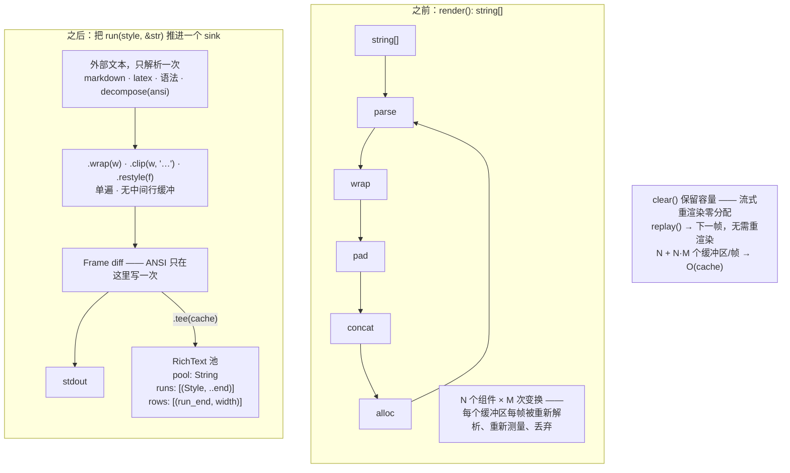

之前：render(): string[]——N 个组件 × M 次变换，每帧每个缓冲区重新解析、重新测量、重新分配。之后：RichText 流单遍通过抽象管线，直达帧 diff。

临时对象、ANSI 解析、字素处理：从帧渲染器以下的每一层，彻底消失！这很自然！

既然我们可以直接流式输出填充、再输出你的一行、如此往复，为什么要先填充好你的组件再传下去？既然可以直接在你的省略号后面丢掉流、或者把断行作为变换本身的一部分，为什么要先渲染一个 255 行的全彩 diff、再 .slice(0, 3) 截进另一个字符串数组？

### 类型化组件模型

下一步，string[] 换成正经的组件模型。上层消费者只要叠盒子，享受 LSP 指路：

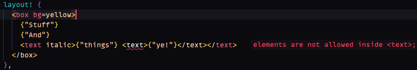

标记是类型化的：在 `<text>` 里嵌元素是编辑时的 lint 错误，不是运行时的一帧乱码。

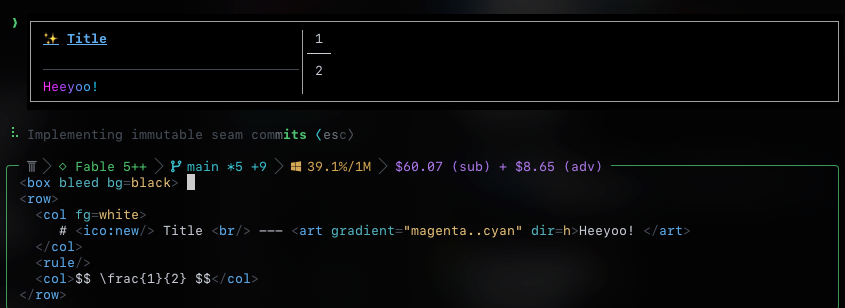

标记进，帧出：`<box>`、`<row>`/`<col>`、一个 `<ico:new/>` 图标、水平 magenta..cyan 渐变，还有一个从 `$$ \frac{1}{2} $$` 实时渲染出来的 ½。

我可能不喜欢写前端，但我真喜欢一个好抽象。(Element, Props, Children) 字面上就是你需要的全部，配上一台布局引擎，比起来简直是享受。

这就是 Read 组件的样子。还不赖吧？

```
<box bc=muted>
	<row kind=title gap=1>
		<text>•</text>
		<text bold>Read</text>
		<a href={input.path}>{input.label}</a>
		{#if status=error}<badge tone=error>exit {code}</badge>{/if}
	</row>
	{#if result.head}<pre lang={result.lang} wrap=word start={result.start}>{result.head}</pre>{/if}
	{#if @expanded}
		{#if result.blob}<pre lang={result.lang} numbers start={result.start} blob={result.blob}></pre>{/if}
	{/if}
	{#each diag as d}<callout tone={d.severity}>{d.msg}</callout>{/each}
	{#if result.src}
		<hr title="Output"/>
		<row gap=1 fg=muted>
			<text>⟨Resolved path:</text>
			<text>{result.src}⟩</text>
		</row>
	{/if}
	{@render usage}
</box>
```

工具作者描述结构；TUI、网页客户端、快照测试与远程检查器各自排版。

### 呈现策略属于渲染器

组件模型免费买到两个有用的属性：

- `<ico:new/>` 让每个插件都有方便的图标，同时尊重用户的 ASCII、Unicode 或 Nerd Font 选择。边框同理。
- 语义颜色不再需要把 theme 对象穿进每个渲染器。Claude 可以直接要 info，而不是选一个字面颜色然后祈祷它配得上用户的主题。

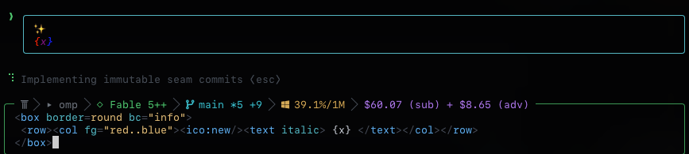

border=round bc="info" 解析到主题的语义色；fg="red..blue" 是渐变。哪里都不用穿 theme 对象。

你还得掌握文本流的节奏。Claude 与 Codex 吐块的节奏天差地别——一个一次几个词，一个一次几个字符。抹平这些差异会改变 harness 的手感：匀速流动读起来是进展；爆发和卡顿不是。嘿。

### 验证是界面的一部分

在当下的“meta”里，ROI 最高又零成本的投资，是让智能体给任何交互式 TUI/GUI 实现一个调试协议。“如何验证”未知且未规定时，智能体会走侧信道、造一个高仿——多数情况下，也就是写一个其实什么都不检查的测试文件。

预先定义“验证”是什么、并给它一个顺手的形状，摩擦大幅下降，它于是主动进入开发循环。

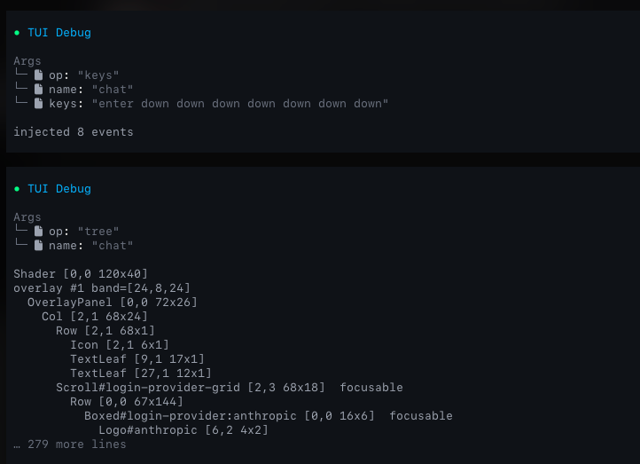

形状本身不重要，随时可以更新：可以是自定义工具、Python 包或 API；但提供一个**非破坏性、离屏、多实例**的东西是绝对必须的——防止智能体重新定义（通常是降格）成功的定义。

### 会话记录是协议

TUI 真正不可能的部分，是关于它坏掉的 GitHub issue 数量为 0。人对自己不知道的东西总是理想主义；不幸的是，多数人并不知道，他们想要的完美 TUI 体验（每个组件无论在哪个位置、无论怎么被动态修改，全都保持最新）是不可能的。

#### 块

我们把规范会话记录定义为块的列表。一个块产出若干行文本，走过一个生命周期：

```
active → finalized → committed
```

活着时，块 *i* 显示当前快照 *W<sub>i</sub>*，一个行数组。终结时，它冻结为不可变快照 *F<sub>i</sub>*。

块有两种模式：

- **可变**：每个新快照可以整体替换前一个（spinner、进度条）。快照是投机的，永不变成历史；只有 *F<sub>i</sub>* 变成历史。
- **只追加**：快照只增长：每个快照是下一个的前缀，最后一个快照是 *F<sub>i</sub>* 的前缀（流式文本）。

块超出分配给它的视口空间时，这个区分才要紧。可变快照不能提前进历史，因为后续更新可能替换它——那样我们就得把已经滚走的行拽回来。像 assistant 思考这样的只追加块只延伸一个稳定前缀，所以那个前缀可以立即开始提交。

#### 终端

一个宽 *W*、高 *H* 的终端有两个缓冲区：

- *V*：视口，*H* 行可见
- *S*：原生回滚区，无界，只追加

技术上我们可以清掉并覆写回滚区，但那会带来用户经常抱怨的行为；所以现在它是一条不变量。

折行 wrap<sub>W</sub> 把逻辑行变成物理行，依赖当前宽度。视口下方没有可寻址区域。写过底部会滚动终端，把顶行不可逆地推进 *S*。

逻辑历史 *L* 按未折行的行保存，因此与宽度无关：已提交的最终快照（final）、按块序、每个恰好一次，加上当前流式块已经放行进来的部分。设 *c* 为最后提交的块、*j* = *c*+1：

$$
L = F_1 \cdot F_2 \cdots F_c \cdot W_j[1..e_j]
$$

其中 *e<sub>j</sub>* 计流式头已经送进历史的行数（除非块 *j* 是流式中的只追加块，否则 *e<sub>j</sub>* = 0）。

因此：

- 已提交的最终快照恰好出现一次，连续，按块序；
- 可变的投机快照永不进入 *L*；
- 只追加的头可以一边流式一边逐行进入 *L*；
- 终结不写任何东西；
- 提交只追加 *F<sub>j</sub>* 尚未送出的行

#### 调整大小

调整大小（resize）在逻辑上什么都不改：每个 *W<sub>i</sub>*、每个 *F<sub>i</sub>* 和 *c* 原样幸存。只有折行与视口分配重新计算。已经在原生回滚区里的行无法重写，所以调整大小对它们需要一条显式策略：

- **保留**：按原样保留模拟器折行的历史。
- **追加**：追加一段重新渲染的历史，可能重复物理行。
- **重建**：开一个新的物理纪元，把历史重放进去。

### 把不可能的部分写成规格

为什么要让你过这一遍“数学”？因为这是一个极难凭感觉验证正确性的算法；上一轮迭代，我们写了一个 fuzzer 才到稳定点，这次我想免掉。

改为按描述在 [TLA+](https://lamport.azurewebsites.net/tla/tla.html) 里建模这些行为，然后迭代修改这些块的提交与终结的处理方式，直到明确写出的不变量全部满足。

现在，如果我们真想改点什么——比如 yolo 地提交部分块、或不允许块截断——我们有一个参照可以更新，而且极其容易知道行不行，不行还给反例。

论文与完整的 ElasticSlots.tla 源码在[附录 B](#附录-b弹性投机槽位elastic-speculative-slots)。

### 这解锁了什么

例行炫耀，然后我们继续！现在谁再抱怨 TUI 坏了，我能给他一份“为什么这修不了”的形式化证明，great.

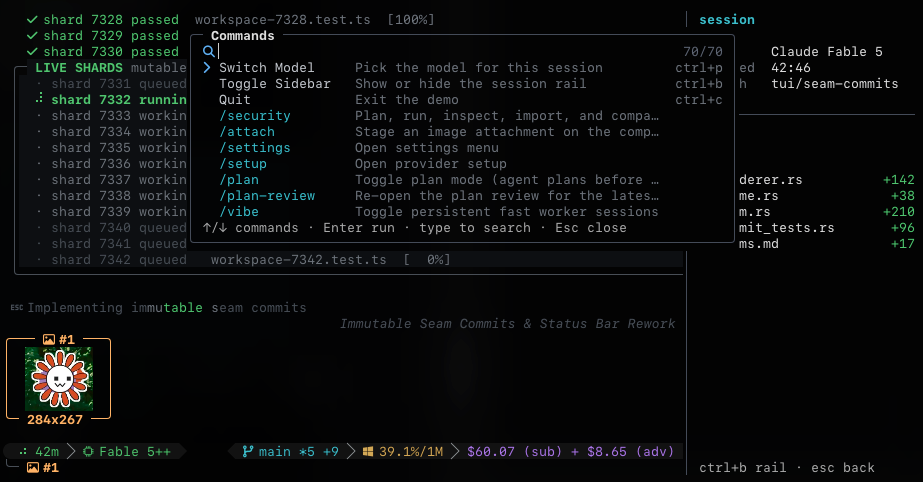

任务中的 omp² TUI：命令面板悬在并行分片上、会话栏显示逐文件 diff 统计、内联图片缩略图——每一个元素都是同一条流式管线上的组件。

## 技术栈

*选那些约束会把智能体赶向你想要维护的代码库的语言。*

### 语言选择就是架构

TypeScript 眼下是糟糕的选择，**除非你别无选择必须碰前端代码**。

现在开一个项目，最有影响的决策之一就是：挑对工具。三年前要我看一篇这样开头的文章，我早开喷了，但……不信的话，把一模一样的 Prompt 丢给 Claude，让它做一个你要的小组件。

再把 macOS（Swift）换成 Linux（Qt/JS）。前者给你一个和操作系统一脉相承的毛玻璃小组件；后者给你一个控件互相重叠的矩形，加一堆可疑的 UX 决策，让你感觉刚啃完定义 UI 用的 XML schema，而且这是你第一次编译它。

当然，Prompt 的写法有影响，你确实可以写得更细；但过一阵你会发现，无论你怎么写，其中一个几乎毫不费力地胜出。macOS 历来擅长的一件事，就是把开发者摁进一种一致的设计风格——LLM 同理。

Swift 没有自己的品味；它有强默认。标准库、惯常的项目布局、编译器报错、生态约定，全都作为生成代码的先验。一门有二十种同样“正常”写法的语言，会让模型在碰到你的问题之前先做二十次选择。

### TypeScript 会变成你的语言

我爱 TypeScript 的一点，不幸在于，它最后总会**变成你的语言**：

- 用 camelCase 还是 snake_case？还是干脆给你的库起名 $
- 写 200 行的泛型，还是一个都不写？
- 用 Buffer 还是 Uint8Array？
- 用 Zod 还是 Typebox？
- 用 `Array<T>` 还是 `T[]`？
- 用 ESM 还是 CJS？（那扩展名呢？.ejs、.cjs、.mjs、.js？）
- 用 TypeScript 还是 JSDoc？
- 用 class，还是继续用对象（或者见鬼，new function()）？
- 默认导出，还是不默认导出？
- 用 star re-export，还是逐个具名？
- 用 private foo 还是 #foo？
- 用 module/index.ts 还是 module.ts？
- 用 const x = () => .. 还是 function x() {？
- 用 function x(args) 还是 function x(...args)？
- 后者的话，用 ...args: any[] 还是 ...args: unknown[]？
- 用 const X = 1、enum E { X = 1 }，还是 const enum E { X = 1 }？

你看，人生十年交给了最大的只写语言 C++ 之后，我确实能从中找到乐趣。然而，被逼在 Zod 和 Typebox 之间二选一时，你那位初级朋友会搓出我们所谓的 isRecord。能用类型并集为什么用泛型？能在脑子里让每个分支同时满足两种类型，为什么要用个 typeof 特化？要什么类，不就是对象和原型吗？

可能是外面烂 JS 代码实在太多，也可能它们一路吞过一堆压缩代码，但我烦了。想想同一个初级能找到 Linux 0-day——要是我，就不会再指望对的模型**或对的代码质量工具**，也不会再钻 hoop。

也许 EffectJS 能改变这一点。我认为最后的赢家是 Go（尤其等 WASM 的 GC 提案定稿），理由与 Swift 赢在设计上类似（尤其编译速度与交叉编译之便）；不过有些场景需要更低层的系统语言，所以我们选了 Rust。

它们还是需要相当频繁地被引导：抄最短路径奔目标；宁可分配拷贝也不对付精妙的借用；把错误当字符串传，而不是用 thiserror。但它们需要的东西多数都在 std 里，配上 serde 生态，编译器也提供足够的安全性，就这么定了。

### 扩展用 Python

下一个决定是是否把 TS 请回来做扩展。我们说不，主要因为：

- 智能体输出的 Py 相当不错 => 顺带，扩展也相当不错
- 小体积下合规的 JS 运行时基本不可能（谢谢你，Locale）& 没有生态，那不如跑 Lua
- 扩展连运行时间的 1% 都占不到，真不需要 JIT
- 嵌入完整的 Py 运行时，还能保证 eval 工具开箱即用，而不是求用户装 py3、而我们发布的流程里永远指望不上它
- Python 代码开箱即可自检 AST。这就是“运行时”一章 @remote 设计成立的原因。

## 结语

智能体 harness 是系统软件——不是一个包着 fetch 的 while 循环。

为什么？因为上面每一章都是人们造了几十年的那类软件：复制、沙箱、配置、调度、协议兼容、实时渲染，以及语言/运行时设计。

omp² 仍在对照本文档构建中，各处状态从已发布到仍在推敲不等；但我们由衷感谢每一位试用的人，感谢你们与我们分享各种绝妙用法——从让它运营一家软件工厂，到让它在同一部手机上给自己写一个相机 App。

[在 X 上查看这篇帖子](https://x.com/i/status/2092690773221458376)

你们塑造了 omp，我们对未来的期待也同样有趣！

## 附录 A：官方示例中的状态失效

[“状态”一章](#证据正确性在-api-里是可选项)中各失效案例的源码链接、最小代码摘录与复现视频。

#### 1. 检查点在 /fork 用到它之前就被清掉：git-checkpoint.ts

[源码](https://github.com/earendil-works/pi/blob/853a80d26c90a14c1886f0ebb8ffaae133ca2185/packages/coding-agent/examples/extensions/git-checkpoint.ts#L11-L51)：缺少持久的检查点所有权；`/fork` 在空闲时被调用，而 `agent_settled` 早已清空了 stash ref 唯一的那张 map。

```
const checkpoints = new Map<string, string>();
// …
pi.on("agent_settled", async () => {
  checkpoints.clear();
});
```

<video controls muted src="../assets/videos/articles/harness-playbook/git-checkpoint.mp4"></video>

#### 2. 树导航不恢复状态：plan-mode/index.ts

[源码](https://github.com/earendil-works/pi/blob/853a80d26c90a14c1886f0ebb8ffaae133ca2185/packages/coding-agent/examples/extensions/plan-mode/index.ts#L340-L352)：缺少 session_tree 与 getBranch()；回退后 plan 模式及其工具限制仍然激活，而恢复能复活死分支的快照。

```
const entries = ctx.sessionManager.getEntries();
const planModeEntry = entries
  .filter((e) => e.type === "custom" && e.customType === "plan-mode")
  .pop();
```

<video controls muted src="../assets/videos/articles/harness-playbook/plan-mode.mp4"></video>

#### 3. 计数器数不了历史：status-line.ts

[源码](https://github.com/earendil-works/pi/blob/853a80d26c90a14c1886f0ebb8ffaae133ca2185/packages/coding-agent/examples/extensions/status-line.ts#L10-L23)：缺少分支派生；从第 3 轮回退到第 1 轮，下一轮显示 4，而恢复又从零开始。

```
let turnCount = 0;
// …
pi.on("turn_start", async (_event, ctx) => {
  turnCount++;
```

<video controls muted src="../assets/videos/articles/harness-playbook/status-line.mp4"></video>

#### 4. 动态添加的工具熬过回退、又在恢复后消失：dynamic-tools.ts

[源码](https://github.com/earendil-works/pi/blob/853a80d26c90a14c1886f0ebb8ffaae133ca2185/packages/coding-agent/examples/extensions/dynamic-tools.ts#L25-L33)：`/add-echo-tool echo_branch` 只写进实时扩展注册表；`/tree` 不会重启那张注册表，所以回退保住了工具，而 `--continue` 开了一张新注册表，工具就消失了。

```
const registeredToolNames = new Set<string>();
// …
registeredToolNames.add(name);
pi.registerTool({
```

<video controls muted src="../assets/videos/articles/harness-playbook/dynamic-tools.mp4"></video>

#### 5. 死分支上的存档回来了：snake.ts

[源码](https://github.com/earendil-works/pi/blob/853a80d26c90a14c1886f0ebb8ffaae133ca2185/packages/coding-agent/examples/extensions/snake.ts#L320-L328)：恢复时扫描整个会话文件；在分支 A 上存档、回退到它之前、打开 `/snake`，死掉的存档就回来了。

```
const entries = ctx.sessionManager.getEntries();
for (let i = entries.length - 1; i >= 0; i--) {
  const entry = entries[i];
  if (entry.type === "custom" && entry.customType === SNAKE_SAVE_TYPE) {
```

<video controls muted src="../assets/videos/articles/harness-playbook/snake.mp4"></video>

#### 6. “最后一条消息”指文件里最后一条：bookmark.ts

[源码](https://github.com/earendil-works/pi/blob/853a80d26c90a14c1886f0ebb8ffaae133ca2185/packages/coding-agent/examples/extensions/bookmark.ts#L19-L25)：缺少 `getBranch()`；回退之后，`/bookmark` 可以给废弃分支上一条用户看不见的 assistant 消息打标签。

```
const entries = ctx.sessionManager.getEntries();
for (let i = entries.length - 1; i >= 0; i--) {
  const entry = entries[i];
  if (entry.type === "message" && entry.message.role === "assistant") {
```

<video controls muted src="../assets/videos/articles/harness-playbook/bookmark.mp4"></video>

#### 7. Calculator 在回退到早于发现点的轮次后仍然激活：kimi-deferred-tools.ts

[源码](https://github.com/earendil-works/pi/blob/853a80d26c90a14c1886f0ebb8ffaae133ca2185/packages/coding-agent/examples/extensions/kimi-deferred-tools.ts#L47-L60)：`tool_search` 激活了 Calculator，但没有 `session_tree` 处理器重新派生活动花名册；回到早于发现点的轮次后，Calculator 仍然激活。

```
const active = pi.getActiveTools();
const added = active.includes("Calculator") ? [] : ["Calculator"];
if (added.length > 0) pi.setActiveTools([...active, ...added]);
// Missing: session_tree → derive active tools from selected branch.
```

<video controls muted src="../assets/videos/articles/harness-playbook/kimi-deferred-tools.mp4"></video>

#### 8. 切换会话提交工作树：auto-commit-on-exit.ts

[源码](https://github.com/earendil-works/pi/blob/853a80d26c90a14c1886f0ebb8ffaae133ca2185/packages/coding-agent/examples/extensions/auto-commit-on-exit.ts#L11-L42)：缺少“仅退出”的边界；`/new`、`/resume` 与 `/fork` 都会触发 `session_shutdown`，把脏的工作树暂存并提交。

```
pi.on("session_shutdown", async (_event, ctx) => {
  // …
  await pi.exec("git", ["add", "-A"]);
  await pi.exec("git", ["commit", "-m", commitMessage]);
});
```

<video controls muted src="../assets/videos/articles/harness-playbook/auto-commit-on-exit.mp4"></video>

#### 9. 实时状态与恢复状态不一致：tic-tac-toe.ts

[恢复](https://github.com/earendil-works/pi/blob/853a80d26c90a14c1886f0ebb8ffaae133ca2185/packages/coding-agent/examples/extensions/tic-tac-toe.ts#L631-L645)、[用户落子](https://github.com/earendil-works/pi/blob/853a80d26c90a14c1886f0ebb8ffaae133ca2185/packages/coding-agent/examples/extensions/tic-tac-toe.ts#L802-L810)：重建只接受工具结果，而用户落子是 `custom` 条目；X 之后、O 之前崩溃，X 就消失了。

```
if (entry.type !== "message") continue;
if (msg.role !== "toolResult") continue;
// User moves take a different path:
pi.appendEntry(SAVE_TYPE, getBoardDetails());
```

<video controls muted src="../assets/videos/articles/harness-playbook/tic-tac-toe.mp4"></video>

## 附录 B：弹性投机槽位（Elastic Speculative Slots）

[“界面”一章](#会话记录是协议)用来检查会话记录不变量的论文与完整 [TLA+](https://lamport.azurewebsites.net/tla/tla.html) 模型。

[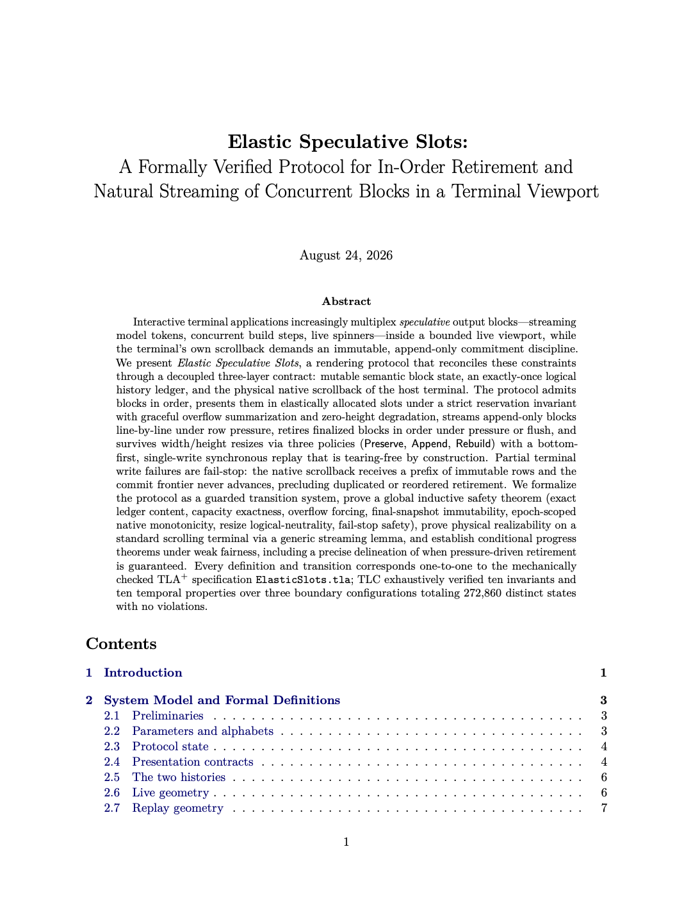](https://stencil.so/blog/harness-playbook/elastic-slots.pdf)

[“Elastic Speculative Slots”论文](https://stencil.so/blog/harness-playbook/elastic-slots.pdf)：三层契约、安全性定理与条件进展结果，与下方完整规范一一对应。点击查看完整 PDF。

**ElasticSlots.tla —— 完整规范**

```
---- MODULE ElasticSlots ----
\* =========================================================================
\* Elastic Speculative Slots: a formally verified rendering protocol for
\* streaming concurrent output blocks through a bounded terminal viewport
\* into append-only scrollback.
\*
\* Three decoupled layers, related by invariants (see ELASTIC_SLOTS2.tex):
\*   1. semantic block state   (phase/mode/want/final/emitted per block)
\*   2. logical history ledger (`history`: width-independent, exactly-once)
\*   3. physical native rows   (`native`: width-rendered, source-tagged)
\* =========================================================================
EXTENDS Naturals, Sequences, FiniteSets, TLC
\* Naturals: arithmetic; Sequences: <<>>/Len/SubSeq/\o; FiniteSets:
\* Cardinality/IsFiniteSet; TLC: model-checking utilities.

CONSTANTS N, H, MaxResizes, MaxLive, RowValues, SnapshotValues,
          NoFinal, Placeholder, Blank, OverflowMarker
\* N            : number of block identities (blocks are 1..N, in commit order)
\* H            : maximum viewport (live transcript) height, in rows
\* MaxResizes   : bound on resize events (keeps the state space finite)
\* MaxLive      : uncommitted-block count that constitutes "pressure"
\* RowValues    : finite row alphabet (what a semantic line of output "is")
\* SnapshotValues: finite universe of block contents (sequences of rows)
\* NoFinal      : sentinel "this block has no final snapshot yet"
\* Placeholder  : synthetic viewport row shown for an empty slot
\* Blank        : synthetic viewport row for unused screen space
\* OverflowMarker: synthetic viewport row summarizing hidden older blocks

ASSUME
    ∧ N ∈ ℕ \ {0}                                  \* at least one block
    ∧ H ∈ ℕ \ {0}                                  \* viewport can be nonempty
    ∧ MaxResizes ∈ ℕ                               \* zero resizes is allowed
    ∧ MaxLive ∈ ℕ \ {0}                            \* pressure threshold >= 1
    ∧ IsFiniteSet(RowValues)                           \* finite row alphabet
    ∧ RowValues ≠ {}                                   \* ... and nonempty
    ∧ IsFiniteSet(SnapshotValues)                      \* finite snapshot universe
    ∧ SnapshotValues ⊆ Seq(RowValues)          \* snapshots are row sequences
    ∧ ⟨⟩ ∈ SnapshotValues                          \* the empty snapshot exists
    ∧ (∃ snapshot ∈ SnapshotValues : Len(snapshot) = 1)  \* a length-1 snapshot exists
    ∧ (∃ snapshot ∈ SnapshotValues : Len(snapshot) > 1)  \* a longer one exists too
    ∧ NoFinal ∉ SnapshotValues                    \* sentinel distinct from real data
    ∧ Placeholder ∉ RowValues                     \* synthetic rows are not
    ∧ Blank ∉ RowValues                           \* ... confusable with
    ∧ OverflowMarker ∉ RowValues                  \* ... semantic rows,
    ∧ Placeholder ≠ Blank                              \* and are pairwise
    ∧ Placeholder ≠ OverflowMarker                     \* distinct from
    ∧ Blank ≠ OverflowMarker                           \* each other.

Blocks ≜ 1‥N                                          \* the block identities
ModelRows ≜ {"row-a", "row-b"}                         \* tiny concrete row alphabet for TLC
ModelSnapshots ≜                                       \* a richer snapshot universe (unused by the shipped cfg)
    {⟨⟩,                                              \* empty block
     ⟨"row-a"⟩,                                       \* one-liner
     ⟨"row-b"⟩,                                       \* one-liner, other row
     ⟨"row-a", "row-b"⟩,                              \* two distinct rows
     ⟨"row-b", "row-a"⟩,                              \* order matters
     ⟨"row-a", "row-b", "row-a"⟩}                     \* length three, with repeat
SmallModelSnapshots ≜ {⟨⟩, ⟨"row-a"⟩, ⟨"row-a", "row-b"⟩}  \* the cfg's universe: lengths 0, 1, 2

WidthValues ≜ {"Wide", "Narrow"}                       \* two-point abstraction of terminal width
ResizeModes ≜ {"Preserve", "Append", "Rebuild"}        \* policy chosen at a width-changing resize
ReplayModes ≜ {"None", "Append", "Rebuild"}            \* pending replay (None = no replay in flight)
BlockModes ≜ {"Undeclared", "Mutable", "AppendOnly"}   \* presentation contract, fixed at Create
Phases ≜ {"Absent", "Queued", "Active", "Finalized", "Committed"}  \* block lifecycle, monotone left-to-right
StopReasons ≜ {"Running", "Graceful", "Detach", "WriteFailure"}    \* why the host stopped (Running = it hasn't)
NativeSources ≜ {"Append", "Retire", "Replay", "Resize", "FailedWrite", "Exit"}  \* provenance tag on every native row
CellRows ≜ RowValues ∪ {Placeholder, Blank, OverflowMarker}     \* what a viewport cell may display
Cells ≜ [owner : 0‥N, row : CellRows]                 \* a viewport cell: owning block (0 = chrome) + row
TaggedRows ≜ [owner : Blocks, row : RowValues]         \* a ledger row: semantic, width-independent
NativeRows ≜ [source : NativeSources, owner : 0‥N, row : CellRows, width : WidthValues]
\* a native row: provenance source, owner, rendered row, and the width it was rendered at

SnapshotLengths ≜ {Len(snapshot) : snapshot ∈ SnapshotValues}  \* set of occurring snapshot lengths
MaxSnapshotLength ≜                                    \* L_max: the longest snapshot length
    CHOOSE maximum ∈ SnapshotLengths :                \* (CHOOSE is fine here: the maximum
        ∀ length ∈ SnapshotLengths : length ≤ maximum  \*  of a finite set is unique)
MaxFailureRows ≜ 2 * N * MaxSnapshotLength             \* K_max: upper bound on one physical write batch
                                                        \* (factor 2 = worst-case Narrow doubling)

BlankCell ≜ [owner ↦ 0, row ↦ Blank]               \* the unused-screen-space cell
OverflowCell ≜ [owner ↦ 0, row ↦ OverflowMarker]   \* the "N older blocks hidden" summary cell

\* -------------------------------------------------------------------------
\* State variables (one tuple entry per column of Table 1 in the paper).
\* -------------------------------------------------------------------------
VARIABLES c, phase, mode, want, final, emitted, alloc, target,
          history, native, width, height, resizes, epoch,
          replayMode, replayCursor, replayEnd, replayPartial,
          replayPrepared, replayCut,
          flush, shutdown, running, stopReason
\* c              : commit frontier -- blocks 1..c are committed (retired)
\* phase          : lifecycle phase per block
\* mode           : Mutable / AppendOnly contract per block
\* want           : current speculative snapshot per block
\* final          : frozen final snapshot per block (NoFinal until finalized)
\* emitted        : rows of the head block already streamed into history
\* alloc          : painted slot height per block (rows on screen now)
\* target         : requested slot height per block (animation target)
\* history        : the logical ledger (layer 2)
\* native         : the physical scrollback of the current epoch (layer 3)
\* width, height  : current terminal geometry
\* resizes        : how many resizes happened (bounded by MaxResizes)
\* epoch          : display epoch; Rebuild resets native and bumps this
\* replayMode     : pending replay policy (None / Append / Rebuild)
\* replayCursor   : first committed block to replay (invariantly 1 while replaying)
\* replayEnd      : last committed block to replay (= c at replay start)
\* replayPartial  : how many stable head rows to replay
\* replayPrepared : replay frame computed and cut fixed (gates the scheduler)
\* replayCut      : rows of the replay frame that must scroll into native
\* flush          : explicit "retire everything" request (never reset)
\* shutdown       : graceful shutdown initiated
\* running        : host still alive; every action requires it
\* stopReason     : why we stopped (Running while alive)

vars ≜ ⟨c, phase, mode, want, final, emitted, alloc, target,
          history, native, width, height, resizes, epoch,
          replayMode, replayCursor, replayEnd, replayPartial,
          replayPrepared, replayCut,
          flush, shutdown, running, stopReason⟩
\* the full variable tuple, used for stuttering ([Next]_vars) and UNCHANGED

Maximum(left, right) ≜ IF left ≥ right THEN left ELSE right  \* max of two naturals

\* -------------------------------------------------------------------------
\* Width rendering: the two-point abstraction of soft-wrap reflow.
\* -------------------------------------------------------------------------
RECURSIVE DoubleRows(_)
DoubleRows(snapshot) ≜                                 \* Narrow rendering:
    IF Len(snapshot) = 0 THEN ⟨⟩                      \* empty stays empty;
    ELSE ⟨Head(snapshot), Head(snapshot)⟩ ∘ DoubleRows(Tail(snapshot))
    \* every semantic row occupies TWO physical rows (models a wrapped line)

Render(snapshot, wx) ≜ IF wx = "Wide" THEN snapshot ELSE DoubleRows(snapshot)
\* rho_omega: Wide = identity, Narrow = row doubling; prefix-monotone by construction

Tag(i, snapshot) ≜                                     \* tg_i: stamp each row with its owner
    [j ∈ 1‥Len(snapshot) ↦ [owner ↦ i, row ↦ snapshot[j]]]

SnapshotSlice(snapshot, lo, hi) ≜                      \* s[lo..hi], empty when lo > hi
    IF lo > hi THEN ⟨⟩ ELSE SubSeq(snapshot, lo, hi)

TagSlice(i, snapshot, lo, hi) ≜ Tag(i, SnapshotSlice(snapshot, lo, hi))  \* owner-tagged slice

NativeTag(source, i, snapshot, wx) ≜                   \* ntg: render at width wx, then tag
    [j ∈ 1‥Len(Render(snapshot, wx)) ↦             \* one native row per RENDERED row
        [source ↦ source, owner ↦ i,                \* provenance + owner
         row ↦ Render(snapshot, wx)[j], width ↦ wx]]  \* rendered row + width it used
NativeTagSlice(source, i, snapshot, lo, hi, wx) ≜      \* native-tag a semantic slice
    NativeTag(source, i, SnapshotSlice(snapshot, lo, hi), wx)

NativeCells(source, cells, wx) ≜                       \* lift screen cells to native rows
    [j ∈ 1‥Len(cells) ↦                            \* (used when the emulator itself
        [source ↦ source, owner ↦ cells[j].owner,   \*  pushes viewport rows into
         row ↦ cells[j].row, width ↦ wx]]           \*  scrollback, e.g. on resize/exit)

PrefixOf(sequence, count) ≜ [j ∈ 1‥count ↦ sequence[j]]  \* first `count` elements

\* -------------------------------------------------------------------------
\* The logical ledger as a FUNCTION of state (invariant ECH says
\* `history` always equals CommittedRows(c, final) \o PartialHeadRows).
\* -------------------------------------------------------------------------
RECURSIVE CommittedRows(_, _)
CommittedRows(k, finals) ≜                             \* C(k): finals of blocks 1..k,
    IF k = 0 THEN ⟨⟩                                  \* tagged, concatenated in
    ELSE CommittedRows(k - 1, finals) ∘ Tag(k, finals[k])  \* block (= commit) order

RECURSIVE TaggedRange(_, _, _)
TaggedRange(lo, hi, finals) ≜                          \* tagged finals of blocks lo..hi
    IF lo > hi THEN ⟨⟩                                \* (empty range allowed)
    ELSE Tag(lo, finals[lo]) ∘ TaggedRange(lo + 1, hi, finals)

RECURSIVE NativeRange(_, _, _, _, _)
NativeRange(source, lo, hi, finals, wx) ≜              \* same, but width-rendered and
    IF lo > hi THEN ⟨⟩                                \* source-tagged for `native`
    ELSE NativeTag(source, lo, finals[lo], wx)
         ∘ NativeRange(source, lo + 1, hi, finals, wx)

RetirementRows(lo, hi, finals, firstEmitted) ≜         \* logical retirement batch:
    IF lo > hi THEN ⟨⟩                                \* head block lo contributes only
    ELSE TagSlice(lo, finals[lo], firstEmitted + 1, Len(finals[lo]))  \* its UNstreamed suffix,
         ∘ TaggedRange(lo + 1, hi, finals)             \* later blocks contribute in full

NativeRetirementRows(source, lo, hi, finals, firstEmitted, wx) ≜
    IF lo > hi THEN ⟨⟩                                \* physical twin of RetirementRows:
    ELSE NativeTagSlice(                                \* the same rows,
             source,                                    \* provenance-tagged
             lo,                                        \* (Retire on success,
             finals[lo],                                \*  FailedWrite on failure),
             firstEmitted + 1,                          \* starting after the already-
             Len(finals[lo]),                           \* streamed head prefix,
             wx                                         \* rendered at the current width
         )
         ∘ NativeRange(source, lo + 1, hi, finals, wx) \* then full later finals

FinalizedRange(lo, hi) ≜                               \* "blocks lo..hi are all Finalized"
    ∀ i ∈ lo‥hi : phase[i] = "Finalized"            \* (a retirement batch precondition)

Unemitted(snapshot, i, emission) ≜                     \* U_i(s): the part of s not yet
    IF mode[i] = "AppendOnly"                           \* streamed into history --
    THEN SnapshotSlice(snapshot, emission[i] + 1, Len(snapshot))  \* suffix for append-only,
    ELSE snapshot                                       \* everything for mutable blocks

\* -------------------------------------------------------------------------
\* Live-viewport geometry: who is presented, who is visible, how much
\* space is reserved. All operators take the ambient tuple explicitly so
\* that action guards can evaluate them at SUCCESSOR values.
\* -------------------------------------------------------------------------
Presented(ph, finals, emission, i, wx) ≜               \* block i occupies viewport iff
    ∨ ph[i] = "Active"                                 \* it is actively producing, or
    ∨ ∧ ph[i] = "Finalized"                           \* it is finalized AND still has
     ∧ Len(Render(Unemitted(finals[i], i, emission), wx)) > 0  \* unstreamed content to show

PresentedSet(ph, finals, emission, wx) ≜               \* the set of presented blocks
    {i ∈ Blocks : Presented(ph, finals, emission, i, wx)}
PresentedCount(ph, finals, emission, wx) ≜             \* pi: how many are presented
    Cardinality(PresentedSet(ph, finals, emission, wx))
Overflow(ph, finals, emission, wx, hx) ≜               \* ovf: more presented blocks
    PresentedCount(ph, finals, emission, wx) > hx       \* than viewport rows
SummaryRows(ph, finals, emission, wx, hx) ≜            \* sigma: one summary row is
    IF hx > 0 ∧ Overflow(ph, finals, emission, wx, hx) THEN 1 ELSE 0  \* shown iff overflowing (and h>0)

NewerPresented(ph, finals, emission, wx, i) ≜          \* how many presented blocks are
    Cardinality({                                       \* NEWER (higher index) than i --
        j ∈ Blocks :                                  \* used to privilege recency
            j > i ∧ Presented(ph, finals, emission, j, wx)
    })

VisiblePresented(ph, finals, emission, wx, hx, i) ≜    \* vis(i): presented AND, under
    ∧ Presented(ph, finals, emission, i, wx)           \* overflow, among the hx-1
    ∧ IF Overflow(ph, finals, emission, wx, hx)        \* newest presented blocks
       THEN ∧ hx > 0                                   \* (one row is sacrificed to
            ∧ NewerPresented(ph, finals, emission, wx, i) < hx - 1  \* the summary marker)
       ELSE TRUE                                        \* no overflow: presented = visible

RECURSIVE AllocationTotal(_, _)
AllocationTotal(al, i) ≜                               \* sum of painted heights,
    IF i > N THEN 0 ELSE al[i] + AllocationTotal(al, i + 1)  \* blocks i..N

RECURSIVE ReservationTotal(_, _, _)
ReservationTotal(al, requested, i) ≜                   \* Res: each block is charged
    IF i > N THEN 0                                     \* max(painted, requested) --
    ELSE Maximum(al[i], requested[i]) + ReservationTotal(al, requested, i + 1)
    \* growth pays up front, shrink keeps its old charge until painted

AllocationStateOK(al, requested, ph, finals, emission, wx, hx) ≜  \* A_OK: allocation admissibility
    ∧ al ∈ [Blocks → 0‥H]                          \* painted heights in range
    ∧ requested ∈ [Blocks → 0‥H]                   \* requested heights in range
    ∧ ∀ i ∈ Blocks :
           IF VisiblePresented(ph, finals, emission, wx, hx, i)
           THEN IF ph[i] = "Active"
                THEN ∧ al[i] ∈ 1‥H                  \* visible active: painted >= 1,
                     ∧ requested[i] ∈ 1‥H           \* target >= 1 (may differ: animating)
                ELSE ∧ al[i] ∈ 1‥H                  \* visible finalized: painted >= 1,
                     ∧ requested[i] = al[i]            \* and frozen (no more animation)
           ELSE ∧ al[i] = 0                            \* invisible blocks hold
                ∧ requested[i] = 0                     \* no space at all
    ∧ ReservationTotal(al, requested, 1)               \* reservation invariant:
       + SummaryRows(ph, finals, emission, wx, hx) ≤ hx  \* reservations + summary fit in h

CanonicalAllocation(ph, finals, emission, wx, hx) ≜    \* kappa: the safe default --
    [i ∈ Blocks ↦                                   \* one row per visible block,
        IF VisiblePresented(ph, finals, emission, wx, hx, i) THEN 1 ELSE 0]  \* zero otherwise

SnapshotHeight(ph, wants, finals, i, wx) ≜             \* dm(i): row demand of block i
    CASE ph[i] = "Active" →
             Maximum(1, Len(Render(Unemitted(wants[i], i, emitted), wx)))  \* live: >= 1 row
      □ ph[i] = "Queued" →
             Maximum(1, Len(Render(Unemitted(wants[i], i, emitted), wx)))  \* queued demands space too
      □ ph[i] = "Finalized" →
             Len(Render(Unemitted(finals[i], i, emitted), wx))  \* finalized: exactly its unstreamed rows
      □ OTHER → 0                                     \* absent/committed demand nothing

RECURSIVE FullRows(_, _, _, _, _)
FullRows(ph, wants, finals, wx, i) ≜                   \* D: total row demand of
    IF i > N THEN 0                                     \* blocks i..N
    ELSE SnapshotHeight(ph, wants, finals, i, wx)
         + FullRows(ph, wants, finals, wx, i + 1)

CreatedCount ≜ Cardinality({i ∈ Blocks : phase[i] ≠ "Absent"})  \* gamma: how many blocks exist

PartialHeadExists ≜                                    \* PH: the head block (c+1) has
    ∧ c < CreatedCount                                 \* been created,
    ∧ mode[c + 1] = "AppendOnly"                       \* is append-only,
    ∧ phase[c + 1] ∈ {"Active", "Finalized"}         \* is live,
    ∧ emitted[c + 1] > 0                               \* and has streamed some rows

PartialHeadRows ≜                                      \* A(c): the head's streamed
    IF PartialHeadExists                                \* prefix as tagged ledger rows
    THEN TagSlice(c + 1, want[c + 1], 1, emitted[c + 1])  \* (prefix of `want`, stable by
    ELSE ⟨⟩                                           \*  the append-only contract)

RowPressure ≜ FullRows(phase, want, final, width, 1) > height  \* demand exceeds viewport
Pressure ≜                                             \* pressure = row pressure OR
    ∨ RowPressure                                      \* too many uncommitted
    ∨ CreatedCount - c ≥ MaxLive                      \* blocks piling up
RetirementRequested ≜ flush ∨ Pressure                \* Req: when retirement may fire
Replaying ≜ replayMode ≠ "None"                        \* a replay is in flight

PreviewSource(i) ≜                                     \* what a slot displays:
    IF phase[i] = "Active"                              \* live blocks show their
    THEN Unemitted(want[i], i, emitted)                 \* unstreamed speculation,
    ELSE Unemitted(final[i], i, emitted)                \* others their unstreamed final

PreviewCell(i, snapshot) ≜                             \* the representative cell of a slot:
    LET rendered ≜ Render(snapshot, width) IN          \* render at current width;
    [owner ↦ i,
     row ↦ IF Len(rendered) = 0                       \* empty content shows the
             THEN Placeholder                           \* placeholder row, otherwise
             ELSE rendered[Len(rendered)]]              \* the LAST rendered row (tail view)

Repeat(value, count) ≜ [j ∈ 1‥count ↦ value]      \* value^count as a sequence
Slot(i, snapshot, allocation) ≜ Repeat(PreviewCell(i, snapshot), allocation)
\* a slot = its preview cell repeated alloc[i] times (abstracting the real tail window)

RECURSIVE PresentedCells(_)
PresentedCells(i) ≜                                    \* all slots, ascending block
    IF i > N THEN ⟨⟩                                  \* order (newest at the bottom,
    ELSE (IF alloc[i] = 0 THEN ⟨⟩ ELSE Slot(i, PreviewSource(i), alloc[i]))  \* next to the cursor);
         ∘ PresentedCells(i + 1)                       \* zero-alloc blocks contribute nothing

Screen ≜                                               \* Q: the whole viewport, top to bottom:
    Repeat(
        BlankCell,                                      \* blank filler first,
        height - AllocationTotal(alloc, 1) - SummaryRows(phase, final, emitted, width, height)
    )                                                   \* (exactly the unclaimed rows)
    ∘ (IF SummaryRows(phase, final, emitted, width, height) = 1
        THEN ⟨OverflowCell⟩                           \* then the overflow summary if any,
        ELSE ⟨⟩)
    ∘ PresentedCells(1)                                \* then the block slots

\* -------------------------------------------------------------------------
\* Replay geometry: what a width-changing resize must re-render.
\* -------------------------------------------------------------------------
ReplayRows ≜                                           \* R: the full replay frame --
    IF ¬Replaying
    THEN ⟨⟩                                           \* nothing when no replay pending
    ELSE NativeRange("Replay", replayCursor, replayEnd, final, width)  \* committed finals 1..c
         ∘ (IF replayPartial = 0                       \* re-rendered at the NEW width,
             THEN ⟨⟩                                  \* plus the head's already-
             ELSE NativeTagSlice(                       \* streamed stable prefix
                     "Replay",                          \* (if it had streamed rows
                     replayEnd + 1,                     \*  at resize time) --
                     want[replayEnd + 1],               \* prefix of want, immutable
                     1,                                 \* under the append-only
                     replayPartial,                     \* contract, so stable while
                     width                              \* the replay is in flight
                  ))

ReplayRoom ≜                                           \* how many blank rows the
    Cardinality({j ∈ 1‥height : Screen[j] = BlankCell})  \* viewport can absorb scroll-free

RequiredReplayCut ≜                                    \* cut*: replay rows that do NOT
    IF Len(ReplayRows) > ReplayRoom THEN Len(ReplayRows) - ReplayRoom ELSE 0
    \* fit in the blank region and must scroll into native scrollback

PreparedReplayTail ≜                                   \* the part painted bottom-first
    IF replayPrepared                                   \* into blank rows (no scroll);
    THEN SnapshotSlice(ReplayRows, replayCut + 1, Len(ReplayRows))  \* only meaningful once
    ELSE ⟨⟩                                           \* the frame is prepared

Prefix(left, right) ≜                                  \* left is a prefix of right
    ∧ Len(left) ≤ Len(right)                          \* (the partial order behind the
    ∧ ∀ j ∈ 1‥Len(left) : left[j] = right[j]       \*  append-only contract)

NoEarlierQueued(i) ≜ ∀ j ∈ 1‥(i - 1) : phase[j] ≠ "Queued"  \* FIFO admission guard

\* =========================================================================
\* Initial state: nothing created, full-height wide viewport, empty
\* histories, no replay, host running.
\* =========================================================================
Init ≜
    ∧ c = 0                                            \* nothing committed
    ∧ phase = [i ∈ Blocks ↦ "Absent"]              \* no block exists
    ∧ mode = [i ∈ Blocks ↦ "Undeclared"]           \* no contract chosen
    ∧ want = [i ∈ Blocks ↦ ⟨⟩]                   \* empty speculation
    ∧ final = [i ∈ Blocks ↦ NoFinal]               \* nothing finalized
    ∧ emitted = [i ∈ Blocks ↦ 0]                   \* nothing streamed
    ∧ alloc = [i ∈ Blocks ↦ 0]                     \* no slot painted
    ∧ target = [i ∈ Blocks ↦ 0]                    \* no slot requested
    ∧ history = ⟨⟩                                   \* empty ledger (= CommittedRows(0,...))
    ∧ native = ⟨⟩                                    \* empty scrollback
    ∧ width = "Wide"                                   \* initial geometry:
    ∧ height = H                                       \* wide, full height
    ∧ resizes = 0                                      \* no resizes yet
    ∧ epoch = 0                                        \* first display epoch
    ∧ replayMode = "None"                              \* no replay pending
    ∧ replayCursor = 0                                 \* replay window empty
    ∧ replayEnd = 0
    ∧ replayPartial = 0
    ∧ replayPrepared = FALSE                           \* no frame prepared
    ∧ replayCut = 0
    ∧ flush = FALSE                                    \* no flush requested
    ∧ shutdown = FALSE                                 \* not shutting down
    ∧ running = TRUE                                   \* host alive
    ∧ stopReason = "Running"                           \* ... and not stopped

\* =========================================================================
\* Actions. Every guard conjoins `running`; most also require ~shutdown.
\* =========================================================================

Create(declaration) ≜                                  \* a new block is declared
    ∧ running                                          \* host alive
    ∧ ¬shutdown                                        \* no new work during shutdown
    ∧ CreatedCount < N                                 \* an identity is still free
    ∧ phase[CreatedCount + 1] = "Absent"               \* blocks are created contiguously
    ∧ declaration ∈ {"Mutable", "AppendOnly"}        \* contract chosen now, forever
    ∧ phase' = [phase EXCEPT ![CreatedCount + 1] = "Queued"]  \* enters the queue
    ∧ mode' = [mode EXCEPT ![CreatedCount + 1] = declaration] \* contract recorded
    ∧ UNCHANGED ⟨c, want, final, emitted, alloc, target, history, native,
                   width, height, resizes, epoch,
                   replayMode, replayCursor, replayEnd, replayPartial,
                   replayPrepared, replayCut,
                   flush, shutdown, running, stopReason⟩  \* pure bookkeeping: no paint, no history

Admit(i) ≜                                             \* a queued block gets a live slot
    ∧ running                                          \* host alive
    ∧ ¬shutdown                                        \* not during shutdown
    ∧ phase[i] = "Queued"                              \* must be waiting
    ∧ NoEarlierQueued(i)                               \* FIFO: no older block still queued
    ∧ LET newPhase ≜ [phase EXCEPT ![i] = "Active"]   \* candidate successor phase,
           newAlloc ≜ [alloc EXCEPT ![i] = 1]          \* with a fresh 1-row slot
           newTarget ≜ [target EXCEPT ![i] = 1]        \* painted and requested
       IN ∧ ¬Overflow(newPhase, final, emitted, width, height)  \* admission may NOT overflow --
          ∧ AllocationStateOK(newAlloc, newTarget, newPhase, final, emitted, width, height)
          \* ... and the new slot must fit the reservation invariant; otherwise the
          \* block simply stays queued (denied, not summarized)
          ∧ phase' = newPhase                          \* commit the candidate state
          ∧ alloc' = newAlloc
          ∧ target' = newTarget
    ∧ UNCHANGED ⟨c, mode, want, final, emitted, history, native, width, height,
                   resizes, epoch, replayMode, replayCursor, replayEnd, replayPartial,
                   replayPrepared, replayCut,
                   flush, shutdown, running, stopReason⟩  \* repaint only: histories untouched

Update(i, snapshot) ≜                                  \* speculation evolves
    ∧ running                                          \* host alive
    ∧ ¬shutdown                                        \* not during shutdown
    ∧ phase[i] ∈ {"Queued", "Active"}                \* only unfinalized blocks change
    ∧ (mode[i] = "Mutable" ∨ Prefix(want[i], snapshot))  \* THE append-only contract:
    \* mutable blocks may replace their content arbitrarily; append-only
    \* blocks may only extend it (old rows are immutable)
    ∧ snapshot ≠ want[i]                               \* no stuttering updates
    ∧ want' = [want EXCEPT ![i] = snapshot]            \* the only writer of speculation
    ∧ UNCHANGED ⟨c, phase, mode, final, emitted, alloc, target, history, native,
                   width, height, resizes, epoch,
                   replayMode, replayCursor, replayEnd, replayPartial,
                   replayPrepared, replayCut,
                   flush, shutdown, running, stopReason⟩  \* repaint only

RequestAllocation(newTarget) ≜                         \* the app asks for new slot heights
    ∧ running                                          \* host alive
    ∧ ¬shutdown                                        \* not during shutdown
    ∧ AllocationStateOK(alloc, newTarget, phase, final, emitted, width, height)
    \* admissible against the CURRENT paint: max(painted, newly-requested)
    \* must fit, so every later animation frame is pre-paid (dominance)
    ∧ newTarget ≠ target                               \* no stuttering requests
    ∧ target' = newTarget                              \* targets change; paint doesn't yet
    ∧ UNCHANGED ⟨c, phase, mode, want, final, emitted, alloc, history, native,
                   width, height, resizes, epoch,
                   replayMode, replayCursor, replayEnd, replayPartial,
                   replayPrepared, replayCut,
                   flush, shutdown, running, stopReason⟩  \* nothing visible happens yet

BridgeHeight(sampled, requested) ≜                     \* B(a,t): next painted height
    IF sampled < requested THEN requested               \* growth jumps straight to target;
    ELSE IF sampled > 2 ∧ requested = 1 THEN 2         \* a deep shrink (>2 -> 1) pauses at 2
    ELSE requested                                      \* all other shrinks are direct
    \* the 2-row bridge frame makes deep collapses read as contractions, not snaps

ApplyAllocation(i) ≜                                   \* one animation frame is painted
    ∧ running                                          \* host alive
    ∧ ¬shutdown                                        \* not during shutdown
    ∧ phase[i] = "Active"                              \* only active slots animate
    ∧ alloc[i] ≠ target[i]                             \* something to do
    ∧ LET nextHeight ≜ BridgeHeight(alloc[i], target[i])  \* bridged next height
           newAlloc ≜ [alloc EXCEPT ![i] = nextHeight]
       IN ∧ AllocationStateOK(newAlloc, target, phase, final, emitted, width, height)
          \* always satisfiable along a bridge: B never raises max(alloc, target)
          ∧ alloc' = newAlloc                          \* paint the frame
    ∧ UNCHANGED ⟨c, phase, mode, want, final, emitted, target, history, native,
                   width, height, resizes, epoch,
                   replayMode, replayCursor, replayEnd, replayPartial,
                   replayPrepared, replayCut,
                   flush, shutdown, running, stopReason⟩  \* repaint only

FinalizeActive(i, snapshot) ≜                          \* a live block completes
    ∧ running                                          \* host alive
    ∧ ¬shutdown                                        \* not during shutdown
    ∧ phase[i] = "Active"                              \* it was producing
    ∧ (mode[i] = "Mutable" ∨ Prefix(want[i], snapshot))  \* final must honor the contract
    ∧ LET newPhase ≜ [phase EXCEPT ![i] = "Finalized"]
           newFinal ≜ [final EXCEPT ![i] = snapshot]   \* the final value, frozen forever
           newAlloc ≜ CanonicalAllocation(newPhase, newFinal, emitted, width, height)
       IN ∧ phase' = newPhase                          \* lifecycle advances
          ∧ want' = [want EXCEPT ![i] = snapshot]      \* want converges to final
          ∧ final' = newFinal                          \* (invariant: final = want)
          ∧ alloc' = newAlloc                          \* ALL slots collapse to canonical
          ∧ target' = newAlloc                         \* 1-row previews: finished content
    ∧ UNCHANGED ⟨c, mode, emitted, history, native, width, height,  \* no longer animates
                   resizes, epoch, replayMode, replayCursor, replayEnd, replayPartial,
                   replayPrepared, replayCut,
                   flush, shutdown, running, stopReason⟩  \* repaint only: nothing retires yet

FinalizeQueued(i, snapshot) ≜                          \* a block completes WITHOUT ever
    ∧ running                                          \* having held a slot (finished
    ∧ ¬shutdown                                        \* before space freed up)
    ∧ phase[i] = "Queued"                              \* straight from the queue
    ∧ (mode[i] = "Mutable" ∨ Prefix(want[i], snapshot))  \* same contract check
    ∧ LET newPhase ≜ [phase EXCEPT ![i] = "Finalized"]
           newWant ≜ [want EXCEPT ![i] = snapshot]
           newFinal ≜ [final EXCEPT ![i] = snapshot]
           newAlloc ≜ CanonicalAllocation(newPhase, newFinal, emitted, width, height)
       IN ∧ phase' = newPhase                          \* note: THIS transition may cause
          ∧ want' = newWant                            \* overflow (a hidden block becomes
          ∧ final' = newFinal                          \* presented) -- summarization, not
          ∧ alloc' = newAlloc                          \* denial, handles it here
          ∧ target' = newAlloc
    ∧ UNCHANGED ⟨c, mode, emitted, history, native, width, height,
                   resizes, epoch, replayMode, replayCursor, replayEnd, replayPartial,
                   replayPrepared, replayCut,
                   flush, shutdown, running, stopReason⟩  \* repaint only

AppendStable ≜                                         \* natural streaming: ONE stable row
    ∧ running                                          \* of the append-only HEAD block
    ∧ ¬shutdown                                        \* scrolls into both histories
    ∧ ¬Replaying                                       \* never interleaves with replay
    ∧ c < CreatedCount                                 \* a head block exists
    ∧ mode[c + 1] = "AppendOnly"                       \* only append-only blocks stream
    ∧ phase[c + 1] ∈ {"Active", "Finalized"}         \* and only while live
    ∧ RowPressure                                      \* only under ROW pressure: with
    \* room to spare, stable rows stay in the viewport (still repositionable)
    ∧ emitted[c + 1] < Len(want[c + 1])                \* a stable row remains to stream
    ∧ LET next ≜ emitted[c + 1] + 1                   \* index of the row to emit
           newEmitted ≜ [emitted EXCEPT ![c + 1] = next]
           newAlloc ≜ CanonicalAllocation(phase, final, newEmitted, width, height)
       IN ∧ history' = history ∘ TagSlice(c + 1, want[c + 1], next, next)  \* ledger += 1 semantic row
          ∧ native' =
                 native
                 ∘ NativeTagSlice("Append", c + 1, want[c + 1], next, next, width)
          \* native += the same row, rendered (1 or 2 physical rows), tagged Append
          ∧ emitted' = newEmitted                      \* the stable frontier advances
          ∧ alloc' = newAlloc                          \* layout recanonicalizes (the
          ∧ target' = newAlloc                         \* streamed row left the viewport)
    ∧ UNCHANGED ⟨c, phase, mode, want, final,
                   width, height, resizes, epoch,
                   replayMode, replayCursor, replayEnd, replayPartial,
                   replayPrepared, replayCut,
                   flush, shutdown, running, stopReason⟩  \* frontier c itself does not move

CompleteAppendOnly ≜                                   \* the fully-streamed head commits
    ∧ running                                          \* host alive
    \* (deliberately NO ~shutdown: draining the head stays possible while
    \*  shutting down)
    ∧ ¬Replaying                                       \* never during replay
    ∧ c < CreatedCount                                 \* head exists
    ∧ mode[c + 1] = "AppendOnly"                       \* head is append-only
    ∧ phase[c + 1] = "Finalized"                       \* head is done
    ∧ emitted[c + 1] = Len(final[c + 1])               \* every row already streamed
    ∧ LET newPhase ≜ [phase EXCEPT ![c + 1] = "Committed"]
           newEmitted ≜ [emitted EXCEPT ![c + 1] = 0]  \* emitted counter retires with it
           newAlloc ≜ CanonicalAllocation(newPhase, final, newEmitted, width, height)
       IN ∧ c' = c + 1                                 \* frontier advances: PURE
          ∧ phase' = newPhase                          \* bookkeeping -- every row is
          ∧ emitted' = newEmitted                      \* already in both histories,
          ∧ alloc' = newAlloc                          \* so nothing is written
          ∧ target' = newAlloc
    ∧ UNCHANGED ⟨mode, want, final, history, native, width, height,
                   resizes, epoch, replayMode, replayCursor, replayEnd, replayPartial,
                   replayPrepared, replayCut,
                   flush, shutdown, running, stopReason⟩  \* note: history unchanged!

BeginFlush ≜                                           \* someone asks for full retirement
    ∧ running                                          \* host alive
    ∧ ¬flush                                           \* idempotent: set once,
    ∧ flush' = TRUE                                    \* never reset
    ∧ UNCHANGED ⟨c, phase, mode, want, final, emitted, alloc, target,
                   history, native, width, height, resizes, epoch,
                   replayMode, replayCursor, replayEnd, replayPartial,
                   replayPrepared, replayCut,
                   shutdown, running, stopReason⟩      \* a pure request: no effect yet

RetireSuccess(batchEnd) ≜                              \* in-order retirement of a batch
    ∧ running                                          \* host alive
    ∧ ¬Replaying                                       \* never during replay
    ∧ batchEnd ∈ (c + 1)‥N                          \* batch = blocks c+1 .. batchEnd
    ∧ FinalizedRange(c + 1, batchEnd)                  \* ... ALL of them finalized
    ∧ RetirementRequested                              \* only under flush or pressure
    ∧ history' =
           history ∘ RetirementRows(c + 1, batchEnd, final, emitted[c + 1])
    \* ledger += head's unstreamed suffix, then later finals in full
    \* (emitted[c+1] is the only possibly-nonzero emitted counter)
    ∧ native' =
           native
           ∘ NativeRetirementRows(                     \* native += the same rows,
                  "Retire",                             \* tagged Retire, rendered at
                  c + 1,                                \* the current width; realized
                  batchEnd,                             \* on a real terminal as ONE
                  final,                                \* streamed write (paper,
                  emitted[c + 1],                       \* Lemma "streaming
                  width                                 \* realization")
              )
    ∧ LET newPhase ≜ [i ∈ Blocks ↦
                            IF i ≤ batchEnd THEN "Committed" ELSE phase[i]]  \* batch commits
           newEmitted ≜ [i ∈ Blocks ↦
                              IF i ≤ batchEnd THEN 0 ELSE emitted[i]]  \* counters reset
           newAlloc ≜ CanonicalAllocation(newPhase, final, newEmitted, width, height)
       IN ∧ c' = batchEnd                              \* frontier jumps to batch end
          ∧ phase' = newPhase
          ∧ emitted' = newEmitted
          ∧ alloc' = newAlloc                          \* retired slots disappear;
          ∧ target' = newAlloc                         \* survivors recanonicalize
    ∧ UNCHANGED ⟨mode, want, final, width, height, resizes, epoch,
                   replayMode, replayCursor, replayEnd, replayPartial,
                   replayPrepared, replayCut,
                   flush, shutdown, running, stopReason⟩  \* finals themselves are untouched

RetireFailure(batchEnd, count) ≜                       \* the SAME write, torn partway:
    ∧ running                                          \* same enabling conditions
    ∧ ¬Replaying                                       \* as RetireSuccess ...
    ∧ batchEnd ∈ (c + 1)‥N
    ∧ FinalizedRange(c + 1, batchEnd)
    ∧ RetirementRequested
    ∧ LET rows ≜
              NativeRetirementRows(                     \* the batch that WOULD have
                  "FailedWrite",                        \* been written, tagged
                  c + 1,                                \* FailedWrite for forensics
                  batchEnd,
                  final,
                  emitted[c + 1],
                  width
              )
       IN ∧ count ∈ 0‥Len(rows)                     \* the terminal accepted `count`
          ∧ native' = native ∘ PrefixOf(rows, count)  \* rows: an arbitrary PREFIX --
          \* never reordered, never a row from outside the batch
    ∧ running' = FALSE                                 \* fail-stop: the host halts;
    ∧ stopReason' = "WriteFailure"                     \* no retry path exists, so
    ∧ UNCHANGED ⟨c, phase, mode, want, final, emitted, alloc, target, history,
                   width, height, resizes, epoch,
                   replayMode, replayCursor, replayEnd, replayPartial, replayPrepared, replayCut, flush, shutdown⟩
    \* CRITICAL: c and history do NOT advance -- the ledger never lies about
    \* what committed, so duplication/reordering after failure is impossible

Resize(newWidth, newHeight, resizePolicy, pushed) ≜    \* terminal geometry changes
    ∧ running                                          \* host alive
    ∧ ¬shutdown                                        \* not during shutdown
    ∧ resizes < MaxResizes                             \* bounded (finite model)
    ∧ newWidth ∈ WidthValues                         \* new geometry and the
    ∧ newHeight ∈ 0‥H                               \* policy for native history
    ∧ resizePolicy ∈ ResizeModes
    ∧ newWidth ≠ width ∨ newHeight ≠ height           \* an actual change
    ∧ pushed ∈ 0‥Len(Screen)                        \* emulator may scroll 0..h top
    \* viewport rows into scrollback during the resize (e.g. height shrink)
    ∧ LET widthChanged ≜ newWidth ≠ width
           effectiveMode ≜ IF widthChanged THEN resizePolicy ELSE "Preserve"
           \* height-only resizes never replay: rendered rows are still valid
           pushedRows ≜ NativeCells("Resize", PrefixOf(Screen, pushed), width)
           \* rows pushed by the emulator, tagged Resize, at the OLD width
           beginReplay ≜ effectiveMode ≠ "Preserve" ∧ (c > 0 ∨ PartialHeadExists)
           \* replay only if there is committed/streamed content to re-render
           newPhase ≜ phase                            \* lifecycle is untouched
           newAlloc ≜ CanonicalAllocation(newPhase, final, emitted, newWidth, newHeight)
       IN ∧ width' = newWidth                          \* adopt the new geometry
          ∧ height' = newHeight
          ∧ resizes' = resizes + 1                     \* burn one resize budget
          ∧ alloc' = newAlloc                          \* layout recanonicalizes at
          ∧ target' = newAlloc                         \* the new geometry
          ∧ native' = IF effectiveMode = "Rebuild"
                        THEN ⟨⟩                       \* Rebuild: native display is wiped ...
                        ELSE native ∘ pushedRows       \* else: record what the emulator pushed
          ∧ epoch' = IF effectiveMode = "Rebuild" THEN epoch + 1 ELSE epoch
          \* ... and the display epoch increments (native monotonicity is epoch-scoped)
          ∧ replayMode' =
                 IF beginReplay THEN effectiveMode      \* start a replay,
                 ELSE IF Replaying THEN replayMode ELSE "None"  \* or keep/clear the old one
          ∧ replayCursor' =
                 IF beginReplay THEN 1                  \* replay window = committed
                 ELSE IF Replaying THEN replayCursor ELSE 0     \* blocks 1..c
          ∧ replayEnd' =
                 IF beginReplay THEN c
                 ELSE IF Replaying THEN replayEnd ELSE 0
          ∧ replayPartial' =
                 IF beginReplay
                 THEN IF PartialHeadExists THEN emitted[c + 1] ELSE 0  \* plus the streamed head prefix
                 ELSE IF Replaying THEN replayPartial ELSE 0
          ∧ replayPrepared' = FALSE                    \* ANY resize invalidates a
          ∧ replayCut' = 0                             \* previously prepared frame
    ∧ UNCHANGED ⟨c, phase, mode, want, final, emitted, history,
                   flush, shutdown, running, stopReason⟩
    \* resize logical-neutrality: ledger, frontier, and semantics never move

PrepareReplay ≜                                        \* compute the replay frame
    ∧ running                                          \* host alive
    ∧ Replaying                                        \* a replay is pending
    ∧ ¬replayPrepared                                  \* and not yet prepared
    ∧ replayPrepared' = TRUE                           \* freeze the frame NOW:
    ∧ replayCut' = RequiredReplayCut                   \* cut = rows that must scroll
    \* from here the scheduler gate (see Next) admits ONLY the two replay
    \* writes, so the sampled cut cannot be invalidated by interleaving
    ∧ UNCHANGED ⟨c, phase, mode, want, final, emitted, alloc, target,
                   history, native, width, height, resizes, epoch,
                   replayMode, replayCursor, replayEnd, replayPartial,
                   flush, shutdown, running, stopReason⟩  \* pure computation: no write yet

ReplaySynchronousSuccess ≜                             \* the single buffered write lands
    ∧ running                                          \* host alive
    ∧ Replaying                                        \* replay pending
    ∧ replayPrepared                                   \* frame prepared (gate open)
    ∧ native' = native ∘ PrefixOf(ReplayRows, replayCut)  \* exactly `cut` rows scroll into
    \* native; the tail was painted into blank rows (no scroll, no history)
    ∧ replayMode' = "None"                             \* replay fully drains:
    ∧ replayCursor' = 0                                \* all replay state returns
    ∧ replayEnd' = 0                                   \* to its idle shape
    ∧ replayPartial' = 0
    ∧ replayPrepared' = FALSE
    ∧ replayCut' = 0
    ∧ UNCHANGED ⟨c, phase, mode, want, final, emitted, alloc, target,
                   history, width, height, resizes, epoch,
                   flush, shutdown, running, stopReason⟩  \* logically neutral: ledger untouched

ReplaySynchronousFailure(count) ≜                      \* the same write, torn partway
    ∧ running                                          \* host alive
    ∧ Replaying                                        \* replay pending
    ∧ replayPrepared                                   \* frame prepared
    ∧ count ∈ 0‥replayCut                           \* an arbitrary prefix of the
    ∧ native' = native ∘ PrefixOf(ReplayRows, count)  \* scrolled portion landed
    ∧ running' = FALSE                                 \* fail-stop, as with
    ∧ stopReason' = "WriteFailure"                     \* RetireFailure: halt, no retry
    ∧ UNCHANGED ⟨c, phase, mode, want, final, emitted, alloc, target, history,
                   width, height, resizes, epoch,
                   replayMode, replayCursor, replayEnd, replayPartial,
                   replayPrepared, replayCut,
                   flush, shutdown⟩                    \* ledger and frontier still truthful

BeginGracefulShutdown ≜                                \* wind-down begins
    ∧ running                                          \* host alive
    ∧ ¬shutdown                                        \* only once
    ∧ LET newPhase ≜ [i ∈ Blocks ↦
                            IF phase[i] = "Absent" THEN "Absent"     \* never-created stay absent;
                            ELSE IF i ≤ c THEN "Committed" ELSE "Finalized"]  \* all live work freezes
           newFinal ≜ [i ∈ Blocks ↦
                            IF phase[i] = "Absent" THEN NoFinal      \* absent: still no final;
                            ELSE IF i ≤ c ∨ phase[i] = "Finalized"
                            THEN final[i]               \* already-frozen finals kept;
                            ELSE want[i]]               \* queued/active freeze AT their
           newAlloc ≜ CanonicalAllocation(newPhase, newFinal, emitted, width, height)
       IN ∧ phase' = newPhase                          \* current speculation (f := w)
          ∧ final' = newFinal
          ∧ alloc' = newAlloc                          \* layout collapses to canonical
          ∧ target' = newAlloc
    ∧ flush' = TRUE                                    \* permanent flush: everything
    ∧ shutdown' = TRUE                                 \* must drain, then exit
    ∧ UNCHANGED ⟨c, mode, want, emitted, history, native, width, height,
                   resizes, epoch, replayMode, replayCursor, replayEnd, replayPartial,
                   replayPrepared, replayCut,
                   running, stopReason⟩                \* nothing retires in this step itself

GracefulExit(push) ≜                                   \* clean exit after full drain
    ∧ running                                          \* host alive
    ∧ shutdown                                         \* shutdown was initiated,
    ∧ ¬Replaying                                       \* replay has drained,
    ∧ c = CreatedCount                                 \* and EVERY block committed
    ∧ push ∈ 0‥1                                    \* optionally scroll one last row
    ∧ push = 0 ∨ height > 0                           \* (only if a viewport row exists)
    ∧ running' = FALSE                                 \* host stops
    ∧ stopReason' = "Graceful"                         \* ... cleanly
    ∧ native' = IF push = 0
                 THEN native                            \* either no final scroll, or the
                 ELSE native ∘ NativeCells("Exit", ⟨Screen[1]⟩, width)
                 \* top viewport row scrolls out (restoring the shell prompt),
                 \* tagged Exit
    ∧ UNCHANGED ⟨c, phase, mode, want, final, emitted, alloc, target, history,
                   width, height, resizes, epoch,
                   replayMode, replayCursor, replayEnd, replayPartial, replayPrepared, replayCut, flush, shutdown⟩

DetachExit(push) ≜                                     \* abandon ship: exit NOW,
    ∧ running                                          \* uncommitted work is dropped
    ∧ ¬shutdown                                        \* (a detach, not a shutdown)
    ∧ push ∈ 0‥1                                    \* same optional final scroll
    ∧ push = 0 ∨ height > 0
    ∧ running' = FALSE                                 \* host stops
    ∧ stopReason' = "Detach"
    ∧ native' = IF push = 0
                 THEN native
                 ELSE native ∘ NativeCells("Exit", ⟨Screen[1]⟩, width)
    ∧ UNCHANGED ⟨c, phase, mode, want, final, emitted, alloc, target, history,
                   width, height, resizes, epoch,
                   replayMode, replayCursor, replayEnd, replayPartial, replayPrepared, replayCut, flush, shutdown⟩
    \* ECH guarantees `history` holds exactly the committed content at detach

\* -------------------------------------------------------------------------
\* Existentially closed action wrappers (for fairness and Next).
\* -------------------------------------------------------------------------
RetireSuccessAction ≜ ∃ batchEnd ∈ Blocks : RetireSuccess(batchEnd)  \* some batch retires
RetireFailureAction ≜                                  \* some batch write fails at
    ∃ batchEnd ∈ Blocks :                            \* some prefix length
        ∃ count ∈ 0‥MaxFailureRows : RetireFailure(batchEnd, count)
ReplaySynchronousFailureAction ≜                       \* replay write fails at some
    ∃ count ∈ 0‥MaxFailureRows : ReplaySynchronousFailure(count)  \* prefix length

\* -------------------------------------------------------------------------
\* The scheduler gate: once a replay frame is prepared, the ONLY possible
\* steps are the replay write landing or failing. This is what the word
\* "synchronous" means, and it is what keeps replayCut = RequiredReplayCut
\* stable (nothing may repaint in between).
\* -------------------------------------------------------------------------
Next ≜
    IF replayPrepared
    THEN ReplaySynchronousSuccess ∨ ReplaySynchronousFailureAction  \* gate closed: write or die
    ELSE ∨ ∃ declaration ∈ {"Mutable", "AppendOnly"} : Create(declaration)  \* gate open:
         ∨ ∃ i ∈ Blocks : Admit(i)                                          \* any protocol
         ∨ ∃ i ∈ Blocks, snapshot ∈ SnapshotValues : Update(i, snapshot)  \* step may fire
         ∨ ∃ newTarget ∈ [Blocks → 0‥H] : RequestAllocation(newTarget)
         ∨ ∃ i ∈ Blocks : ApplyAllocation(i)
         ∨ ∃ i ∈ Blocks, snapshot ∈ SnapshotValues : FinalizeActive(i, snapshot)
         ∨ ∃ i ∈ Blocks, snapshot ∈ SnapshotValues : FinalizeQueued(i, snapshot)
         ∨ AppendStable
         ∨ CompleteAppendOnly
         ∨ BeginFlush
         ∨ RetireSuccessAction
         ∨ RetireFailureAction
         ∨ ∃ newWidth ∈ WidthValues, newHeight ∈ 0‥H,
               resizePolicy ∈ ResizeModes, pushed ∈ 0‥H :
                Resize(newWidth, newHeight, resizePolicy, pushed)
         ∨ PrepareReplay
         ∨ BeginGracefulShutdown
         ∨ ∃ push ∈ 0‥1 : GracefulExit(push)
         ∨ ∃ push ∈ 0‥1 : DetachExit(push)

Spec ≜
    ∧ Init                                             \* start in the initial state,
    ∧ □[Next]_vars                                    \* take Next steps (or stutter),
    ∧ WF_vars(RetireSuccessAction)                     \* and don't ignore forever:
    ∧ WF_vars(PrepareReplay)                           \* retirement, replay preparation,
    ∧ WF_vars(ReplaySynchronousSuccess)                \* the replay write,
    ∧ WF_vars(AppendStable)                            \* head streaming,
    ∧ WF_vars(CompleteAppendOnly)                      \* and head commitment.
    \* Weak fairness: an action enabled forever is eventually taken. Failures
    \* and exits are NOT fair -- they may happen, but are never forced.

\* =========================================================================
\* Invariants (checked by TLC in every reachable state).
\* =========================================================================

TypeOK ≜                                               \* T: every variable in range
    ∧ c ∈ 0‥N                                       \* frontier within block ids
    ∧ phase ∈ [Blocks → Phases]                     \* valid phase per block
    ∧ mode ∈ [Blocks → BlockModes]                  \* valid mode per block
    ∧ want ∈ [Blocks → SnapshotValues]              \* speculation from the universe
    ∧ final ∈ [Blocks → SnapshotValues ∪ {NoFinal}]  \* final or the sentinel
    ∧ emitted ∈ [Blocks → 0‥MaxSnapshotLength]     \* emitted counter bounded
    ∧ alloc ∈ [Blocks → 0‥H]                       \* painted heights bounded
    ∧ target ∈ [Blocks → 0‥H]                      \* requested heights bounded
    ∧ history ∈ Seq(TaggedRows)                      \* ledger rows well-formed
    ∧ native ∈ Seq(NativeRows)                       \* native rows well-formed
    ∧ width ∈ WidthValues                            \* geometry in range
    ∧ height ∈ 0‥H
    ∧ resizes ∈ 0‥MaxResizes                        \* resize budget respected
    ∧ epoch ∈ 0‥MaxResizes                          \* epochs only at resizes
    ∧ replayMode ∈ ReplayModes                       \* replay state in range
    ∧ replayCursor ∈ 0‥(N + 1)                      \* (loose bound; really 0 or 1)
    ∧ replayEnd ∈ 0‥N
    ∧ replayPartial ∈ 0‥MaxSnapshotLength
    ∧ replayPrepared ∈ BOOLEAN
    ∧ replayCut ∈ 0‥MaxFailureRows                  \* cut bounded by max batch size
    ∧ flush ∈ BOOLEAN
    ∧ shutdown ∈ BOOLEAN
    ∧ running ∈ BOOLEAN
    ∧ stopReason ∈ StopReasons

LifecycleShape ≜                                       \* LS: blocks form three bands --
    ∧ c ≤ CreatedCount                                \* can't commit the uncreated
    ∧ ∀ i ∈ 1‥c :                                  \* band 1: 1..c
           ∧ phase[i] = "Committed"                    \* all committed,
           ∧ mode[i] ∈ {"Mutable", "AppendOnly"}     \* with a declared mode
    ∧ ∀ i ∈ (c + 1)‥CreatedCount :                 \* band 2: live blocks
           ∧ phase[i] ∈ {"Queued", "Active", "Finalized"}
           ∧ mode[i] ∈ {"Mutable", "AppendOnly"}
    ∧ ∀ i ∈ (CreatedCount + 1)‥N :                 \* band 3: not yet created
           ∧ phase[i] = "Absent"
           ∧ mode[i] = "Undeclared"

SnapshotDiscipline ≜                                   \* SD: finals exist exactly for
    ∀ i ∈ Blocks :                                   \* finalized/committed blocks,
        IF phase[i] ∈ {"Finalized", "Committed"}
        THEN ∧ final[i] ∈ SnapshotValues             \* are real snapshots,
             ∧ final[i] = want[i]                      \* and equal the last speculation
        ELSE final[i] = NoFinal                         \* everyone else: the sentinel

EmissionDiscipline ≜                                   \* ED: streaming is head-only --
    ∧ ∀ i ∈ Blocks :
           ∧ emitted[i] ≤ Len(want[i])                \* never emitted more than exists
           ∧ (mode[i] ≠ "AppendOnly" ⇒ emitted[i] = 0)  \* mutable blocks never stream
           ∧ (emitted[i] > 0 ⇒
                  ∧ i = c + 1                          \* only the HEAD may have
                  ∧ phase[i] ∈ {"Active", "Finalized"})  \* streamed rows, and only live
    ∧ (PartialHeadExists ⇒ emitted[c + 1] ≤ Len(want[c + 1]))  \* (redundant safety belt)

Capacity ≜ AllocationStateOK(alloc, target, phase, final, emitted, width, height)
\* CAP: the reservation invariant holds of the ACTUAL alloc/target at all times

ExactCommittedHistory ≜ history = CommittedRows(c, final) ∘ PartialHeadRows
\* ECH, the central equation: the ledger IS the committed finals in block
\* order, plus the head's streamed prefix -- no dupes, no gaps, no reorders

NoPrematureHistory ≜                                   \* every ledger row is owned by
    ∀ j ∈ 1‥Len(history) :
        LET owner ≜ history[j].owner IN
        ∨ ∧ owner ∈ 1‥c                            \* a committed block, or
         ∧ phase[owner] = "Committed"
        ∨ ∧ PartialHeadExists                         \* the streaming head --
         ∧ owner = c + 1                              \* speculation NEVER leaks

ScreenCapacity ≜                                       \* the screen is exactly right:
    ∧ Screen ∈ Seq(Cells)                            \* well-formed cells,
    ∧ Len(Screen) = height                             \* exactly `height` of them,
    ∧ ∀ i ∈ Blocks :
           Cardinality({j ∈ 1‥height : Screen[j].owner = i}) = alloc[i]  \* each block owns alloc[i] rows,
    ∧ Cardinality({j ∈ 1‥height : Screen[j] = OverflowCell})
       = SummaryRows(phase, final, emitted, width, height)  \* the summary row appears iff overflowing,
    ∧ Cardinality({j ∈ 1‥height : Screen[j] = BlankCell})
       = height - AllocationTotal(alloc, 1)
         - SummaryRows(phase, final, emitted, width, height)  \* the rest is blank -- accounts balance

ReplayShape ≜                                          \* RS: replay bookkeeping is sane
    ∧ (replayMode = "None" ⇒                          \* idle: all replay state zeroed
           ∧ replayCursor = 0
           ∧ replayEnd = 0
                     ∧ replayPartial = 0
          ∧ ¬replayPrepared
          ∧ replayCut = 0)
    ∧ (replayMode ≠ "None" ⇒                          \* in flight: window is 1..replayEnd
                     ∧ replayCursor = 1
           ∧ replayEnd ∈ 0‥c                        \* over COMMITTED blocks only,
                     ∧ replayPartial ≤ MaxSnapshotLength
          ∧ IF replayPrepared
             THEN ∧ replayCut = RequiredReplayCut      \* prepared: the sampled cut is
                  ∧ Len(PreparedReplayTail) ≤ ReplayRoom  \* still exact (the gate!) and
             ELSE replayCut = 0)                        \* the tail fits the blank region

NativeSourceSafety ≜                                   \* NSS: provenance never lies --
    ∀ j ∈ 1‥Len(native) :
        LET owner ≜ native[j].owner IN
        ∧ (native[j].source = "Retire" ⇒              \* Retire rows: from blocks that
               ∧ owner ∈ 1‥c                        \* really are committed
               ∧ phase[owner] = "Committed")
        ∧ (native[j].source ∈ {"Append", "Replay"} ⇒  \* streamed/replayed rows: from
               ∧ owner ∈ Blocks                        \* committed blocks or the
               ∧ (∨ owner ∈ 1‥c                      \* append-only head -- never
                  ∨ ∧ owner = c + 1                    \* from mutable speculation
                    ∧ mode[owner] = "AppendOnly"))
        ∧ (native[j].source = "FailedWrite" ⇒ stopReason = "WriteFailure")  \* failure rows only after failing
        ∧ (native[j].source = "Exit" ⇒ ¬running)      \* exit rows only after exiting

\* =========================================================================
\* Temporal (action and liveness) properties.
\* =========================================================================

HistoryExtension ≜ Prefix(history, history')           \* one step never rewrites the ledger
HistoryMonotonicity ≜ □[HistoryExtension]_vars        \* ... in ANY step: append-only forever

NativeEpochStep ≜                                      \* per step, native either
    IF epoch' = epoch
    THEN Prefix(native, native')                        \* grows at the end (same epoch)
    ELSE ∧ epoch' = epoch + 1                          \* or is wiped exactly when the
         ∧ native' = ⟨⟩                              \* epoch increments (Rebuild)
NativeEpochDiscipline ≜ □[NativeEpochStep]_vars       \* holds of every step

FinalsStayFixed ≜                                      \* finals are immutable:
    ∀ i ∈ Blocks :
        phase[i] ∈ {"Finalized", "Committed"} ⇒ final'[i] = final[i]
FinalImmutability ≜ □[FinalsStayFixed]_vars           \* once frozen, frozen forever

AppendOnlyPrefixStep ≜                                 \* the append-only contract as
    ∀ i ∈ Blocks :                                   \* an action property:
        (mode[i] = "AppendOnly" ∧ phase[i] ∈ {"Queued", "Active"})
        ⇒ Prefix(want[i], want'[i])                    \* want only ever extends
AppendOnlyMonotonicity ≜ □[AppendOnlyPrefixStep]_vars

ResizeKeepsLogicalHistoryStep ≜                        \* resize logical-neutrality:
    (width' ≠ width ∨ height' ≠ height) ⇒             \* a geometry change moves
        ∧ history' = history                           \* NONE of the semantic state --
        ∧ c' = c                                       \* not the ledger, not the
        ∧ mode' = mode                                 \* frontier, not modes,
        ∧ want' = want                                 \* speculation,
        ∧ final' = final                               \* finals,
        ∧ emitted' = emitted                           \* or streamed counters
ResizeKeepsLogicalHistory ≜ □[ResizeKeepsLogicalHistoryStep]_vars

FailedWriteStops ≜ □(                                 \* fail-stop: a write failure
    stopReason = "WriteFailure" ⇒ ¬running             \* and a live host never coexist
)

StoppedStep ≜ ¬running ⇒ UNCHANGED vars               \* a stopped host is frozen:
StoppedQuiescence ≜ □[StoppedStep]_vars               \* every later step stutters

AllFinalized ≜                                         \* every created block is done
    ∀ i ∈ 1‥CreatedCount : phase[i] ∈ {"Finalized", "Committed"}
AllCommitted ≜                                         \* everything retired, and the
    ∧ c = CreatedCount                                 \* ledger is exactly the
    ∧ history = CommittedRows(c, final)                \* committed finals

FlushLiveness ≜                                        \* drain guarantee: finalized +
    (AllFinalized ∧ flush ∧ shutdown ∧ running ∧ ¬Replaying)  \* flushing + shutting down
    ↝ (AllCommitted ∨ ¬running)                       \* eventually fully commits (or halts)

ReplayLiveness ≜ (Replaying ∧ running) ↝ (¬Replaying ∨ ¬running)
\* every replay eventually drains (or the host halts trying)

QueuedDemand ≜ ∃ i ∈ Blocks : phase[i] = "Queued"   \* someone is waiting for space
QueuedPressureRetirement ≜                             \* pressure + queued demand
    ∀ i ∈ Blocks :                                   \* eventually sweeps a finalized
        (∧ running                                     \* head block into history:
         ∧ ¬Replaying
         ∧ c = i - 1                                   \* i is the head,
         ∧ phase[i] = "Finalized"                      \* it is done,
         ∧ Pressure                                    \* space is scarce,
         ∧ QueuedDemand)                               \* and someone needs it
        ↝ (c ≥ i ∨ ¬running)                         \* => i eventually commits (or halt)
    \* NB: this needs MaxLive small enough that queued demand implies
    \* PERSISTENT count pressure; pure row pressure alone can evaporate
    \* (see the paper's sharpness remark)

====
```
