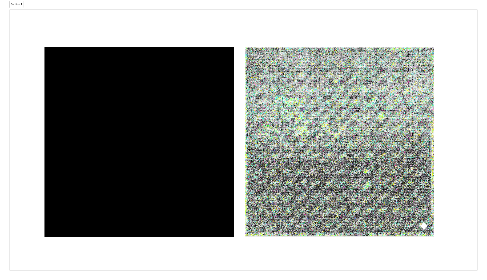
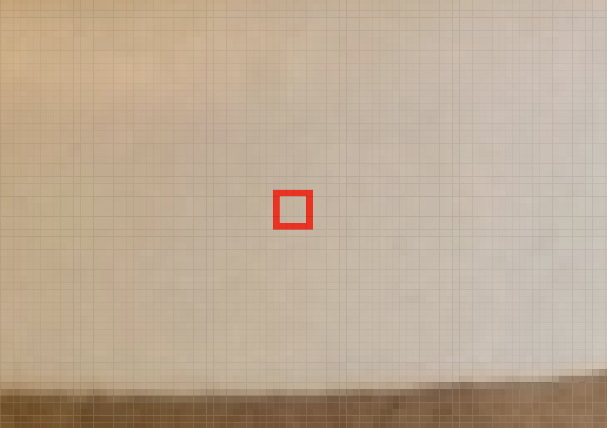
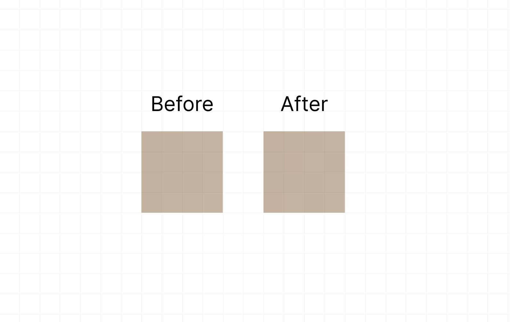
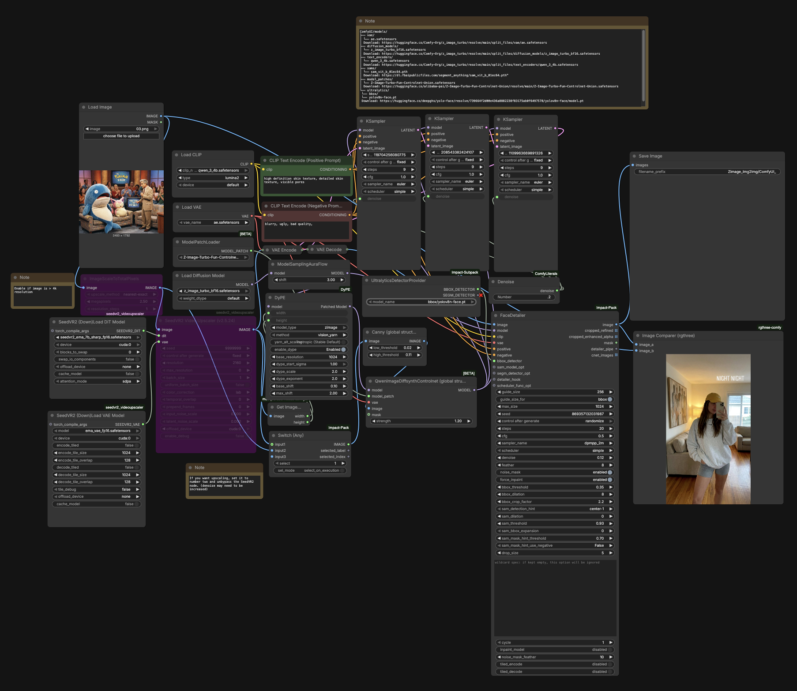
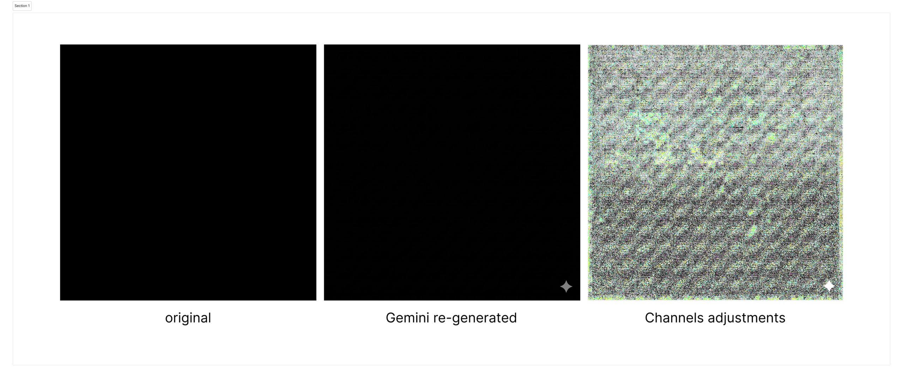

> 原文：[Tagging AI-generated images with SynthID](https://kolacki.eu/en/article/tagging-ai-generated-images-with-synthid/)
> 作者：[Radosław Kołacki](https://kolacki.eu/author/radoslawkolacki/) · 发布时间：2026 年 1 月 21 日
> 导语：SynthID-Image 是一种有效的 post-hoc（事后再加）水印，但它有时可以被绕过（例如通过重新渲染），也可能在强烈的色阶校正之后变得可见。

# 用 SynthID 标记 AI 生成图像



"这是 AI 生成的图吗？"这个问题，直到不久前还挺容易回答，因为生成器会留下可复现的痕迹。你去看手、牙齿、标牌上的文字、光影是否"说得通"，往往就能猜对。这个阶段已经过去了。倒不是因为人们突然不再善于观察，而是因为问题本身不再是光学层面的了。现代扩散模型的训练目标，就是让产出的结果具备照片图像的统计特征：纹理、边缘分布、色调过渡，甚至细节的"随机性"，都越来越像训练数据。这意味着今天典型的"肉眼判断"，更像是在收集旁证，而不是在做验证。你可能找到一个异常并且猜对了，但同样常见的是：你找到的只是一张被重度处理过的真实照片；或者一张经过颗粒滤镜、压缩和强到把曾经"刺眼"的差异都淹没在互联网常规噪声里的 JPEG 重编码的 AI 图。

还有一点值得注意："视觉错误"本身的分布变了，而且变得专门跟直觉作对。过去占主导的是些壮观的错误（多一根手指、假装是字母的字母），如今更常见的是语义错误：某处不合逻辑，但视觉上完全正确。而更常见的情况是，根本没有哪里明显不对，只是这张图的风格，有些人觉得"太完美了"，另一些人觉得那是好镜头加好调色的结果。这类观感极易受语境和偏见影响。如果某人"知道"这张图可能来自 AI，他就开始看出症状；如果不知道，往往就什么都没注意到。这不是下结论的可靠依据。

如果你想要的是可重复、站得住脚的判断，就得把问题从"我看得出来吗？"换成"我有没有一条可验证的来源痕迹？"。实践中这类痕迹有三类，证据分量各不相同。第一类是**来源信息（provenance）**：记录文件是如何、用什么创建和编辑的，通常以签名元数据或凭证链的形式存在（C2PA 这类标准是很好的参照点，但不是唯一一个）。这可能是最强的一类证据，因为它并不试图从像素里"猜"故事。但它有个明显的毛病：来源信息常常在传播途中就丢了。只要截个图、重新上传到社交平台、导出成另一种格式，那段漂亮的出身叙事就消失了。第二类是**水印（watermarking）**，即图像数据本身携带一种隐藏信号，可以用工具检测出来。SynthID 就属于这一类：思路很简单，尽管实现可能很复杂——往图像里加入一层不可见的"签名"结构，以便日后检查这个签名是否存在。这比视觉启发式"硬"得多，但有一个根本限制：它只有在水印确实施加过的前提下才成立。检测不到并不意味着"不是 AI"，只意味着"没有找到这个特定的标记"。第三类是**统计检测器**：试图基于分布特征区分 AI 图与非 AI 图的模型。它们作为辅助信号有用，但也有自己的一堆问题：生成器在进化、检测器落在后面（漂移，drift），或者图像来自与检测器训练数据不同的域（域偏移，domain shift）。这时误报和漏报都会上升，而且往往难以预测，除非下功夫做校准。

因此最稳妥的做法不是去找某一个"神奇测试"，而是分层。先找来源信息，因为只要它还在，就是最好的上下文。然后检查图像是否带有某个特定生态的水印（SynthID 就是这种思路的例子）。最后才动用眼睛和统计检测器，把它们当作支撑，而不是最终裁决。这个层级很重要，它把后续讨论组织起来了：既然"肉眼"越来越不具决定性，就值得先弄明白扩散模型的真实感从何而来，再看 SynthID-Image 究竟如何把一种看不见、却能检测到的信号嵌进图像里——哪怕经过压缩和线上处理之后仍能检测。

## 扩散模型速览

要理解"AI 图 vs 非 AI 图"的检测为什么变得这么吃力不讨好，得先往下走一层，看看扩散模型到底在做什么。它们的基本技巧出人意料地优雅：不是教网络从零"画"一张图，而是教它**逆转图像被破坏的过程**。这是实践层面的差别，不是哲学层面的。所以在标准描述里，我们有**前向过程**（forward / noising）与**反向过程**（reverse / denoising）。

在前向过程中，我们拿一张真实图像，分多步往里加高斯噪声。经过 $t$ 步之后，得到的图像越来越接近纯噪声。关键在于这个过程被设计成数学上很简洁：通常你选定一个方差调度（variance schedule，即每一步 $t$ 加多少噪声），并定义马尔可夫转移。于是可以证明，$x_t$ 能直接写成信号与噪声的混合：通俗说就是"一点图像 + 一点高斯"。这意味着模型训练时目标非常明确：它拿到一个带噪样本，要复现出"加了什么噪声"或"更干净的图像长什么样"这类信息。

反向过程就是生成时发生的事。我们从几乎纯噪声出发，执行一连串去噪步骤。每一步，网络接收当前状态和关于当前步的信息，预测类似"这个信号里有多少是噪声"的东西。在最流行的参数化方式里，网络预测的是噪声估计，采样器再用它算出下一个噪声更少的状态。

那"Prompt"和条件生成在这一切里处于什么位置？这是第二个同样重要的特点：多数现代扩散模型是**有条件的（conditional）**。最常见的做法是通过交叉注意力机制：文本（或其他条件）被编码成向量，U-Net 在去噪过程中"查阅"这份编码，让图像朝与描述一致的方向移动。技术上讲，这意味着采样分布不是"来自数据的任意一张图"，而是"来自数据、且符合条件的那张图"。对检测来说，这里有个要点：既然模型是在海量真实图像上训练的，又在反向过程中以与这个分布一致的方式重构样本，结果就具备非常自然的统计特征。不是因为模型"理解了世界"，而是因为它把数据中存在的视觉规律模仿得非常好。

最后，还有一点在科普描述里常被漏掉：**很多系统并不直接在像素上工作**，而是在所谓的**隐空间（latent space）**里工作。在隐扩散（latent diffusion）中，图像先被自编码器（VAE）压缩成低维表示，扩散发生在这个隐量上；只在最后，VAE 解码器才把隐量映射回 RGB。这加快了生成、降低了成本，但也带来一个后果：图像的一部分"结构"是在隐量里成形的，另一部分是在解码器里成形的。因此后面谈水印时，我们必须始终说明：标记是"边生成边"嵌进隐量 / 采样过程，还是**事后（post-hoc）**加在现成像素上。这个区分是理性讨论 SynthID-Image 的基础，因为该方案不必干预扩散过程本身：它可以作用于一张已经完成的图像，不管这张图是用哪个模型生成的。

这一切听起来很技术，但结论很简单：扩散之所以产出"统计上可靠"的图像，是因为它是通过朝数据分布方向受控去噪而生成的。于是，单纯猎寻视觉错误就失去了威力，而不去从外观猜测、转而依赖嵌在数据本身里的可验证信号的方法，重要性就上来了——到这里也就顺理成章地转到了 SynthID。

## "一眼看过去"：什么管用、什么不管用、为什么它不能当基石

既然已经知道扩散能产出统计特征非常"照片化"的图像，就更容易理解人眼为什么越来越落于下风。但也别走到另一个极端：视觉评估仍然有用，只是必须把它当作**初步工具**，而不是取证方法。这是"我有个怀疑"和"我有验证"之间的区别。

最经典的一套怀疑清单，针对的是那些同时对语义和几何敏感的地方。手和指头长期以来是弱项，因为它们既要求解剖学一致性（手指数量、关节形状），又要求光照一致性（指间阴影、指甲上的反光）。文字也类似：字母尤其不留情面，因为人是范畴式地认字的——要么是"A"，要么不是，在波兰语里尤其如此。最后是光与反射：窗户、金属、玻璃、镜子，只要反射与物体位置对不上，就能把模型暴露出来。

问题在于，这些线索会自然地被模型"挤"出去。当成千上万的用户开始指出同一个错误，就有了修复它的压力：要么靠更好的训练，要么靠生成后过滤器，要么靠辅助工具（例如自动校正人脸、手、文字）。结果是，两年前很好用的启发式，今天效果就差得多，而且没法保证明天还有效。

还有第二个原因，实践中往往更重要：你在网上看到的图，几乎从来不是模型的"干净"输出。它要经过压缩、缩放、锐化、去噪、加颗粒，有时加个色彩滤镜，有时连着过好几道。这不仅掩盖了可能存在的 AI 伪影，也把伪影加到了真实照片上。如果有人把手机拍的照片做了重度夜景去噪、再锐化一下，平台又额外重编码成 JPEG，效果可能看起来"不自然地平滑"，很容易引发误报。同样地，如果有人拿一张 AI 图加上胶片颗粒、再压一遍，就得到了"可信的脏"，很多人会把它误当成真实性的证据。

因此做"肉眼"评估时，值得把两样东西分开：**结构性伪影**（几何、物理、语义上的不一致）与**处理伪影**（JPEG、锐化、去噪、颗粒）。后者很阴险，因为它们无处不在，而且完全不说明来源。前者虽然有时很有力，但在模型里越来越罕见，在流水线里也越来越被"修掉"。

实践中，可以把视觉当作第一遍过滤器：如果某处明显不合逻辑或物理上不可能，那是好线索。但如果这张图只是"好看"或者"太顺滑"，那不是证据，只是感觉。于是我们回到了那个点上：既然外观充其量只是软性前提，我们就需要某种不受口味、压缩和语境影响也能核查的东西——也就是数据里的信号——来做判断。今天最说得通的两类方案，正是这么做的：**来源信息**（如果保住了）与**水印**（如果用上了）。而在水印里，最有意思的、因为它是按"互联网尺度"设计的，是 Google DeepMind 的方案：SynthID，尤其是 SynthID-Image。

下一章我们从总体思路转到机制：编码器–检测器架构长什么样、payload 是什么、对 JPEG 和裁剪的抵抗力是怎么学出来的，以及在像素层面，我们该如何想象一种"看不见"、检测器却依然能发现的变化。

## SynthID 与 SynthID-Image：技术内核（post-hoc）+ 像素级小演示

实践中的"SynthID"并不是某一个取巧的算法，而是一套**水印 + 检测系统**，为在真实互联网流通中工作而设计：图像会被压成 JPEG、缩放、裁剪、过滤镜、反复重传。Google DeepMind 直接把它描述为三件事同时取折中：标记必须**不可见**、**可检测**、并且**能抵抗典型改动**。在图像版本（SynthID-Image）里，有一句组织起整个架构的关键表述：这套方法是 **post-hoc 且与模型无关的（model-independent）**，标记由独立模块（编码器）叠加**到已完成的图像上**，再由对应的检测器 / 解码器检出。这不是"边跑扩散边改过程"。[^1]

这个"post-hoc"比听起来更重要。它意味着流水线大致是这样：生成器（扩散模型或别的什么）产出最终图像，之后才轮到 **SynthID-Image 编码器**上场，往图像里加入一个非常小、经过精确挑选的扰动。这个扰动不是"每十个像素改一下"的随机噪声，而是训练出来的结果：DeepMind 把 SynthID 描述为基于**两个深度学习模型**（一个加水印、一个做识别）的方案，二者联合训练，一边提高检测率，一边把可见性压到最低，其中就包括让标记与内容"视觉上匹配"。[^2] SynthID-Image 的论文把这个问题形式化为"以一种能被检测器发现的方式平移图像分布"，但要同时守住质量约束，而质量不只靠指标验证，还靠真人研究验证。[^1]

SynthID-Image 区别于许多流行水印描述的第二个特点是 **payload（载荷）**。系统不应只回答"有 / 没有标记"，还要提供多比特信息（例如用于水印的版本管理和组织级治理）。作者强调，payload 要能抵抗"日常"的内容改动；在他们的方案里，检测问题与 payload 问题是被有意识地分开处理的（论文把它们写成两项独立要求，并讨论了为什么 payload 对实践中的来源追溯至关重要）。[^1]

第三点是**检测是概率性结果，不是判决**。在操作层面，检测器给出的结果需要**校准**（为目标的误报水平选定阈值）。[^1] 在对外沟通中，DeepMind 早在 2023 年就谈到用置信度等级（例如三级置信度）来解释结果。[^2] 这是"工程式"的做法：工具要能在规模化下工作、有受控的 FPR（误报率），而不是假装自己是 100% 的神谕。

背景里还有"互联网尺度"这一条：论文明确写到，SynthID-Image 已被用于为 Google 服务中的**超过 100 亿**张图像和视频帧加水印，验证服务当时向受信任的测试者开放。[^3] 在产品层，Google 还描述了一个检测门户（SynthID Detector），用于检测多种模态的标记，并能指出内容中最可能带水印的片段。[^4]

### 小演示：像素层面的"微改动"长什么样

要有个实感，我们取一块**真实的**、来自杯子上棕色纸板的 4×4 像素切片（平滑、明亮的表面——正是标记必须特别不侵入、特别轻柔的地方）。下面是直接从文件里读出的 HEX 颜色矩阵。

### 原始照片


### 原始 4×4 像素区域示例



```text
#C6B19C  #C7B29D  #C8B3A0  #C8B3A0
#C6B19C  #C7B29D  #C7B29F  #C8B3A0
#C7B19C  #C8B29D  #C7B29F  #C8B3A0
#C7B19C  #C9B39E  #C8B3A0  #C9B4A1
```

理论上，**没有真正的 SynthID-Image 编码器，就不可能为文件生成"真"水印**。不过我们可以展示一下所说的改动在**量级**和**性质**上是什么样——RGB 通道里以个位数为单位的微位移。所以下面给出一个**示意性**的"已加水印"版本（玩具演示），我们只把选中的像素做最小改动（例如某个通道 +1、另一个通道 −1），使颜色在视觉上几乎不变。

### "加水印后"示意（4×4，玩具演示）

```text
#C7B09C  #C6B39D  #C9B2A0  #C8B3A1
#C5B29C  #C8B19D  #C7B39E  #C9B2A0
#C7B09D  #C8B39C  #C6B39F  #C8B3A1
#C8B09C  #C8B49D  #C9B2A0  #C9B4A0
```

即便在这么小的样本里，"工程上"能看出什么？像 `#C6B19C → #C7B09C` 这样的变化，意思是红色通道 +1、绿色通道 −1、蓝色通道不变。肉眼看，它仍是同一种暖米色，尤其放在相邻像素、光照和整个场景的上下文里。但对检测器要紧的不是单个像素，而是**这类微改动共同构成了一片弥散的、统计上自洽的信号**，铺在图像的许多区域上。



而这里是最重要的直觉：SynthID-Image 式的检测器**不是从某一处"读出标记"**，也不是在找"每第十个像素的最低有效位"这种简单模式。在 Google DeepMind 描述的方案里，思路是让编码器学会引入这样一类扰动：(a) 感知上最小，但 (b) 在 JPEG 压缩、缩放、裁剪等典型变换之后仍可检测——正因如此，训练过程中会在学习回路里模拟这些变换。[^1] 在 SynthID 的公开描述里，结果解释还有一个很实际的层面：检测工具通常不给出"绝对判决"，而是给出置信度等级 / 分数形式的结果，并针对误报与漏报之间的合理折中做过校准。[^2]

所以这个小例子只有一个目的：说明在 HEX 层面你"看到"的只是显微级别的位移，它们本身证明不了什么。只有当它们由训练好的编码器协同生成、并由对应的检测器核查时，才成为一条可验证的来源信号。因此在实践中，你既不能靠视觉、也不能靠逐个像素"看见" SynthID，**它是用工具查出来的**——工具知道自己要找的是哪一类分布式结构，也就是能够"解码"这个标记。

## SynthID 在实践中长什么样？

这里值得补一条提醒：SynthID-Image 的抵抗力主要是针对典型的传播变换（压缩、缩放、裁剪）设计的，但另有一类操作不属于普通的图像编辑，而是**生成式重新渲染（generative re-rendering）**——重复、受控的再合成，保留场景的语义与构图，同时可以覆盖掉承载水印的底层像素"层"。在 *SynthID-Bypass* 仓库里[^9]，作者描述了一个概念验证：这样的处理会降低标记的可检测性，并展示了一个用 Comfy 做的有意思的"诊断"步骤。

<figure id="fig-comfy-workflow" markdown="1">

[{: width="100%" }](../assets/images/articles/synthid/04-comfy-workflow.png)

Comfy 工作流示例，试图降低标记的可检测性。来源：[Synthid-Bypass](https://github.com/00quebec/Synthid-Bypass)。点击图片查看原图。
{: .figcap }

</figure>

我在下面准备的例子里也能看到非常相似的直觉：生成一个 `#000000` 的黑色方块后，通过对色阶做操作、使用激进的色调校正，可以把文件里带有编码元素的结构"提取"出来——它在常规预览中不可见，却存在于像素的微差异里。当然，这并不是要"推翻" SynthID，只是想把边界说清楚：SynthID-Image 是一种面向互联网尺度、面向特定"威胁模型"的水印；遇到主动的对手（尤其是用生成式手段"洗"内容的），必须考虑到检出率可能下降——这与 SynthID-Image 那篇论文里关于安全性与折中（保真度 / 鲁棒性 / 安全性，fidelity/robustness/security）的讨论直接相关。



*黑色方块的色调校正示例*

## 对照：post-hoc（SynthID-Image）vs in-process（"边生成边"加水印）

实践中，给生成图像加水印分成两种听起来很像（"加个水印"）、但在技术和运营上完全是两套系统的做法。第一种是 **post-hoc**，也就是把标记加到完成的图像上。第二种是 **in-process**，也就是把标记一步步"织进"生成过程本身。

**以 SynthID-Image 为代表的 post-hoc**，概念上更简单：生成模型干完活、产出最终图像，之后才由独立模块（编码器）在像素里引入肉眼看不出、但对应检测器能认出的微改动。这套做法最大的优势非常工程化：**不必碰生成器**。这正是"模型无关"的含义——同一套水印方案可以接到不同生成器后面，因为它作用在它们的输出上。从实现角度看这是巨大的便宜：你可以把标记与检测当作独立组件来开发、做版本管理、针对新变换（JPEG、裁剪、缩放）测试并更新，而不必重建整个生成模型。SynthID-Image 的论文还表明，post-hoc 更容易被当作"互联网尺度产品"来对待：校准检测器、保证低误报率、通过带模拟线上处理的增广训练来建立免疫力。

这份便利的代价同样具体：**编码器不能指望生成器替它把扰动"抹平"**。图像已经完成，编码器必须非常谨慎地挑选改动，既不能留下可见痕迹，又要保住压缩和编辑之后的可检测性。这往往导致更硬的"质量 vs 抵抗力"取舍：想让标记扛住更激进的变换，就得加得更重，而这又抬高了感知伪影的风险。按定义，post-hoc 对某些"靠强降质把标记磨掉"的攻击也更脆弱，因为攻击者不必跟生成机制较劲，只需要把图磨到检测器丢掉信号为止（当然，这通常也把画质毁了）。

**In-process，也就是"边生成边"加水印**，工作方式不同：标记不是事后加的，而是生成轨迹的一部分。在扩散模型里，这通常意味着在后续去噪步中，系统对图像的成形方式引入受控的、细微的偏好，让最终结果"携带"这个信号。技术上可以有几种实现：改变后续噪声样本的选取方式、控制隐量里的某些特征，或者引入额外的目标项 / 正则项来强制存在一种易于检测的签名。文献里有直接在扩散过程里这么做的方案（例如 "tree-ring" 一系，或其他隐空间水印方案），但共同思路是一样的：生成器与水印缠在一起。

In-process 的好处是，水印对生成出来的图像可以"更有机"，不是叠加在成品上的一层，而是从图像如何被生成这件事里长出来的。在某些设定下，这带来了对部分变换更强的抵抗力，因为信号与生成特征的结构绑得更紧。此外，由于掌控整个生成过程，你可以从一开始就围绕特定通道（例如频域）设计水印，并更好地把它与感知平衡好。

但代价很高，而且非常实际：**你必须掌控生成器**。In-process 不是"叠一层"，而是改变模型或采样器的行为，因此：

- 很难同时在多个模型上实现；
- 很难在更新时不动到结果的质量与分布；
- 对于外部模型（拿不到采样器控制权）则根本不可能。

另外，in-process 让评测更麻烦。既然水印是生成的一部分，问题就变成了：质量下降到底是水印造成的，还是采样配置不同造成的？模型之间怎么公平比较？post-hoc 给出的实验更干净：生成器固定，水印只是一个独立模块。

## 总结

看起来就目前而言，**post-hoc 在运营层面胜出**，而 **in-process** 在科学上仍有吸引力，或许更长远地看，它会成为一种更"有质感"的水印形式——标记更深地嵌进生成机制，而不是在末尾加上去。但 post-hoc（如 SynthID-Image）有一个在实践中决定选择的优点：它**易于标准化、易于规模化**。你可以把它当作独立的基础设施组件，接在任意生成器后面，用单独的周期推进编码器和检测器，针对真实变换（JPEG、resize、crop、滤镜）调校抵抗力，为低误报率校准阈值，并且不必"挖开"生成模型本身就能更新系统。当目标是广泛适用时，这一点很重要：可重复性、风险可控、与各种流水线兼容，以及即便生成模型换了、系统也能维护多年。

In-process 能提供有意思的取舍，可能带来更"有机"的信号嵌入，以及对某些攻击类别的抵抗力，因为水印关联的是生成轨迹，而不只是最终图像。但它代价高昂：**要求对生成过程（建模与采样）有完全控制**，很难跨多个不同模型实现，而且更新会影响结果的质量与分布，让生产环境里的评测和维护都变复杂。

换句话说：**in-process** 在整个技术栈可控且稳定的地方可以非常好，但当你想为更广的受众造一套方案、要跨不同产品、跨不同模型、在持续变化的条件下工作时，它就变得麻烦了。这正是大公司愿意选择 post-hoc 作为整个流程末端一层的原因——它给出了可实现性与收益之间最好的比值；同时把 in-process 研究保留为另一条备选路线，它可能在封闭环境里、或在未来那些对生成器拥有完全控制、无需支付高额集成成本的系统里，变得至关重要。

## 脚注

[^1]: S. Gowal *et al.*，"**SynthID-Image: Image watermarking at internet scale**"，*arXiv preprint* **arXiv:2510.09263**，2025 年 10 月 10 日，DOI: 10.48550/arXiv.2510.09263。
[^2]: Google DeepMind，"**SynthID**"（产品页 / 通用文档），访问日期：2026 年 1 月 14 日。
[^3]: Google AI，"**Advancing AI safely and responsibly**"（章节：SynthID / SynthID Detector），访问日期：2026 年 1 月 14 日。
[^4]: Coalition for Content Provenance and Authenticity (C2PA)，"**C2PA Technical Specification v1.3**"，2023 年 3 月 29 日。
[^5]: Y. Wen, J. Kirchenbauer, J. Geiping, T. Goldstein，"**Tree-Ring Watermarks: Fingerprints for Diffusion Images that are Invisible and Robust**"，*arXiv preprint* **arXiv:2305.20030**，2023 年 5 月 31 日。
[^6]: P. Fernandez *et al.*，"**The Stable Signature: Rooting Watermarks in Latent Diffusion Models**"，*ICCV 2023*（论文），亦见：*arXiv preprint* **arXiv:2303.15435**，2023。
[^7]: H. Huang *et al.*，"**ROBIN: Robust and Invisible Watermarks for Diffusion Models…**"，*NeurIPS 2024 Proceedings*（论文）。
[^8]: "**Guidance Watermarking for Diffusion Models**"，*arXiv / OpenReview*，2025（通过 guidance 实现 on-the-fly 水印）。
[^9]: [00quebec，"SynthID-Bypass"（README）](https://github.com/00quebec/Synthid-Bypass)，GitHub，访问日期：21/01/2026。

---

## 原文信息

- 原文栏目：Article（kolacki.eu 英文版）
- 原文配图：6 张（封面 1 + 正文 5），均已本地化至 `docs/assets/images/articles/synthid/`
- 原文脚注：9 条，其中正文实际引用 1、2、3、4、9；5–8 仅在脚注列表中出现

## 版权与许可

- **原文**：Radosław Kołacki，《Tagging AI-generated images with SynthID》，2026-01-21 — [原文链接](https://kolacki.eu/en/article/tagging-ai-generated-images-with-synthid/)
- **原文许可**：原文页面、站脚仅标注"©2026"，未声明任何开放许可协议（未检索到 CC 或其他授权条款），默认视为保留所有权利
- **本译文**：非官方中文翻译，仅作学习与交流用途；已署名原作者并链接原文，如权利人提出异议将即时下架
- **配图**：原文图片版权归原作者所有，此处仅为配合译文说明而本地化引用

## 译者注

1. **原文是波兰语写作的英文版**：文中残留若干波兰语连接词，如 "forward process **i** reverse process""post-hoc wins operationally, **a** in-process" 中的 `i`（和）与 `a`（而 / 但是）；译文按中文习惯统一处理为"与""而"，未保留原字样。类似地，"youngest bit"是波兰语 *najmłodszy bit* 的直译，按计算机术语译作"最低有效位（LSB）"；"character / sign"对应波兰语 *znak*，按语境统一译作"标记 / 水印"；"painting"对应 *obraz*，统一译作"图像"。
2. **公式字符**：原文 MathML 中时间步变量渲染为 `vol`，而同一公式的 TeX 标注写的是 `x_t`；译文按上下文还原为 $t$ 与 $x_t$。另有 "After $t$ steps we get, increasingly resembling pure noise." 一句原文缺主语，译文补作"得到的图像越来越接近纯噪声"。
3. **脚注编号不一致（原文如此）**：正文中 [^4] 用于指代 SynthID Detector 检测门户，但脚注 [^4] 实际是 C2PA 技术规范 v1.3；SynthID Detector 应对应 [^3]。为保持完整保真，脚注列表与正文引用编号均按原样保留，此处仅作说明。另，原文脚注 [^5][^6][^7][^8] 对应 in-process 一系的文献（tree-ring、Stable Signature、ROBIN、Guidance Watermarking），正文只在提到"tree-ring 一系或其他隐空间水印方案"时笼统带过、并未逐一引用，故按原样保留在脚注列表中。
4. **玩具演示的性质**：原文明确说明没有真实 SynthID-Image 编码器就无法生成"真"水印，两个 4×4 HEX 矩阵只是示意微位移量级的 toy demo，不构成可检测信号；译文保留全部原始 HEX 数值与 `#C6B19C → #C7B09C` 的通道变化分析（R +1、G −1、B 不变）。
5. **术语**：post-hoc（事后施加）与 in-process（生成过程中施加）、provenance（来源信息）、payload（载荷）、watermark（水印）、C2PA、latent space（隐空间）、cross-attention（交叉注意力）、FPR（误报率）、domain shift（域偏移）、drift（漂移）、tree-ring、Comfy（指 ComfyUI 工作流）等，均按项目术语表在首现处附英文。
6. **数据保留**：4×4 像素、`#000000` 黑色方块、超过 100 亿张图像与视频帧、2023 年三级置信度、arXiv:2510.09263 / 2305.20030 / 2303.15435、DOI 10.48550/arXiv.2510.09263、C2PA v1.3（2023-03-29）、ICCV 2023、NeurIPS 2024 等全部按原文保留。
